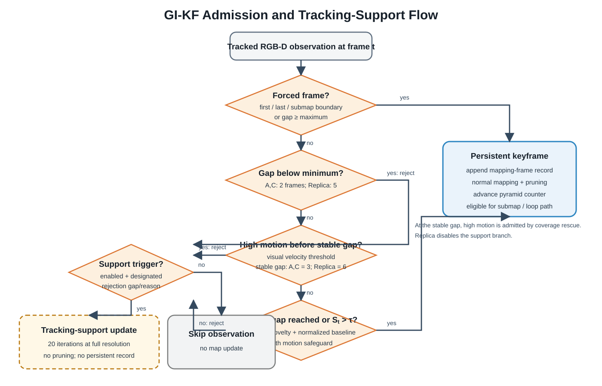

# Resource-Aware Extensions to LoopSplat: Weak Inertial Rotation Regularization, Visibility-Aware Keyframes, and Coarse-to-Fine RGB-D Mapping

## Abstract

Online 3D Gaussian SLAM must balance camera tracking, reconstruction quality, and the cost of repeatedly optimizing observed frames. This paper studies three bounded extensions to LoopSplat: a robust gyroscope-preintegration rotation residual for RGB-D tracking, a visibility-aware persistent-keyframe policy with non-persistent tracking-support updates, and per-keyframe coarse-to-fine RGB-D supervision. The inherited submap registration, loop closure, and pose-graph backend are retained. We evaluate 70 scene–strategy configurations on five TUM RGB-D scenes, eight Replica scenes, and three inertial FMDataset scenes. On Replica, the combined keyframe and pyramid strategy reduces persistent keyframes by 16.3%, improves macro ATE from 0.292 to 0.262 cm, and raises PSNR from 28.168 to 28.606 dB. On FMDataset, the complete three-module configuration reduces persistent keyframes by 58.3% and peak GPU memory by 47.6%, while increasing PSNR by 1.159 dB and reducing depth error by 25.6%; trajectory accuracy cannot be assessed because reference trajectories are unavailable. TUM reveals the main limitation: the combined strategy reduces keyframes by 63.9% and slightly improves observed-view quality, but macro ATE rises from 3.309 to 5.887 cm, with a pronounced scene-specific failure for keyframing alone. The results support resource-aware operation, while showing that aggressive observation selection requires motion-domain validation.

**Keywords:** 3D Gaussian splatting; RGB-D SLAM; visual–inertial sensing; keyframe selection; image pyramid; dense reconstruction; loop closure

## 1. Introduction

Three-dimensional scene reconstruction is increasingly expected to operate online rather than after a sequence has been captured. A useful system must estimate camera motion, update geometry and appearance, and maintain global consistency while new observations continue to arrive. These requirements compete for the same computational budget. Dense supervision can improve a local map, but repeatedly optimizing similar views consumes time and memory. Reducing the observation set saves resources, yet the resulting map may no longer adapt quickly enough to support tracking. Inertial measurements can constrain rapid motion, although a complete visual–inertial estimator introduces state, calibration, and observability requirements that may be disproportionate for an existing RGB-D pipeline.

Neural implicit SLAM showed that continuous learned scene functions can support joint tracking and mapping [@sucar2021_imap; @zhu2022_niceslam]. Its online optimization cost motivated hybrid grids, sparse encodings, points, and local submaps [@wang2023_coslam; @sandstrom2023_pointslam; @tang2023_mipsfusion]. The explicit Gaussian representation introduced by 3D Gaussian splatting offers a different compromise: differentiable rendering remains fast, while position, covariance, opacity, and appearance can be optimized directly [@kerbl2023_3dgs]. SplaTAM, GS-SLAM, Gaussian Splatting SLAM, Gaussian-SLAM, and Photo-SLAM demonstrate that these primitives can support dense camera tracking and photorealistic mapping [@keetha2024_splatam; @yan2024_gsslam; @matsuki2024_gaussiansplatting; @yugay2023_gaussianslam; @huang2024_photoslam].

Long online sequences still present two distinct scaling problems. First, local maps can drift and require global correction. Second, even when global correction is available, the active mapper can accumulate redundant observations and expensive supervision. LoopSplat addresses the first problem by registering Gaussian submaps for loop closure and applying pose-graph correction [@zhu2025_loopsplat]. We use that system as the baseline and focus on the second problem. The distinction matters: all global-consistency functions in this study are inherited, while the evaluated changes govern tracking regularization, persistent observation admission, and mapping resolution.

Keyframe selection is the most direct resource-control mechanism, but a fixed cadence treats every part of a trajectory alike. A visibility-aware score can postpone redundant observations, whereas minimum and maximum interval rules keep the selection process bounded. In practice, persistent storage is not the only role an observation can play. A recently captured view may be unnecessary for future loop closure but still valuable for adapting the active map used by the tracker. This motivates a separation between persistent keyframes and short-lived support observations. The former enter submap records; the latter perform a small map update and are then discarded.

Mapping resolution provides a second control dimension. Classical image pyramids organize visual information from coarse structure to fine detail [@burt1981_fastfilter; @burt1983_pyramid], and Photo-SLAM illustrates the value of multiscale supervision in a Gaussian SLAM setting [@huang2024_photoslam]. Large-scene rendering research has also explored multiresolution 3DGS representations [@kerbl2024_hierarchical]. Our use of a pyramid is narrower: it changes the resolution of RGB-D supervision over repeated uses of each keyframe, while retaining one shared active set of Gaussian primitives. The schedule is per-keyframe because online submap optimization does not sample every stored observation equally often.

The third control signal comes from the IMU. Full visual–inertial Gaussian systems such as MM3DGS SLAM, VINGS-Mono, and GI-SLAM show the potential of combining inertial and Gaussian representations [@sun2024_mm3dgsslam; @wu2025_vingsmono; @liu2025_gislam]. Our objective is not to reproduce their state estimators. Instead, calibrated gyroscope measurements between RGB-D frames are preintegrated on the rotation group and used as a weak robust residual in visual tracking. Translation is excluded from the formal inertial loss. This design tests whether a small, inspectable addition can help an established RGB-D tracker without redefining the entire backend.

The experimental question is therefore one of controlled integration. Can visibility-aware persistence reduce the keyframe and memory burden without making the active map too stale? Does coarse-to-fine RGB-D supervision recover geometry or appearance under that reduced budget? Does a weak rotational cue add useful information on rapid handheld sequences? We answer these questions through strategy ablations on TUM RGB-D, Replica, and FMDataset. The datasets deliberately expose different conditions: real RGB-D motion with trajectory ground truth, stable synthetic scenes with a five-frame baseline cadence, and synchronized RGB-D/inertial sequences without trajectory ground truth.

The results do not reduce to a single universal improvement. Replica shows a favorable balance: the combined GI-KF and pyramid configuration uses fewer persistent frames while improving macro trajectory and observed-view quality. FMDataset shows the strongest reconstruction and memory result for the three-module combination, but cannot support a localization claim. TUM exposes a counterexample. Persistent keyframe reduction is large, yet trajectory error increases in aggregate and one sequence fails severely for GI-KF alone. Keeping this regression in the analysis is essential because the proposed policy is meant to reduce resources, and an efficiency claim is meaningful only when its accuracy cost is visible.

The paper makes the following contributions:

1. A weak gyroscope rotation regularizer derived from calibrated midpoint preintegration, with robust residual weighting and explicit rejection of invalid measurement intervals. Its scope is limited to RGB-D tracking; no full inertial state is claimed.
2. A visibility- and motion-aware persistent-keyframe policy with dataset-matched interval safeguards, together with a separate support-update path that adapts the active map without entering persistent, submap, pyramid, or loop-closure records.
3. A validity-aware RGB-D image pyramid and per-keyframe use-count schedule that applies coarse-to-fine supervision to the same active Gaussian representation.
4. A scene-level ablation across 70 configurations, reporting trajectory where ground truth exists, fixed-observed-view color and depth quality, runtime, peak GPU memory, persistent keyframes, and documented failure cases.

Section 2 positions the work relative to dense and Gaussian SLAM, global consistency, inertial estimation, keyframing, and multiscale optimization. Section 3 describes the three modules and their interfaces. Section 4 defines the datasets, strategy matrix, metrics, and reporting constraints. Section 5 presents the ablations and practical tradeoffs. Section 6 discusses validity limits, and Section 7 concludes the study.

## 2. Related work

### 2.1 Dense SLAM representations

Dense visual SLAM has moved through several scene representations, each of which places a different burden on online optimization. Earlier RGB-D systems commonly used geometric maps and keypoint-based tracking; ORB-SLAM2 remains a representative open-source system for monocular, stereo, and RGB-D inputs [@murartal2017_orbslam2]. Learned pose estimation later showed that dense correspondence and recurrent optimization can improve robustness across camera modalities, as demonstrated by DROID-SLAM [@teed2021_droidslam]. Neural implicit mapping introduced compact continuous scene functions. iMAP jointly optimized a neural scene representation and camera poses [@sucar2021_imap], while NICE-SLAM, Vox-Fusion, Co-SLAM, ESLAM, and Point-SLAM addressed locality, scalability, convergence, and reconstruction detail through grids, voxels, hybrid encodings, or neural points [@zhu2022_niceslam; @yang2022_voxfusion; @wang2023_coslam; @johari2023_eslam; @sandstrom2023_pointslam]. Multi-submap systems such as MIPS-Fusion further used local implicit maps to limit the optimization scope [@tang2023_mipsfusion].

The introduction of differentiable 3D Gaussian splatting supplied an explicit, continuously optimizable representation with fast rasterization and high visual fidelity [@kerbl2023_3dgs]. Several systems adapted this representation to online tracking and mapping. SplaTAM jointly tracks the camera and incrementally builds a Gaussian map from RGB-D observations [@keetha2024_splatam]. GS-SLAM and Gaussian Splatting SLAM develop dense Gaussian tracking and mapping pipelines with different choices for geometry, optimization, and map maintenance [@yan2024_gsslam; @matsuki2024_gaussiansplatting]. Gaussian-SLAM also couples photorealistic rendering with dense SLAM, whereas Photo-SLAM supports monocular, stereo, and RGB-D cameras and uses multiscale ideas to accelerate photorealistic mapping [@yugay2023_gaussianslam; @huang2024_photoslam]. These studies establish Gaussian primitives as a viable online representation, but they do not remove the need to manage long sequences, redundant observations, and tracking disturbances.

### 2.2 Global consistency in dense and Gaussian SLAM

Local photometric optimization can accumulate drift. Global systems therefore require a mechanism for recognizing revisited regions and distributing the resulting correction. GO-SLAM combines dense reconstruction with global optimization, and Loopy-SLAM introduces loop closure into dense neural SLAM [@zhang2023_goslam; @liso2024_loopyslam]. In Gaussian SLAM, LoopSplat registers Gaussian submaps directly and applies pose-graph optimization after loop detection [@zhu2025_loopsplat]. This backend is particularly relevant here because it already separates online local mapping from global correction.

Our work keeps LoopSplat's submap, Gaussian registration, loop-closure, and pose-graph components. The research question is narrower: can tracking and mapping inputs be scheduled more economically, and can a weak inertial rotation cue reduce visual ambiguity when synchronized measurements exist? Consequently, the reported gains are attributed to the three front-end and mapping changes, not to a new loop-closure formulation.

### 2.3 Inertial information in Gaussian SLAM

Visual-inertial SLAM normally treats inertial data as part of a state-estimation problem. ORB-SLAM3 jointly uses visual and inertial constraints across multiple maps [@campos2021_orbslam3], and on-manifold preintegration provides the standard mathematical basis for condensing high-rate IMU samples between image timestamps [@forster2017_preintegration]. Recent Gaussian systems have moved beyond camera-only estimation. MM3DGS SLAM combines vision, depth, and inertial measurements [@sun2024_mm3dgsslam]; VINGS-Mono targets large-scene monocular visual-inertial Gaussian mapping [@wu2025_vingsmono]; GI-SLAM studies Gaussian-inertial estimation and motivates information-aware keyframe selection [@liu2025_gislam].

These systems set an important boundary for the present contribution. Our IMU module does not estimate a full inertial state. It uses calibrated gyroscope intervals to construct a robust, low-weight rotation residual during RGB-D camera tracking, while the formal translational inertial weight is zero. The intended benefit is modest regularization under rapid motion, with limited changes to the inherited tracker.

### 2.4 Keyframes, temporary map support, and multiscale supervision

Keyframe selection governs both computational load and the information retained by a map. A fixed interval is predictable but cannot distinguish a redundant view from a view that reveals new geometry. Motion-only selection has the opposite weakness: a large pose change may coincide with poor overlap or tracking uncertainty. GI-SLAM motivates combining Gaussian visibility and motion information [@liu2025_gislam]. We adapt this principle to persistent mapping frames and add explicit minimum, stable, and maximum gaps. We also separate persistent admission from a short tracking-support update. The latter can adapt the active map after a rejected observation without retaining that observation in submap or loop records.

Coarse-to-fine image processing has a longer history. Gaussian and Laplacian pyramids reduce high-frequency detail at coarse levels and progressively restore it at finer levels [@burt1981_fastfilter; @burt1983_pyramid]. Photo-SLAM demonstrates the relevance of multiscale supervision to Gaussian SLAM [@huang2024_photoslam]. Our schedule is maintained per persistent keyframe because online submap optimization samples keyframes nonuniformly. Its purpose is to control the resolution of RGB-D supervision; the same active Gaussian primitives are optimized at every level.

Taken together, prior work suggests three complementary levers: inertial rotation information for tracking, information-aware observation retention, and multiscale mapping supervision. Their interaction inside a loop-closing Gaussian SLAM system is the focus of the following method and ablation study.

## 3. Method

### 3.1 System overview and representation

We build on LoopSplat's RGB-D tracking, submap construction, Gaussian-to-Gaussian loop registration, and pose-graph correction backend [@zhu2025_loopsplat]. Those inherited components remain unchanged in their purpose. Our additions act at three points in the online pipeline: a weak gyroscope-derived rotation term augments camera tracking when calibrated inertial samples are available; a visibility-aware policy decides which observations become persistent mapping keyframes; and an RGB-D image pyramid schedules mapping supervision from coarse to full resolution. Figure 1 summarizes the resulting data flow.

The active submap is represented by anisotropic 3D Gaussian primitives. For Gaussian \(i\), we retain its center \(\boldsymbol\mu_i\), rotation quaternion \(\mathbf q_i\), positive scale vector \(\mathbf s_i\), opacity \(o_i\), and spherical-harmonic appearance coefficients \(\mathbf c_i\). Its covariance is

$$
\mathcal G_i=\{\boldsymbol\mu_i,\mathbf q_i,\mathbf s_i,o_i,\mathbf c_i\},\qquad
\boldsymbol\Sigma_i=\mathbf R(\mathbf q_i)\operatorname{diag}(\mathbf s_i^2)\mathbf R(\mathbf q_i)^\top .
\tag{1}
$$

Here, \(\mathbf R(\mathbf q_i)\) is the rotation matrix obtained from the normalized quaternion. The implementation optimizes three scale components. A soft scale-consistency penalty is used during mapping, but it does not replace the anisotropic representation with a single-scale primitive.

After projection and depth sorting, the differentiable splatter composites color and depth at pixel \(\mathbf p\) as in 3DGS [@kerbl2023_3dgs]:

$$
\widehat{\mathbf C}(\mathbf p)=\sum_{i=1}^{N_{\mathbf p}}T_i(\mathbf p)\,\alpha_i(\mathbf p)\,\mathbf c_i(\mathbf p),\quad
\widehat D(\mathbf p)=\sum_{i=1}^{N_{\mathbf p}}T_i(\mathbf p)\,\alpha_i(\mathbf p)\,z_i,
\quad T_i(\mathbf p)=\prod_{j<i}\left[1-\alpha_j(\mathbf p)\right].
\tag{2}
$$

\(\alpha_i(\mathbf p)\) combines the learned opacity with the projected Gaussian footprint, \(z_i\) is camera-space depth, and \(T_i\) is accumulated transmittance. The same renderer supplies the color, depth, and alpha maps used by tracking and mapping.

### 3.2 Visual tracking with a weak inertial rotation regularizer

For each incoming RGB-D observation \((\mathbf C_t,D_t)\), the tracker optimizes a relative camera transformation by comparing the rendered active submap with valid observed pixels. Its visual objective is

$$
\mathcal L_{\mathrm{vis}}=
w_c\,\underset{\mathbf p\in\mathcal M_c}{\operatorname{mean}}
\left\lVert\widehat{\mathbf C}_t(\mathbf p)-\mathbf C_t(\mathbf p)\right\rVert_1
+(1-w_c)\,\underset{\mathbf p\in\mathcal M_d}{\operatorname{mean}}
\left|\widehat D_t(\mathbf p)-D_t(\mathbf p)\right| .
\tag{3}
$$

\(\mathcal M_d\) is the finite-depth tracking mask, while \(\mathcal M_c\) follows the configured alpha and invalid-depth masking rules. The color weight \(w_c\) is dataset-specific. Both residuals may be softly weighted by rendered alpha, following the inherited tracker.

When FMDataset provides a calibrated IMU interval between frames \(t-1\) and \(t\), midpoint angular velocities are transformed from the IMU frame to the camera frame and accumulated on \(\mathrm{SO}(3)\). With fixed configured gyroscope bias \(\mathbf b_g\), the rotation prediction is

$$
\Delta\mathbf R_{t-1,t}^{I}
=\prod_{k=0}^{K-2}\operatorname{Exp}
\left(\mathbf R_{CI}\left[\tfrac12(\boldsymbol\omega_k+\boldsymbol\omega_{k+1})-\mathbf b_g\right]\Delta t_k\right).
\tag{4}
$$

This construction follows the standard idea of on-manifold inertial preintegration [@forster2017_preintegration], but its role here is deliberately limited. The formal experiment does not optimize velocity, gravity, or sensor biases jointly with the visual state. Invalid, non-monotonic, overlong, or out-of-range IMU intervals are rejected and contribute no inertial term.

Let \(\Delta\mathbf R_{t-1,t}^{V}\) denote the relative rotation implied by the current visual tracking candidate. The normalized rotational disagreement is

$$
\mathbf r_R=
\frac{1}{s_R}\operatorname{Log}
\left[\left(\Delta\mathbf R_{t-1,t}^{I}\right)^\top
\Delta\mathbf R_{t-1,t}^{V}\right],\qquad s_R=0.01\ \mathrm{rad}.
\tag{5}
$$

To reduce the influence of intermittent inertial disagreement, each component is passed through the Huber penalty [@huber1964_robust]:

$$
\rho_\delta(x)=
\begin{cases}
\tfrac12x^2,&|x|\leq\delta,\\
\delta(|x|-\tfrac12\delta),&|x|>\delta,
\end{cases}
\qquad
\mathcal L_{\mathrm{imu}}=\lambda_R\sum_{j=1}^{3}\rho_{\delta_R/s_R}(r_{R,j}),
\quad \lambda_R=10^{-3},\ \delta_R=0.1\ \mathrm{rad}.
\tag{6}
$$

Although the implementation can calculate a translational preintegration residual for diagnostics, its formal ablation weight is \(\lambda_T=0\). Thus, the optimized tracking loss is

$$
\mathcal L_{\mathrm{track}}=
\mathcal L_{\mathrm{vis}}+\mathcal L_{\mathrm{imu}}
=w_c\mathcal L_C+(1-w_c)\mathcal L_D
+10^{-3}\mathcal L_R,qquad \lambda_T=0.
\tag{7}
$$

We therefore describe the module as a preintegration-derived weak gyroscope rotation regularizer. It is narrower than the full visual-inertial estimators represented by ORB-SLAM3, MM3DGS SLAM, and VINGS-Mono [@campos2021_orbslam3; @sun2024_mm3dgsslam; @wu2025_vingsmono].

### 3.3 Visibility-aware persistent keyframes

The baseline admits mapping frames at a fixed cadence. GI-KF instead evaluates a frame against the most recent persistent keyframe using the Gaussian centers contained in their camera frusta. Let \(\mathcal V_t\) and \(\mathcal V_k\) be these center-index sets for the current frame and reference keyframe. Let \(b_{t,k}\) be camera-center displacement, \(\widetilde d_t\) the median valid depth, and \(v_t,\omega_t\) the linear and angular velocities estimated from consecutive visual poses. The information score adapted from the visibility-and-motion principle in GI-SLAM [@liu2025_gislam] is

$$
S_t=
w_{\mathrm{cov}}\left(1-\frac{|\mathcal V_t\cap\mathcal V_k|}{|\mathcal V_t\cup\mathcal V_k|}\right)
+w_b\frac{b_{t,k}}{\max(\widetilde d_t,\varepsilon)}
-w_m\,\mathbb I\!\left[v_t>v_{\max}\ \lor\ \omega_t>\omega_{\max}\right].
\tag{8}
$$

The formal configurations use \(w_{\mathrm{cov}}=w_b=1\), \(w_m=2\), threshold \(\tau=0.1\), \(v_{\max}=1.5\,\mathrm{m/s}\), and \(\omega_{\max}=120^\circ/\mathrm{s}\). Although an optional gyroscope-assisted motion flag exists in code, it is disabled in all formal GI-KF configurations; the motion term in Eq. (8) is therefore computed from visual poses.

Score thresholding is wrapped in interval safeguards. If \(g_t=t-k\) is the gap to the latest persistent keyframe, \(\mathcal F\) contains the first frame, last frame, and submap-boundary frames. High-motion frames are deferred before the stable gap and accepted by a coverage-rescue branch at that gap. The persistent decision \(K_t\) and tracking-support indicator \(U_t\) can be summarized as

$$
K_t=
\begin{cases}
1,&t\in\mathcal F\ \text{or}\ g_t\ge g_{\max},\\
0,&g_t<g_{\min},\\
0,&(v_t>v_{\max}\lor\omega_t>\omega_{\max})\land g_t<g_{\mathrm{stable}},\\
1,&g_t\ge g_{\mathrm{stable}},\\
\mathbb I[S_t>\tau],&\text{otherwise},
\end{cases}
\quad
U_t=\mathbb I[K_t=0]\,\mathbb I[E_t]\,
\mathbb I[(r_t=\text{min},g_t=1)\lor(r_t\in\{\text{low},\text{motion}\},g_t=2)].
\tag{9}
$$

\(E_t\) is the dataset-specific support-update switch, and \(r_t\) records why the frame was rejected. For TUM RGB-D and FMDataset, \(g_{\min}=2\), \(g_{\mathrm{stable}}=3\), and \(g_{\max}=10\). Replica already maps at a five-frame cadence, so it uses \(g_{\min}=5\), \(g_{\mathrm{stable}}=6\), \(g_{\max}=10\), and disables support updates. This budget-matched setting tests information-aware deferral without silently changing Replica into a dense every-frame mapper.

### 3.4 Persistent keyframes versus tracking-support updates

Figure 2 makes the two observation roles explicit. A selected persistent keyframe enters the mapping-frame list, receives normal submap optimization, stores persistent keyframe metadata, and can later support submap checkpointing and loop closure. A support observation is created only on designated rejected frames. It performs 20 optimization iterations on the active Gaussian model, with no pruning and no image pyramid. The observation is then discarded rather than inserted into the persistent records.

This separation addresses a practical failure mode of aggressive keyframe reduction: a tracker may require a recently adapted local appearance/geometry model even when the corresponding observation is redundant for long-term storage. The support path supplies that local adaptation without inflating the persistent-keyframe count. It does not create a hidden second class of loop-closure keyframes.

### 3.5 RGB-D image-pyramid supervision

The third addition changes the resolution schedule of mapping supervision, not the structure of the Gaussian map. For \(L=2\) sublevels, the RGB image is pre-smoothed and downsampled to \(0.25\times\) and \(0.5\times\) resolution; the original observation supplies the final full-resolution level. Depth is downsampled by validity-weighted area averaging so that missing measurements are not mixed into valid depths. If \(n_t\) is the number of times persistent keyframe \(t\) has been sampled for optimization and \(u=8\) is the use budget per sublevel, then

$$
a_\ell=2^{-(L-\ell)},\quad \ell=0,\ldots,L-1;qquad
\ell_t(n_t)=\min\!\left(\left\lfloor\frac{n_t}{u}\right\rfloor,L\right),
\quad L=2,\ u=8,
\tag{10}
$$

where level \(L\) denotes full resolution. The schedule is maintained per persistent keyframe, because sampling across the submap is nonuniform. Camera intrinsics are scaled consistently with the selected raster size. This design is related to classical Gaussian/Laplacian pyramids [@burt1981_fastfilter; @burt1983_pyramid] and Photo-SLAM's multiscale supervision [@huang2024_photoslam], but all levels optimize the same active set of 3D Gaussians.

At the chosen level, mapping minimizes

$$
\mathcal L_{\mathrm{map}}=
(1-\lambda_s)\left\lVert\widehat{\mathbf C}-\mathbf C\right\rVert_{1,\mathcal M}
+\lambda_s\left[1-\operatorname{SSIM}(\widehat{\mathbf C},\mathbf C)\right]
+\left\lVert\widehat D-D\right\rVert_{1,\mathcal M}
+\frac{1}{3N}\sum_{i=1}^{N}\sum_{j=1}^{3}|s_{ij}-\bar s_i|,
\quad \bar s_i=\tfrac13\sum_{j=1}^{3}s_{ij}.
\tag{11}
$$

\(\mathcal M\) contains finite positive observed depths and finite rendered depths. The final term softly discourages extreme scale anisotropy while leaving the three scale parameters trainable. SSIM follows [@wang2004_ssim]. Support updates bypass Eq. (10), always use the original observation resolution, and do not advance a persistent keyframe's pyramid counter.

### 3.6 Strategy composition

The three modules occupy separate interfaces. The inertial term changes only the camera-pose objective; GI-KF changes persistent observation admission and, where enabled, invokes the isolated support path; and the pyramid changes only persistent-keyframe mapping supervision. TUM RGB-D and Replica contain no inertial ablation. FMDataset evaluates the rotation regularizer both alone and in the complete combination. This arrangement permits single-module and combined comparisons while preserving LoopSplat's inherited submap, registration, and pose-graph functions.

## 4. Experimental setup

### 4.1 Datasets and scene groups

We evaluate the system on three indoor RGB-D datasets with different purposes. TUM RGB-D provides real sensor sequences and trajectory ground truth [@sturm2012_tumrgbd]. Five sequences are used: fr1/desk, fr1/desk2, fr1/room, fr2/xyz, and fr3/long_office_household, denoted A1–A5. Together they contain 8,454 processed frames. Replica provides synthetic indoor imagery and exact camera trajectories [@straub2019_replica]. We use all eight commonly adopted scenes, office0–office4 and room0–room2 (R1–R8), for 16,000 processed frames. FMDataset supplies RGB-D and synchronized inertial measurements recorded during handheld indoor motion [@zhu2019_fmdataset]. Its dorm1_fast1, dorm2_fast, and hotel_fast1 sequences form C1–C3 and contain 2,340 processed frames.

The three groups answer different questions. TUM tests the modifications on real RGB-D sequences with trajectory reference. Replica tests whether budget-matched keyframe deferral remains useful in stable synthetic scenes whose baseline already maps every five frames. FMDataset is the only formal group with IMU input and is therefore used for the inertial ablation. Its distributed data used in this experiment do not provide trajectory ground truth, so C-group results contain no ATE or RPE. Separately captured Azure Kinect material is reserved for qualitative engineering inspection and is not part of the quantitative ablation.

### 4.2 Strategy matrix

The Baseline is the inherited LoopSplat configuration with all three additions disabled. TUM and Replica evaluate Baseline, GI-KF, Pyramid, and GI-KF+Pyramid. FMDataset adds IMU and ALL configurations, where ALL enables IMU, GI-KF, and Pyramid. Table 1 summarizes the switches.

**Table 1. Ablation strategy matrix. A check mark means that the module is enabled.**

| Dataset group | Strategy | IMU rotation | GI-KF | Pyramid |
|---|---|---:|---:|---:|
| TUM, Replica, FM | Baseline |  |  |  |
| FM | IMU | ✓ |  |  |
| TUM, Replica, FM | GI-KF |  | ✓ |  |
| TUM, Replica, FM | Pyramid |  |  | ✓ |
| TUM, Replica, FM | GI-KF+Pyramid |  | ✓ | ✓ |
| FM | ALL | ✓ | ✓ | ✓ |

The GI-KF parameters are held fixed except for the cadence needed to match each dataset's baseline. TUM and FMDataset use minimum, stable, and maximum gaps of 2, 3, and 10 frames. Replica uses 5, 6, and 10 frames because its baseline mapping cadence is five frames; tracking-support updates are disabled for this group. The information-score weights, motion thresholds, support-update length, and pyramid schedule are those given in Section 3. The inertial variants use a rotation weight of 0.001 and a translational weight of zero.

### 4.3 Protocol and implementation

Every configuration is evaluated once under the same controlled random seed. Hence, each table entry is a per-scene result, and the “Macro average” row is the unweighted arithmetic mean across scenes rather than an average over repeated seeds. We do not report run-to-run variance or significance tests. All strategy comparisons preserve the dataset frames, evaluation-view list, base parameters, and inherited LoopSplat functions; only the switches in Table 1 change.

Experiments were run on NVIDIA GeForce RTX 2080 Ti and RTX 4080 SUPER GPUs. All strategies for a given scene used the same recorded GPU environment. TUM A1, A2, A3, and A5 and all FMDataset runs used the RTX 2080 Ti; TUM A4 and all Replica runs used the RTX 4080 SUPER. Runtime and memory deltas are therefore interpreted within the same scene. Absolute timing across scenes on different GPU models is presented only as execution context.

The runner stores the effective configuration, feature summaries, evaluation metrics, timing, peak GPU allocation, and persistent-keyframe decisions. A completed run is included only when these outputs exist and all reported metrics are finite. The paper-facing extractor selected one complete record for each of the 70 scene–strategy configurations: 20 on TUM, 32 on Replica, and 18 on FMDataset. The resulting tables are generated from a normalized CSV so that prose and figures share the same values.

### 4.4 Metrics

For TUM and Replica, trajectory accuracy is measured by root-mean-square absolute trajectory error (ATE, reported in centimetres), relative translation error (RPE-t, metres), and relative rotation error (RPE-r, degrees). Lower is better. FMDataset omits these metrics because no reference trajectory is available in the experiment set.

Rendering quality is evaluated on a fixed list of observed frames. PSNR and SSIM measure pixel and structural agreement, while LPIPS measures perceptual distance [@wang2004_ssim; @zhang2018_lpips]. Higher PSNR/SSIM and lower LPIPS indicate better agreement. These images are observations used by the sequence rather than held-out novel viewpoints, so the results are described as fixed-observed-view rendering. Depth L1 is the mean absolute rendered-depth error on valid evaluated pixels and is lower-is-better.

Efficiency is reported using end-to-end SLAM time in hours, peak recorded GPU memory in GiB, persistent-keyframe count, submap count, and the separately logged number and elapsed time of tracking-support updates. Keyframe count never includes support observations. For the main efficiency interpretation, percentage changes use the same-scene Baseline as the denominator.

### 4.5 Reporting conventions

Tables 2–4 report per-scene accuracy and quality, followed by unweighted cross-scene macro averages. Table 5 records paired efficiency measurements and the GPU used by each scene. Figure 3 shows metric changes relative to Baseline, while Figure 4 places quality changes beside keyframe and memory changes. A dataset-level average can hide a localized failure; accordingly, the discussion retains the TUM A3 regression and the mixed FMDataset IMU response rather than relying only on aggregate values.

## 5. Results and discussion

### 5.1 TUM RGB-D: efficiency gain with scene-dependent trajectory cost

The complete TUM results are listed in [Table 2](tables/tum-results.md). At the macro level, GI-KF+Pyramid reduces the mean persistent-keyframe count from 1,690.8 to 610.4, a 63.9% reduction. Fixed-observed-view PSNR rises from 13.257 to 13.470 dB, SSIM from 0.4675 to 0.4807, LPIPS falls from 0.5611 to 0.5438, and Depth L1 falls from 0.3244 to 0.3136. This quality trend is accompanied by weaker trajectory accuracy: macro ATE increases from 3.309 to 5.887 cm, RPE-t from 0.0069 to 0.0128 m, and RPE-r from 0.441° to 0.582°.

The aggregate trajectory result needs scene-level qualification. On A2, GI-KF+Pyramid improves ATE from 3.795 to 3.322 cm and increases PSNR by 1.093 dB. On A4, its ATE is 1.395 cm compared with 1.264 cm for Baseline, while the keyframe count falls from 3,397 to 1,136. A1 and A5 show moderate trajectory degradation. A3 is the decisive failure case: GI-KF alone reaches 563.912 cm ATE versus 7.005 cm for Baseline. Adding the pyramid reduces that failure to 18.782 cm, but does not recover the baseline trajectory. Pyramid alone also records 18.960 cm on A3. The available logs demonstrate that the strategies respond differently on this sequence; they do not establish a unique physical cause, so we refrain from attributing the failure to a particular scene property.

GI-KF alone illustrates why averages must not be read in isolation. Its TUM macro rendering measures improve to 13.680 dB PSNR, 0.4857 SSIM, and 0.5356 LPIPS, while the A3 trajectory failure raises macro ATE to 114.970 cm. The result is useful for resource control and observed-view reconstruction, but its current interval and support policy does not provide uniformly reliable TUM odometry. The combined variant is more conservative in trajectory terms and is the preferred TUM tradeoff among the proposed variants, although it still trails Baseline ATE.

### 5.2 Replica: budget-matched keyframing is stable

Replica results appear in [Table 3](tables/replica-results.md). The budget-matched GI-KF+Pyramid configuration lowers the macro keyframe count from 426.5 to 357.0, or 16.3%, without the TUM-style trajectory failure. Macro ATE improves from 0.292 to 0.262 cm and RPE-t from 0.000632 to 0.000594 m; RPE-r changes slightly from 0.0202° to 0.0209°. At the same time, PSNR increases from 28.168 to 28.606 dB, SSIM from 0.9328 to 0.9381, LPIPS decreases from 0.1164 to 0.1139, and Depth L1 decreases from 0.0291 to 0.0255.

The per-scene rows show that the macro result is not driven by a single room. GI-KF+Pyramid improves PSNR in seven of eight scenes and improves ATE in five. R1, R7, and R8 have slightly higher ATE than Baseline, and R7 is the only scene with lower PSNR. The largest combined depth improvement occurs on R5, where Depth L1 falls from 0.0490 to 0.0405 and PSNR rises by 0.997 dB.

The single-strategy rows clarify the interaction. Pyramid obtains the best macro ATE, 0.252 cm, but its LPIPS rises to 0.1220. GI-KF gives 0.271 cm ATE, 28.416 dB PSNR, and 0.1096 LPIPS while using 357.2 keyframes. The combined variant yields the highest macro PSNR and SSIM and the lowest Depth L1, although it does not inherit the best LPIPS or ATE from the individual modules. On Replica, the main conclusion is therefore a balanced quality–efficiency improvement rather than dominance on every metric.

### 5.3 FMDataset: inertial and mapping ablations

[Table 4](tables/fm-results.md) reports fixed-observed-view quality for FMDataset. Because reference trajectories are unavailable, no conclusion about localization accuracy is drawn. The ALL configuration raises macro PSNR from 13.920 to 15.080 dB and SSIM from 0.5903 to 0.6107. LPIPS decreases from 0.7384 to 0.6722 and Depth L1 from 0.9657 to 0.7181, a 25.6% depth-error reduction. Persistent keyframes fall from 780.0 to 325.0, or 58.3%.

The complete configuration improves PSNR, SSIM, LPIPS, and depth over Baseline on each of C1–C3, although it is not best on every individual metric. On C3, for example, ALL reaches 16.186 dB PSNR and 0.3757 Depth L1, compared with 14.081 dB and 0.6774 for Baseline. On C1, GI-KF+Pyramid has slightly higher PSNR than ALL, 13.684 versus 13.619 dB, whereas ALL has lower LPIPS, 0.6772 versus 0.7166.

IMU alone produces mixed evidence. Its macro PSNR increases by 0.230 dB, LPIPS decreases by 2.6%, and Depth L1 decreases by 18.6%, but SSIM falls from 0.5903 to 0.5781. The scene rows explain the disagreement: PSNR increases on C1 and C2 but decreases from 14.081 to 13.730 dB on C3; LPIPS worsens on C1 but improves on C2 and C3. The rotation prior therefore contributes useful information in some measurements, yet it is not an across-metric improvement by itself.

The mapping modules account for most of the resource reduction. GI-KF alone lowers the C-group keyframe count by 58.5%, reduces macro time by 14.6%, and reduces peak memory by 49.6%; its PSNR rises by 0.591 dB, while Depth L1 changes only from 0.9657 to 0.9534. Pyramid alone leaves the keyframe count unchanged but reduces Depth L1 by 19.1%. Combining GI-KF and Pyramid gives 14.639 dB PSNR, 0.6178 SSIM, and 0.7478 Depth L1. Adding the IMU rotation term to form ALL further improves PSNR, LPIPS, and depth, while SSIM decreases from 0.6178 to 0.6107.

### 5.4 Time, memory, and persistent-map size

The paired measurements in [Table 5](tables/efficiency-results.md) isolate strategy effects from GPU differences. On the five TUM scenes, GI-KF+Pyramid reduces persistent keyframes by 55.0%–66.6% and elapsed time by 9.0%–21.1%. Its peak-memory reduction ranges from 47.8% on A1 to 54.2% on A3. These savings are substantial, but Section 5.1 shows that they are purchased with scene-dependent trajectory error.

All Replica variants for a scene run on the same RTX 4080 SUPER environment. GI-KF+Pyramid reduces persistent keyframes by 14.8%–18.7% and time by 2.5%–20.0% across R1–R8. Macro peak memory changes only from 6.947 to 6.875 GiB, indicating that Replica's memory peak is not governed mainly by the modest reduction in persistent frames. This is consistent with a pipeline whose renderer and active Gaussian state remain resident even when fewer observations are retained.

All FMDataset configurations run on the RTX 2080 Ti. ALL reduces peak memory from 7.197 to 3.770 GiB and keyframes from 780.0 to 325.0 at the macro level. Its elapsed time is 2.576 hours versus 2.607 hours for Baseline, but the scene-level changes range from a 7.5% reduction on C1 to a 6.9% increase on C3. The IMU-only configuration increases time by 13.7% and memory by 7.5%, so the near-neutral ALL runtime reflects savings from GI-KF offsetting the added inertial and mapping work.

Persistent keyframe count and submap count should not be conflated. On Replica, every strategy has the same 33.25 macro submap count despite different keyframe budgets. On TUM, GI-KF alone increases the macro submap count from 20.2 to 46.6, while GI-KF+Pyramid records 20.6. Submap creation still follows inherited boundary logic, and reducing stored mapping frames does not guarantee fewer submaps.

### 5.5 Interactions and practical selection

Figure 3 shows that no single module explains all improvements. The pyramid has little effect on keyframe count, but it can materially improve depth, as on FMDataset. GI-KF is responsible for most persistent-map and memory savings, but its TUM trajectory response is scene-dependent. The inertial regularizer is deliberately weak and changes quality metrics in different directions. Their combination is strongest on FMDataset quality and is balanced on Replica, while TUM retains a trajectory tradeoff.

For deployments where memory and processing time are constrained, GI-KF+Pyramid or ALL is a reasonable operating point provided that the target motion pattern is validated first. For trajectory-critical TUM-like use, Baseline remains safer on the current evidence, and A3 should be treated as a blocking counterexample to any universal robustness claim. The Azure Kinect sequence can illustrate engineering operation, but without a reference trajectory it cannot resolve this limitation.

### 5.6 Validity boundaries

The study compares 70 controlled scene–strategy configurations, but each configuration has one retained run. Cross-scene macro averages characterize this experiment set and do not measure stochastic uncertainty. The observed-view rendering protocol evaluates reconstruction agreement at sampled input views, not generalization to unseen viewpoints. FMDataset supports an IMU quality ablation but no trajectory claim. Finally, the two GPU models prevent absolute time comparisons across differently hosted scenes; only same-scene deltas are used to discuss algorithmic efficiency.

## 6. Limitations and threats to validity

The first limitation is experimental repetition. Each scene–strategy configuration has one retained run under a controlled seed. Cross-scene macro averages summarize behavior over different environments, but they do not estimate random variation. Small differences, especially those in the third decimal place, should therefore be read as observations from the present executions rather than evidence of repeatability. Repeated runs would be needed before making variance or significance claims.

Second, the rendering protocol uses fixed observed frames. It measures how well the final system explains selected input views and is appropriate for checking reconstruction consistency under different mapping schedules. It does not measure unseen-view synthesis. The paper consequently avoids using novel-view terminology for PSNR, SSIM, LPIPS, or depth results. Mesh accuracy, completeness, and surface-normal metrics are also absent because the current output protocol does not provide a common evaluated mesh for all runs.

Third, FMDataset lacks a usable reference trajectory in this experiment set. The IMU ablation can be assessed through image quality, depth agreement, runtime, memory, and map size, but not through ATE or RPE. The inertial method itself is deliberately restricted: it regularizes rotation, keeps the configured bias fixed, and gives translation zero formal weight. Results must not be generalized to a complete visual–inertial estimator or to bias-observable long-term navigation.

Fourth, GI-KF is scene-dependent. TUM A3 shows that a policy which reduces persistent observations can coincide with severe trajectory degradation. The pyramid mitigates the GI-only collapse but does not restore the baseline ATE. The present logs establish the failure and its configuration, not a unique causal explanation. Future work should examine motion-adaptive thresholds, map-health feedback, or an automatic fallback to the baseline cadence, followed by repeated evaluation on fast and low-overlap sequences.

Fifth, the study is centered on LoopSplat. Related systems such as SplaTAM, Photo-SLAM, GS-SLAM, MM3DGS SLAM, and VINGS-Mono are discussed from their published designs, but they are not rerun under the same data preprocessing, hardware, frame lists, and metric implementation. The experiments therefore support claims about extensions to the selected baseline and comparisons among its ablations. They do not support a broad performance ranking across independently reported methods.

Finally, two GPU models were used. Every within-scene strategy comparison uses a compatible recorded environment, which supports paired runtime and memory deltas. Absolute times across scenes hosted on different GPUs remain descriptive. The Azure Kinect sequence is likewise qualitative: it can demonstrate that the engineering pipeline runs on self-captured input, but it supplies neither trajectory truth nor a controlled ablation.

## 7. Conclusion

This study integrates three resource-aware mechanisms into LoopSplat while preserving its global submap and loop-closure backend. The IMU module contributes a robust, low-weight gyroscope rotation residual. GI-KF separates persistent observation admission from temporary tracking support. The RGB-D pyramid schedules repeated mapping supervision from coarse to full resolution without changing the underlying Gaussian representation.

The experiments show where this design is useful and where it remains risky. On Replica, GI-KF+Pyramid reduces persistent keyframes by 16.3%, improves macro ATE from 0.292 to 0.262 cm, and raises PSNR by 0.438 dB. On FMDataset, ALL reduces persistent keyframes by 58.3% and peak memory by 47.6%, while improving observed-view color, perceptual, and depth measures; no trajectory conclusion is possible. On TUM, the combined method reduces keyframes by 63.9% and slightly improves macro rendering metrics, but ATE rises from 3.309 to 5.887 cm, and GI-KF alone fails on A3.

The defensible conclusion is a conditional one. Information-aware keyframing and coarse-to-fine supervision can substantially reduce the persistent mapping burden, and a weak inertial rotation cue can complement them on synchronized handheld data. For trajectory-critical use, the keyframe policy still requires scene-aware validation and a safer fallback mechanism.
