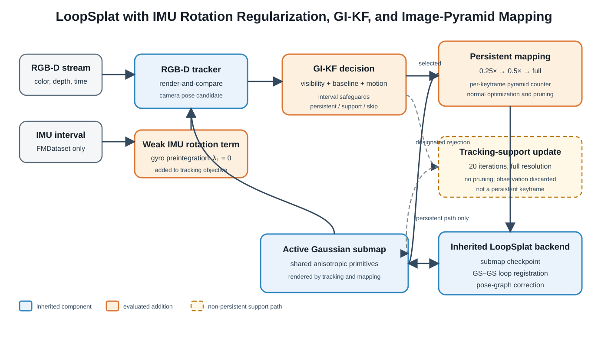
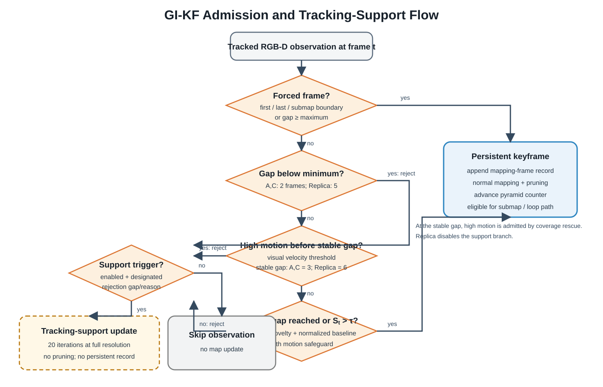
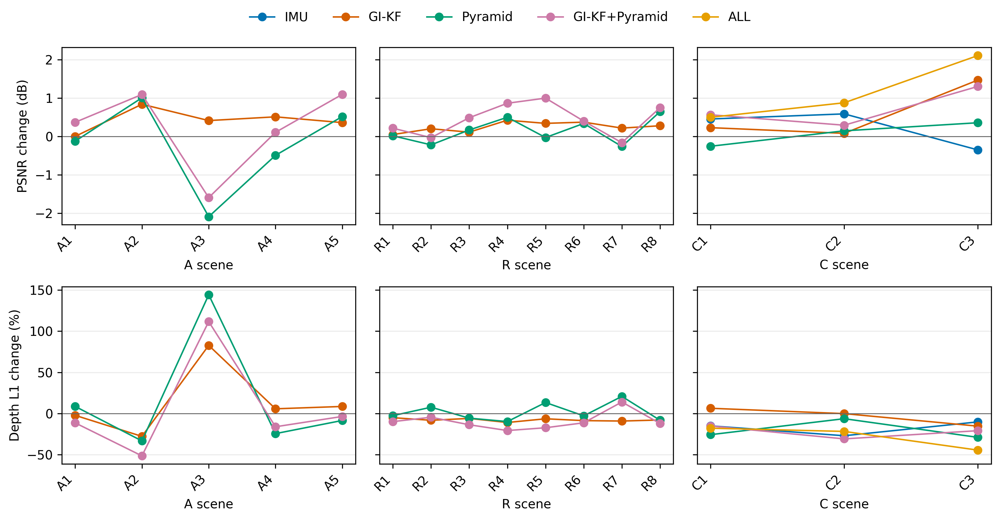

# 面向资源约束的 LoopSplat 扩展：弱惯性旋转正则、可见性感知关键帧与 RGB-D 粗到细建图

## 摘要

在线三维高斯 SLAM 需要在相机跟踪、重建质量与重复优化观测帧的开销之间取得平衡。本文围绕 LoopSplat 研究三项边界明确的扩展：用于 RGB-D 跟踪的鲁棒陀螺仪预积分旋转残差、带非持久跟踪支撑更新的可见性感知持久关键帧策略，以及按关键帧维护的 RGB-D 粗到细监督。系统保留原有的子图配准、回环检测和位姿图后端。实验覆盖 TUM RGB-D 的五个场景、Replica 的八个场景和 FMDataset 的三个惯性场景，共 70 个场景-策略配置。在 Replica 上，关键帧与金字塔组合策略将持久关键帧减少 16.3%，宏平均 ATE 从 0.292 降至 0.262 cm，PSNR 从 28.168 提高到 28.606 dB。在 FMDataset 上，三模块完整配置将持久关键帧减少 58.3%、峰值 PyTorch 已分配显存减少 47.6%，同时使 PSNR 提高 1.159 dB、深度误差降低 25.6%；由于缺少参考轨迹，无法评估轨迹精度。TUM 揭示了主要限制：组合策略减少 63.9% 的关键帧并略微改善已观测视角质量，但宏平均 ATE 从 3.309 增至 5.887 cm，且关键帧模块单独使用时出现明显的场景相关失败。结果表明这些策略适合资源受限的条件化使用，而较激进的观测筛选仍需针对目标运动环境验证。

**关键词：** 三维高斯泼溅；RGB-D SLAM；视觉惯性感知；关键帧选择；图像金字塔；稠密重建；回环检测

## 1 引言

三维场景重建正从离线处理走向连续在线运行。实用系统必须在新观测持续到来的同时估计相机运动、更新几何与外观，并维持全局一致性。这些任务竞争同一份计算资源。稠密监督有助于改善局部地图，但反复优化相似视角会占用时间和显存；减少观测能节省资源，却可能使活动地图无法及时适应跟踪需要。惯性测量可以约束快速运动，但完整视觉惯性估计还需处理状态扩展、标定与可观性，对既有 RGB-D 流程而言改动较大。

神经隐式 SLAM 已证明，连续学习式场景函数可以支持联合跟踪与建图 [@sucar2021_imap; @zhu2022_niceslam]。为了降低在线优化成本，后续研究引入了混合网格、稀疏编码、神经点和局部子图 [@wang2023_coslam; @sandstrom2023_pointslam; @tang2023_mipsfusion]。三维高斯泼溅则提供了另一种折中：场景由显式基元组成，位置、协方差、不透明度和外观可以直接优化，同时保持较快的可微渲染 [@kerbl2023_3dgs]。SplaTAM、GS-SLAM、Gaussian Splatting SLAM、Gaussian-SLAM 与 Photo-SLAM 已表明，这类基元能够承担稠密相机跟踪和照片级建图 [@keetha2024_splatam; @yan2024_gsslam; @matsuki2024_gaussiansplatting; @yugay2023_gaussianslam; @huang2024_photoslam]。

长时间在线序列仍面临两个不同的扩展问题。其一是局部地图的漂移需要全局校正；其二是即使具备全局校正，活动建图器仍会积累冗余观测并承担昂贵监督。LoopSplat 通过注册高斯子图进行回环检测，再利用位姿图传播校正，从而处理第一个问题 [@zhu2025_loopsplat]。本文以该系统为基线，重点研究第二个问题。需要明确的是，本文沿用全部全局一致性模块，新增内容只涉及跟踪正则、持久观测接纳与建图分辨率。

关键帧选择是控制资源最直接的手段，但固定间隔无法适应轨迹各部分的信息差异。可见性感知分数可以延后冗余观测，最小和最大间隔则限制选择过程。观测即使不适合持久保存，也可能在短时间内有用。近期视角对未来回环贡献有限时，仍能帮助跟踪器所依赖的活动地图适应当前外观和几何。基于这一点，本文区分持久关键帧与短时支撑观测。前者写入子图记录，后者执行少量地图更新后即被丢弃。

建图分辨率提供了第二个控制维度。经典图像金字塔按照从粗结构到细节的顺序组织视觉信息 [@burt1981_fastfilter; @burt1983_pyramid]，Photo-SLAM 也展示了多尺度监督在高斯 SLAM 中的价值 [@huang2024_photoslam]。针对大场景的渲染研究还探索了多分辨率三维高斯表示 [@kerbl2024_hierarchical]。本文使用金字塔的范围更窄：它只随每个关键帧的重复使用次数调整 RGB-D 监督分辨率，活动高斯集合始终不变。由于在线子图优化对各存储观测的抽样并不均匀，层级进度需要按关键帧分别维护。

第三类控制信号来自 IMU。MM3DGS SLAM、VINGS-Mono 和 GI-SLAM 等完整视觉惯性高斯系统说明了惯性与高斯表示结合的潜力 [@sun2024_mm3dgsslam; @wu2025_vingsmono; @liu2025_gislam]。本文把相邻 RGB-D 帧之间的标定陀螺仪读数在旋转群上预积分，并作为视觉跟踪中的弱鲁棒残差。正式惯性损失不包含平移。该模块的范围小于上述状态估计器，用于检验有限改动能否帮助既有 RGB-D 跟踪器。

本文通过受控集成考察三个问题：可见性感知持久化能否降低关键帧和显存负担，同时避免活动地图过时；粗到细 RGB-D 监督能否在预算降低后恢复几何或外观；弱旋转信息能否在快速手持序列中提供补充。实验在 TUM RGB-D、Replica 和 FMDataset 上逐项消融。三组数据分别覆盖带轨迹真值的真实 RGB-D 运动、基线按五帧建图的稳定合成场景，以及缺少轨迹真值但含同步 RGB-D/惯性的场景。

三个数据集偏好的配置不同。Replica 上的结果较均衡：GI-KF 与金字塔组合在减少持久帧的同时改善宏平均轨迹和已观测视角质量。FMDataset 上三模块组合取得最强的重建与显存结果，却不能支持定位结论。TUM 则给出反例：持久关键帧大幅减少，但总体轨迹误差增加，GI-KF 单独使用时有一个序列严重失败。保留这一退化十分必要，因为资源节省只有与精度代价一同报告才有实际意义。

本文的主要工作如下：

1. 构造由标定后的中点预积分得到的弱陀螺仪旋转正则，使用鲁棒残差加权，并显式拒绝无效测量区间。该模块仅服务于 RGB-D 跟踪，不声称实现完整惯性状态估计。
2. 设计结合可见性与运动信息的持久关键帧策略，加入与数据集节奏匹配的间隔保护；同时设置独立支撑路径，使短时观测能够调整活动地图，但不会进入持久记录、子图、金字塔状态或回环流程。
3. 构建有效性加权的 RGB-D 图像金字塔和按关键帧计数的层级调度，对同一高斯表示施加由粗到细的监督。
4. 完成覆盖 70 个配置的逐场景消融：在真值可用时报告轨迹，并统一报告固定观测视角色彩与深度质量、用时、峰值 PyTorch 已分配显存、持久关键帧以及失败案例。

第 2 节讨论稠密与高斯 SLAM、全局一致性、惯性估计、关键帧与多尺度优化；第 3 节介绍三个模块及其接口；第 4 节说明数据集、策略矩阵、指标和报告约束；第 5 节分析消融结果与实际权衡；第 6 节讨论有效性限制；第 7 节总结全文。

## 2 相关工作

### 2.1 稠密 SLAM 的场景表示

稠密视觉 SLAM 采用过多种场景表示，不同表示对在线优化的计算需求也不同。早期 RGB-D 系统通常使用几何地图和特征点跟踪，ORB-SLAM2 是支持单目、双目和 RGB-D 输入的代表性开源系统 [@murartal2017_orbslam2]。随后，DROID-SLAM 表明稠密对应关系与循环迭代优化能够用于多种相机输入 [@teed2021_droidslam]。神经隐式建图进一步使用连续场景函数压缩地图。iMAP 联合优化神经场景表示与相机位姿 [@sucar2021_imap]；NICE-SLAM、Vox-Fusion、Co-SLAM、ESLAM 和 Point-SLAM 分别利用网格、体素、混合编码或神经点改善局部性、可扩展性、收敛速度与重建细节 [@zhu2022_niceslam; @yang2022_voxfusion; @wang2023_coslam; @johari2023_eslam; @sandstrom2023_pointslam]。MIPS-Fusion 等多子图系统则通过局部隐式地图限制在线优化范围 [@tang2023_mipsfusion]。

可微三维高斯泼溅提供了显式、可连续优化且能快速栅格化的场景表示 [@kerbl2023_3dgs]。已有多项工作将其用于在线跟踪和建图。SplaTAM 从 RGB-D 观测出发联合跟踪相机并增量构建高斯地图 [@keetha2024_splatam]；GS-SLAM 和 Gaussian Splatting SLAM 分别从几何、优化和地图维护角度构建稠密高斯 SLAM 流程 [@yan2024_gsslam; @matsuki2024_gaussiansplatting]。Gaussian-SLAM 将照片级渲染与稠密 SLAM 结合，Photo-SLAM 则支持单目、双目和 RGB-D 相机，并将多尺度思想用于高斯建图 [@yugay2023_gaussianslam; @huang2024_photoslam]。这些研究说明高斯基元适合在线重建，但长序列中的冗余观测、资源占用和快速运动干扰仍需专门处理。

### 2.2 稠密与高斯 SLAM 的全局一致性

局部光度优化会累积漂移，因此完整系统还需识别重访区域并传播校正。GO-SLAM 将稠密重建与全局优化结合，Loopy-SLAM 在稠密神经 SLAM 中引入回环约束 [@zhang2023_goslam; @liso2024_loopyslam]。对于高斯 SLAM，LoopSplat 直接注册高斯子图，并在检测到回环后执行位姿图优化 [@zhu2025_loopsplat]。这一后端已经把在线局部建图与全局校正分开，适合作为本文的实验基础。

本文保留 LoopSplat 的子图、高斯配准、回环检测和位姿图模块。研究问题限定为：能否更经济地调度跟踪与建图观测，以及在存在同步惯性测量时，弱旋转信息能否缓解视觉跟踪的局部歧义。因此，本文不会把既有回环能力归为三项新策略的贡献。

### 2.3 高斯 SLAM 中的惯性信息

传统视觉惯性 SLAM 通常把 IMU 作为状态估计的一部分。ORB-SLAM3 在多地图框架内联合使用视觉与惯性约束 [@campos2021_orbslam3]；流形预积分则为压缩相邻图像时间戳之间的高频 IMU 测量提供了标准数学工具 [@forster2017_preintegration]。近期高斯系统也开始引入惯性信息。MM3DGS SLAM 融合视觉、深度和惯性测量 [@sun2024_mm3dgsslam]，VINGS-Mono 面向大场景单目视觉惯性高斯建图 [@wu2025_vingsmono]，GI-SLAM 研究高斯惯性估计并给出信息感知关键帧选择的启发 [@liu2025_gislam]。

这些工作也限定了本文 IMU 模块的范围。本文不估计完整惯性状态，而是根据标定后的陀螺仪区间，在 RGB-D 相机跟踪中构造低权重、带鲁棒核的旋转残差；正式实验的惯性平移权重为零。该设计旨在尽量少改动原跟踪器的前提下，为快速运动提供适度约束。

### 2.4 关键帧、临时地图支撑与多尺度监督

关键帧选择同时决定计算负载和地图保留的信息。固定间隔简单稳定，却无法区分冗余视角与揭示新几何的视角；只依据运动幅度又可能在重叠不足或跟踪不稳定时接纳质量较差的观测。GI-SLAM 提出了结合高斯可见性与运动信息的思路 [@liu2025_gislam]。本文将其用于持久建图帧，并增加最小、稳定和最大间隔保护。持久接纳与短时跟踪支撑被明确分开：后者能在某个观测被拒绝保存后调整活动地图，但不会把该观测写入子图或回环记录。

由粗到细的图像处理有较长研究历史。高斯与拉普拉斯金字塔在粗层抑制高频细节，再逐层恢复较细结构 [@burt1981_fastfilter; @burt1983_pyramid]。Photo-SLAM 说明多尺度监督同样适用于高斯 SLAM [@huang2024_photoslam]。本文按持久关键帧分别维护层级进度，以适应在线子图优化中的非均匀抽样。它调节的是 RGB-D 监督分辨率，各层始终更新同一组活动高斯。

相关研究为本文的三个模块提供了直接依据：跟踪中的惯性旋转信息、信息感知的观测保留和多尺度建图监督。下文考察它们在带回环后端的高斯 SLAM 系统中的组合效果与资源-精度权衡。

## 3 方法

### 3.1 系统概述与场景表示

本文以 LoopSplat 的 RGB-D 跟踪、子图构建、高斯到高斯回环配准和位姿图校正后端为基础 [@zhu2025_loopsplat]。这些继承模块的功能保持不变，本文的改动位于在线流程中的三个位置：当数据集提供标定后的惯性测量时，在相机跟踪目标中加入由陀螺仪预积分得到的弱旋转约束；利用可见性和运动信息决定哪些观测应保存为持久关键帧；利用 RGB-D 图像金字塔安排由粗到细的建图监督。整体数据流如图 1 所示。

活动子图由具有方向和尺度的三维高斯基元表示。对于第 \(i\) 个高斯，保留中心 \(\boldsymbol\mu_i\)、旋转四元数 \(\mathbf q_i\)、正尺度向量 \(\mathbf s_i\)、不透明度 \(o_i\) 和球谐外观系数 \(\mathbf c_i\)，其协方差为

$$
\mathcal G_i=\{\boldsymbol\mu_i,\mathbf q_i,\mathbf s_i,o_i,\mathbf c_i\},\qquad
\boldsymbol\Sigma_i=\mathbf R(\mathbf q_i)\operatorname{diag}(\mathbf s_i^2)\mathbf R(\mathbf q_i)^\top .
\tag{1}
$$

其中，\(\mathbf R(\mathbf q_i)\) 为归一化四元数对应的旋转矩阵。实现中三个尺度分量均参与优化。建图损失包含柔性的尺度一致性惩罚，但这一正则项不会把三个尺度参数替换成单一尺度。

高斯投影并按深度排序后，可微渲染器按照 3DGS 的前向 alpha 合成方式生成颜色与深度 [@kerbl2023_3dgs]：

$$
\widehat{\mathbf C}(\mathbf p)=\sum_{i=1}^{N_{\mathbf p}}T_i(\mathbf p)\,\alpha_i(\mathbf p)\,\mathbf c_i(\mathbf p),\quad
\widehat D(\mathbf p)=\sum_{i=1}^{N_{\mathbf p}}T_i(\mathbf p)\,\alpha_i(\mathbf p)\,z_i,
\quad T_i(\mathbf p)=\prod_{j<i}\left[1-\alpha_j(\mathbf p)\right].
\tag{2}
$$

\(\alpha_i(\mathbf p)\) 由学习得到的不透明度和投影后的高斯足迹共同决定，\(z_i\) 是高斯在相机坐标系下的深度，\(T_i\) 是累积透射率。跟踪与建图共享渲染器输出的颜色、深度和 alpha 图。

### 3.2 弱惯性旋转正则辅助的视觉跟踪

对每一帧 RGB-D 观测 \((\mathbf C_t,D_t)\)，跟踪器通过比较活动子图的渲染结果与有效观测像素来优化相对相机变换。视觉目标写为

$$
\mathcal L_{\mathrm{vis}}=
w_c\,\underset{\mathbf p\in\mathcal M_c}{\operatorname{mean}}
\left\lVert\widehat{\mathbf C}_t(\mathbf p)-\mathbf C_t(\mathbf p)\right\rVert_1
+(1-w_c)\,\underset{\mathbf p\in\mathcal M_d}{\operatorname{mean}}
\left|\widehat D_t(\mathbf p)-D_t(\mathbf p)\right| .
\tag{3}
$$

\(\mathcal M_d\) 表示有限深度像素掩码，\(\mathcal M_c\) 由配置中的 alpha 阈值和无效深度屏蔽规则确定；颜色权重 \(w_c\) 随数据集配置。继承的跟踪器还可使用渲染 alpha 对两类残差进行软加权。

FMDataset 在相邻帧 \(t-1\) 与 \(t\) 之间提供标定后的 IMU 序列。系统对相邻陀螺仪读数取中点算术平均，将其由 IMU 坐标系变换到相机坐标系，并在 \(\mathrm{SO}(3)\) 上累积。采用配置中给定且在优化期间固定的陀螺仪偏置 \(\mathbf b_g\)，旋转预测为

$$
\Delta\mathbf R_{t-1,t}^{I}
=\prod_{k=0}^{K-2}\operatorname{Exp}
\left(\mathbf R_{CI}\left[\tfrac12(\boldsymbol\omega_k+\boldsymbol\omega_{k+1})-\mathbf b_g\right]\Delta t_k\right).
\tag{4}
$$

这一计算借鉴流形上的惯性预积分思想 [@forster2017_preintegration]，但本文仅把它用于弱旋转约束。正式实验不把速度、重力和传感器偏置作为视觉状态的联合优化变量。对于无效、时间戳不递增、跨度过长或测量超限的 IMU 区间，系统直接停用该区间的惯性项。

设 \(\Delta\mathbf R_{t-1,t}^{V}\) 为当前视觉跟踪候选给出的相对旋转，归一化旋转差定义为

$$
\mathbf r_R=
\frac{1}{s_R}\operatorname{Log}
\left[\left(\Delta\mathbf R_{t-1,t}^{I}\right)^\top
\Delta\mathbf R_{t-1,t}^{V}\right],\qquad s_R=0.01\ \mathrm{rad}.
\tag{5}
$$

为限制局部惯性异常值的影响，对每个分量使用 Huber 惩罚 [@huber1964_robust]：

$$
\rho_\delta(x)=
\begin{cases}
\tfrac12x^2,&|x|\leq\delta,\\
\delta(|x|-\tfrac12\delta),&|x|>\delta,
\end{cases}
\qquad
\mathcal L_{\mathrm{imu}}=\lambda_R\sum_{j=1}^{3}\rho_{\delta_R/s_R}(r_{R,j}),
\quad \lambda_R=10^{-3},\ \delta_R=0.1\ \mathrm{rad}.
\tag{6}
$$

实现可以计算平移预积分残差并用于诊断，但正式消融中其权重为 \(\lambda_T=0\)。最终跟踪目标为

$$
\mathcal L_{\mathrm{track}}=
\mathcal L_{\mathrm{vis}}+\mathcal L_{\mathrm{imu}}
=w_c\mathcal L_C+(1-w_c)\mathcal L_D
+\lambda_R\sum_{j=1}^{3}\rho_{\delta_R/s_R}(r_{R,j}),
\qquad \lambda_R=10^{-3},\ \lambda_T=0.
\tag{7}
$$

因此，本文把该模块称为“预积分导出的弱陀螺仪旋转正则”。它不同于 ORB-SLAM3、MM3DGS SLAM 和 VINGS-Mono 所代表的完整视觉惯性估计系统 [@campos2021_orbslam3; @sun2024_mm3dgsslam; @wu2025_vingsmono]。

### 3.3 可见性感知的持久关键帧选择

基线系统按固定间隔接纳建图帧。GI-KF 则利用当前相机视锥与最近持久关键帧视锥中所包含的高斯中心来评估候选帧。设 \(\mathcal V_t\) 和 \(\mathcal V_k\) 分别为当前帧与参考关键帧的高斯中心索引集合，\(b_{t,k}\) 为相机中心位移，\(\widetilde d_t\) 为当前帧有效深度中位数，\(v_t\) 与 \(\omega_t\) 为相邻视觉位姿估计出的线速度和角速度。依据 GI-SLAM 的信息感知思想 [@liu2025_gislam]，定义可见性与基线分数

$$
S_t=
w_{\mathrm{cov}}\left(1-\frac{|\mathcal V_t\cap\mathcal V_k|}{|\mathcal V_t\cup\mathcal V_k|}\right)
+w_b\frac{b_{t,k}}{\max(\widetilde d_t,\varepsilon)}.
\tag{8}
$$

正式配置采用 \(w_{\mathrm{cov}}=w_b=1\)、阈值 \(\tau=0.1\)、\(v_{\max}=1.5\,\mathrm{m/s}\) 和 \(\omega_{\max}=120^\circ/\mathrm{s}\)。运动量不进入式（8），而是先由式（9）的硬门控处理：高运动候选在稳定间隔前被拒绝，达到稳定间隔后由覆盖保护分支接纳。代码中保留了使用陀螺仪辅助运动判别的可选开关，但所有正式 GI-KF 配置均关闭该开关，因此该门控使用视觉位姿导出的速度。

分数判定受到关键帧间隔规则保护。令 \(g_t=t-k\) 为当前帧与最近持久关键帧之间的帧号差，\(\mathcal F\) 为首帧、末帧和子图边界帧集合。高运动帧在稳定间隔前被暂缓，而达到稳定间隔后由覆盖保护分支接纳。持久关键帧判定 \(K_t\) 和跟踪支撑更新标志 \(U_t\) 可概括为

$$
K_t=
\begin{cases}
1,&t\in\mathcal F\ \text{or}\ g_t\ge g_{\max},\\
0,&g_t<g_{\min},\\
0,&(v_t>v_{\max}\lor\omega_t>\omega_{\max})\land g_t<g_{\mathrm{stable}},\\
1,&g_t\ge g_{\mathrm{stable}},\\
\mathbb I[S_t>\tau],&\text{otherwise},
\end{cases}
\quad
U_t=\mathbb I[K_t=0]\,\mathbb I[E_t]\,
\mathbb I[(r_t=\mathrm{min},g_t=1)\lor(r_t\in\{\mathrm{low},\mathrm{motion}\},g_t=2)].
\tag{9}
$$

\(E_t\) 表示当前数据集是否启用支撑更新，\(r_t\) 记录候选帧未被接纳的原因。TUM RGB-D 和 FMDataset 采用 \(g_{\min}=2\)、\(g_{\mathrm{stable}}=3\)、\(g_{\max}=10\)。Replica 的基线本身每五帧建图一次，因此使用 \(g_{\min}=5\)、\(g_{\mathrm{stable}}=6\)、\(g_{\max}=10\)，并关闭支撑更新。这一预算匹配设置考察的是信息感知的延后接纳，而不是把 Replica 悄然改成逐帧建图。

### 3.4 持久关键帧与跟踪支撑更新

图 2 区分两类观测。被选中的持久关键帧进入建图帧列表，接受常规子图优化，保存持久元数据，并可参与后续子图检查点和回环流程。支撑观测只在指定的拒绝帧上产生：它对活动高斯执行 20 次优化，不进行剪枝，也不使用图像金字塔；完成后便丢弃该观测，而不写入持久记录。

这一划分针对激进减少关键帧时的实际问题：某个观测对于长期存储可能是冗余的，但跟踪器仍可能需要局部模型及时适应近期外观和几何变化。支撑路径提供短时适应，同时不增加持久关键帧数量，也不会形成另一类隐含的回环关键帧。

### 3.5 RGB-D 图像金字塔监督

第三项改进只改变建图监督的分辨率调度，不改变高斯场景表示。设置 \(L=2\) 个降采样层，RGB 图像先经过平滑，再分别降采样到 \(0.25\times\) 和 \(0.5\times\) 分辨率，原始观测构成最终的全分辨率层。深度采用有效性加权的区域平均，避免把缺失深度混入有效测量。设 \(n_t\) 为持久关键帧 \(t\) 被抽中优化的累计次数，\(u=8\) 为每个降采样层的使用预算，则

$$
a_\ell=2^{-(L-\ell)},\quad \ell=0,\ldots,L-1;\qquad
\ell_t(n_t)=\min\!\left(\left\lfloor\frac{n_t}{u}\right\rfloor,L\right),
\quad L=2,\ u=8.
\tag{10}
$$

其中层 \(L\) 表示全分辨率。由于子图内各关键帧被抽样的次数并不相同，层级计数按持久关键帧分别维护；渲染时相机内参随目标图像尺寸同步缩放。该方法与经典高斯/拉普拉斯图像金字塔 [@burt1981_fastfilter; @burt1983_pyramid] 及 Photo-SLAM 的多尺度监督 [@huang2024_photoslam] 有关，但所有分辨率始终优化同一组活动三维高斯。

在选定分辨率层上，建图目标为

$$
\mathcal L_{\mathrm{map}}=
(1-\lambda_s)\left\lVert\widehat{\mathbf C}-\mathbf C\right\rVert_{1,\mathcal M}
+\lambda_s\left[1-\operatorname{SSIM}(\widehat{\mathbf C},\mathbf C)\right]
+\left\lVert\widehat D-D\right\rVert_{1,\mathcal M}
+\frac{1}{3N}\sum_{i=1}^{N}\sum_{j=1}^{3}|s_{ij}-\bar s_i|,
\quad \bar s_i=\tfrac13\sum_{j=1}^{3}s_{ij}.
\tag{11}
$$

\(\mathcal M\) 包含观测深度为有限正值且渲染深度有限的像素，所有实验均设 \(\lambda_s=0.2\)。最后一项以软约束抑制过强的尺度不均衡，同时保留三个独立可训练尺度参数。单尺度 SSIM 损失的定义沿用 [@wang2004_ssim]。支撑更新绕过式（10），始终使用原始观测分辨率，也不会推进任何持久关键帧的金字塔计数。

### 3.6 策略组合

三个模块作用于不同接口：惯性项只改变相机位姿优化目标；GI-KF 改变持久观测的接纳规则，并在允许的数据集上调用相互隔离的支撑路径；图像金字塔只改变持久关键帧的建图监督。TUM RGB-D 和 Replica 不包含惯性消融；FMDataset 同时评测单独的旋转正则和三种策略的完整组合。这样的实验设计既能比较单模块与组合效果，又保留 LoopSplat 原有的子图、配准和位姿图功能。

## 4 实验设置

### 4.1 数据集与场景分组

本文在三个用途不同的室内 RGB-D 数据集上评测系统。TUM RGB-D 包含真实传感器序列和轨迹真值 [@sturm2012_tumrgbd]。实验选用 fr1/desk、fr1/desk2、fr1/room、fr2/xyz 和 fr3/long_office_household 五个序列，记为 A1-A5，共处理 8,454 帧。Replica 提供合成室内图像和精确相机轨迹 [@straub2019_replica]。实验采用常用的全部八个场景，即 office0-office4 与 room0-room2（R1-R8），共处理 16,000 帧。FMDataset 提供手持室内运动下采集的 RGB-D 与同步惯性测量 [@zhu2019_fmdataset]。其中 dorm1_fast1、dorm2_fast 和 hotel_fast1 构成 C1-C3，共处理 2,340 帧。

三组数据对应不同问题。TUM 用于考察改进在具有轨迹真值的真实 RGB-D 序列上的表现。Replica 用于检验预算匹配的关键帧延后策略在稳定合成场景上是否仍有价值，其基线本身已按五帧间隔建图。FMDataset 是正式实验中唯一含 IMU 输入的数据组，因此用于惯性消融。本实验所用的 C 组数据不含轨迹真值，故不报告 ATE 和 RPE。自采 Azure Kinect 材料仅用于工程定性检查，不纳入定量消融。

### 4.2 策略矩阵

Baseline 表示关闭三项改进的既有 LoopSplat 配置。TUM 与 Replica 比较 Baseline、GI-KF、Pyramid 和 GI-KF+Pyramid。FMDataset 另外加入 IMU 与 ALL，其中 ALL 同时启用 IMU、GI-KF 和 Pyramid。表 1 给出各策略开关。

**表 1 消融策略矩阵。勾选表示启用相应模块。**

| 数据组 | 策略 | IMU 旋转 | GI-KF | Pyramid |
|---|---|---:|---:|---:|
| TUM、Replica、FM | Baseline |  |  |  |
| FM | IMU | ✓ |  |  |
| TUM、Replica、FM | GI-KF |  | ✓ |  |
| TUM、Replica、FM | Pyramid |  |  | ✓ |
| TUM、Replica、FM | GI-KF+Pyramid |  | ✓ | ✓ |
| FM | ALL | ✓ | ✓ | ✓ |

除匹配各数据集基线节奏所需的间隔外，GI-KF 参数保持一致。TUM 与 FMDataset 的最小、稳定和最大间隔分别为 2、3、10 帧。Replica 的基线每五帧建图一次，因此采用 5、6、10 帧，并关闭跟踪支撑更新。信息分数权重、运动阈值、支撑更新长度和金字塔调度均按第 3 节设置。惯性策略的旋转权重为 0.001，平移权重为零。

### 4.3 实验协议与实现

表中每项对应一个场景-策略结果，“宏平均”表示对场景做无权算术平均。当前报告协议不估计运行间方差，也不支持显著性检验。所有策略使用相同的数据帧、评测视角列表、基础参数和 LoopSplat 既有功能，只改变表 1 中的策略开关。

实验使用云端提供的 22-GiB NVIDIA GeForce RTX 2080 Ti 实例与 16-GiB RTX 4080 SUPER。对于同一场景，各策略使用相同的 GPU 环境。TUM 的 A1、A2、A3、A5 及全部 FMDataset 实验使用 22-GiB RTX 2080 Ti 环境；TUM A4 与全部 Replica 实验使用 RTX 4080 SUPER。因此，时间和显存变化只在同一场景内解释；不同 GPU 场景之间的绝对用时仅作为运行背景。

实验程序保存实际生效配置、策略摘要、评测指标、耗时、峰值 PyTorch 已分配显存和持久关键帧判定。只有上述输出齐全且指标均为有限值的运行才进入论文结果。面向论文的提取程序为 70 个场景-策略配置各选择一条完整记录，其中 TUM 20 条、Replica 32 条、FMDataset 18 条。随后由统一 CSV 自动生成表格，使正文、表格和图中的数字来自同一数据源。

### 4.4 评测指标

TUM 与 Replica 的轨迹指标包括经过无尺度 Horn 刚性 \(SE(3)\) 对齐后的均方根绝对轨迹误差 ATE（厘米）。相对平移误差 RPE-t（米）和相对旋转误差 RPE-r（度）是在相邻帧对上计算的 RMSE，三者均为越低越好。FMDataset 因缺少参考轨迹而不报告这些指标。

渲染质量在固定的已观测帧列表上计算。PSNR 与 MS-SSIM 衡量像素和多尺度结构一致性，LPIPS 衡量感知距离 [@wang2003_msssim; @zhang2018_lpips]。PSNR、MS-SSIM 越高越好，LPIPS 越低越好。每次运行均使用自身估计位姿，并从未经全局细化的子图高斯直接拼接结果进行渲染。评测图像来自序列中已经观测过的帧，因此这些指标反映估计轨迹下的系统内部重投影一致性，不能单独代表世界坐标中的地图精度或未知视角泛化。Depth L1 是有效评测像素上的渲染深度平均绝对误差，越低越好。

效率指标包括端到端 SLAM 用时（小时）、由 torch.cuda.max_memory_allocated() 记录的峰值 PyTorch 已分配显存（GiB）、持久关键帧数量、子图数量，以及单独记录的跟踪支撑更新次数和用时。关键帧数量不包含支撑观测。主要效率结论中的百分比均以同场景 Baseline 为分母。

### 4.5 报告方式

表 2-4 先报告逐场景精度与质量，再给出跨场景无权宏平均；表 5 记录配对效率数据及每个场景所用 GPU。图 3 表示相对 Baseline 的指标变化，图 4 对照展示质量、关键帧和显存变化。数据集平均可能掩盖局部失败，因此结果讨论将明确保留 TUM A3 的退化和 FMDataset 上 IMU 的混合变化，而不会只依据总体均值。

## 5 实验结果与讨论

### 5.1 TUM RGB-D：效率收益伴随场景相关的轨迹代价

完整 TUM 结果见[表 2](tables/tum-results.md)。从宏平均看，GI-KF+Pyramid 将持久关键帧从 1,690.8 降到 610.4，减少 63.9%。固定观测视角 PSNR 从 13.257 提高到 13.470 dB，MS-SSIM 从 0.4675 提高到 0.4807，LPIPS 从 0.5611 降到 0.5438，Depth L1 从 0.3244 降到 0.3136。与此同时，轨迹指标变差：宏平均 ATE 从 3.309 增至 5.887 cm，RPE-t 从 0.0069 增至 0.0128 m，RPE-r 从 0.441° 增至 0.582°。

这一轨迹均值必须结合逐场景结果解释。在 A2 上，GI-KF+Pyramid 将 ATE 从 3.795 降至 3.322 cm，PSNR 提高 1.093 dB。在 A4 上，其 ATE 为 1.395 cm，Baseline 为 1.264 cm，而关键帧由 3,397 降至 1,136。A1 与 A5 出现中等程度的轨迹退化。A3 是决定性的失败案例：GI-KF 单独使用时的 ATE 达到 563.912 cm，Baseline 仅为 7.005 cm。加入金字塔后，该值降为 18.782 cm，但仍未恢复到基线；Pyramid 单独使用在 A3 上也得到 18.960 cm。现有日志只能证明各策略对该序列的响应不同，尚不能确定唯一物理原因，因此本文不把失败归因于某个未经验证的场景属性。

GI-KF 单独结果也暴露出数据集平均值的局限。其 TUM 宏平均渲染指标改善到 13.680 dB PSNR、0.4857 MS-SSIM 和 0.5356 LPIPS，但 A3 的轨迹失败使宏平均 ATE 升至 114.970 cm。该策略对资源控制和已观测视角重建有价值，但当前间隔与支撑规则尚不能保证 TUM 轨迹的一致可靠性。组合策略在轨迹上更保守，是本文策略中更合适的 TUM 折中点，不过其 ATE 仍不及 Baseline。

### 5.2 Replica：预算匹配的关键帧策略较稳定

Replica 结果见[表 3](tables/replica-results.md)。预算匹配的 GI-KF+Pyramid 将宏平均关键帧由 426.5 降至 357.0，减少 16.3%，且没有出现类似 TUM A3 的轨迹失败。宏平均 ATE 从 0.292 降至 0.262 cm，RPE-t 从 0.000632 降至 0.000594 m，RPE-r 则从 0.0202° 略增至 0.0209°。PSNR 同时从 28.168 提高到 28.606 dB，MS-SSIM 从 0.9328 提高到 0.9381，LPIPS 从 0.1164 降到 0.1139，Depth L1 从 0.0291 降到 0.0255。

逐场景改善分布在多个房间。GI-KF+Pyramid 在八个场景中的六个提高了 PSNR，在五个场景中降低了 ATE。R1、R7、R8 的 ATE 略高于 Baseline，R2 与 R7 的 PSNR 低于 Baseline。组合策略在 R4 上取得最大的 Depth L1 降幅，从 0.0513 降到 0.0406。R5 的 PSNR 增益最大，为 0.997 dB，其 Depth L1 从 0.0490 降到 0.0405。

单策略结果进一步解释了模块交互。Pyramid 的宏平均 ATE 最低，为 0.252 cm，但 LPIPS 增至 0.1220。GI-KF 得到 0.271 cm ATE、28.416 dB PSNR 和 0.1096 LPIPS，同时使用 357.2 个关键帧。组合策略取得最高的宏平均 PSNR、MS-SSIM 和最低 Depth L1，但没有同时继承单模块最优的 LPIPS 或 ATE。因此，Replica 上呈现的是质量与效率的均衡改善，各模块分别在不同指标上领先。

### 5.3 FMDataset：惯性与建图模块消融

FMDataset 的固定观测视角结果见[表 4](tables/fm-results.md)。由于缺少参考轨迹，本文不对定位精度作结论。ALL 将宏平均 PSNR 从 13.920 提高到 15.080 dB，MS-SSIM 从 0.5903 提高到 0.6107；LPIPS 从 0.7384 降到 0.6722，Depth L1 从 0.9657 降到 0.7181，深度误差减少 25.6%。持久关键帧从 780.0 降到 325.0，减少 58.3%。

完整组合在 C1-C3 上均同时改善 Baseline 的 PSNR、MS-SSIM、LPIPS 与深度。不同单项仍各有表现更好的策略。例如 C3 上，ALL 达到 16.186 dB PSNR 和 0.3757 Depth L1，Baseline 分别为 14.081 dB 和 0.6774。C1 上 GI-KF+Pyramid 的 PSNR 略高于 ALL，分别为 13.684 与 13.619 dB；ALL 的 LPIPS 则更低，分别为 0.6772 与 0.7166。

IMU 单独使用呈现混合证据。其宏平均 PSNR 增加 0.230 dB，LPIPS 降低 2.6%，Depth L1 降低 18.6%，但 MS-SSIM 从 0.5903 降到 0.5781。逐场景数据解释了这种分歧：PSNR 在 C1、C2 上提高，却在 C3 上由 14.081 降至 13.730 dB；LPIPS 在 C1 上变差，在 C2、C3 上改善。旋转先验能为部分测量提供有用信息，单独使用时各指标的变化方向仍不一致。

资源收益主要来自建图模块。GI-KF 单独使用将 C 组关键帧减少 58.5%，宏平均用时减少 14.6%，峰值 PyTorch 已分配显存减少 49.6%；PSNR 提高 0.591 dB，而 Depth L1 仅从 0.9657 变为 0.9534。Pyramid 单独使用不改变关键帧数量，却将 Depth L1 降低 19.1%。GI-KF 与 Pyramid 组合后得到 14.639 dB PSNR、0.6178 MS-SSIM 和 0.7478 Depth L1。在此基础上加入 IMU 形成 ALL，PSNR、LPIPS 与深度继续改善，但 MS-SSIM 从 0.6178 降至 0.6107。

### 5.4 时间、显存与持久地图规模

[表 5](tables/efficiency-results.md)中的配对测量避免把 GPU 差异误认为策略收益。在五个 TUM 场景上，GI-KF+Pyramid 将持久关键帧减少 55.0%-66.6%，用时减少 9.0%-21.1%；峰值 PyTorch 已分配显存降幅从 A1 的 47.8% 到 A3 的 54.2%。这些资源节省较明显，但第 5.1 节表明其代价是与场景相关的轨迹误差。

Replica 每个场景的所有策略均运行在同一 RTX 4080 SUPER 环境。GI-KF+Pyramid 在 R1-R8 上将持久关键帧减少 14.8%-18.7%，用时减少 2.5%-20.0%。宏平均峰值 PyTorch 已分配显存仅由 6.947 降到 6.875 GiB，说明 Replica 的峰值 PyTorch 已分配显存并不主要由这部分持久帧数量决定；即使保留观测减少，渲染器和活动高斯状态仍常驻显存。

全部 FMDataset 配置均使用 22-GiB RTX 2080 Ti 环境。ALL 在宏平均上将峰值 PyTorch 已分配显存从 7.197 降到 3.770 GiB，关键帧从 780.0 降到 325.0。其用时为 2.576 小时，Baseline 为 2.607 小时，但逐场景变化从 C1 减少 7.5% 到 C3 增加 6.9%。IMU 单独使用使时间增加 13.7%、显存增加 7.5%，因此 ALL 接近不变的总体用时反映的是 GI-KF 节省与惯性、建图额外开销的抵消。

表 5 还报告了临时支撑路径。TUM GI-KF+Pyramid 平均包含 610.4 个持久关键帧和 1080.4 次支撑更新，两者合计对应 1690.8 个处理帧；支撑更新耗时为 351.4 s。FMDataset ALL 平均包含 325.0 个持久关键帧和 455.0 次支撑更新，合计对应 780.0 帧，支撑更新耗时为 154.0 s。每次支撑更新仅执行 20 次迭代，随后丢弃该观测。因此，关键帧降幅衡量的是持久存储与完整关键帧优化的减少，并不表示所有地图更新事件按同等比例减少。

持久关键帧数量不能等同于子图数量。Replica 所有策略的宏平均子图数均为 33.25，尽管关键帧预算不同。TUM 上 GI-KF 单独使用把宏平均子图数从 20.2 增至 46.6，而 GI-KF+Pyramid 为 20.6。子图创建仍受既有边界逻辑控制，减少持久建图帧并不必然减少子图。

### 5.5 策略交互与实际选择

图 3 分开呈现三个模块的影响。金字塔几乎不改变关键帧数量，但能明显改善 FMDataset 深度。GI-KF 贡献了主要的持久地图和显存节省，其 TUM 轨迹表现却依赖场景。惯性正则的权重较弱，不同质量指标的变化方向并不一致。三者组合在 FMDataset 上取得最强总体质量，在 Replica 上形成较均衡结果，而 TUM 仍保留轨迹代价。

当部署资源受限时，GI-KF+Pyramid 或 ALL 可作为候选工作点，但应先针对目标运动模式验证。对于重视轨迹的 TUM 类应用，现有证据下 Baseline 更稳妥；A3 是不能忽略的反例，排除了普遍鲁棒性的表述。Azure Kinect 序列可以展示工程运行情况，但因无参考轨迹，不能消除这一限制。

### 5.6 定性诊断

图 5 和图 6 给出 Replica R5 在第 1990 帧保存的最终在线建图诊断。Baseline 面板显示其日志中的迭代计数 1000，GI-KF+Pyramid 则在其配置的建图预算下显示 100。每个面板并列展示输入与渲染的 RGB-D 观测、深度残差和致密化掩码。这些图是已观测帧上的优化快照，不是留出视角结果或完整全局地图渲染。

图 7 和图 8 展示 A3 轨迹反例。Baseline 经刚性对齐后的 ATE 为 7.005 cm，GI-KF 则发散至 563.912 cm。这一对照也说明，已观测视角渲染分数不能代替全局轨迹精度。

### 5.7 有效性边界

实验比较了 70 个受控的场景-策略配置。跨场景宏平均用于描述本实验集合，但当前证据不能衡量随机不确定性。固定观测视角协议评测的是输入采样视角上的重建一致性，不代表未知视角泛化。FMDataset 可以支持带 IMU 的质量消融，但不能支持轨迹结论。最后，两种 GPU 型号使不同运行环境场景之间的绝对用时不可直接比较，因此效率讨论只依据同场景差值。

## 6 局限性与有效性威胁

第一，实验重复评测有限，现有输出不能估计多次执行之间的随机波动。跨场景宏平均可以概括不同环境中的表现，但不能替代随机不确定性估计。特别是小数点后第三位附近的差异，只应视为当前实验的观测，而不代表可重复性证据。在讨论方差或显著性之前，仍需补充重复评测。

第二，渲染协议使用固定已观测帧。每次运行都在自身估计位姿上渲染未经细化的子图高斯拼接，因此结果同时受位姿和地图影响。A3 表明，即使世界坐标轨迹较差，渲染分数仍可能较高。这些指标描述的是系统内部重投影一致性，不能衡量未知视角合成或独立的几何精度。当前输出协议也没有为所有运行提供统一评测网格，故未报告网格精度、完整度或表面法向。

第三，本实验集中的 FMDataset 没有可用参考轨迹。IMU 消融可以通过图像质量、深度一致性、时间、显存和地图规模评测，却不能通过 ATE 或 RPE 评测。惯性方法本身也受到有意限制：它只正则旋转，配置偏置在优化期间固定，平移的正式权重为零。因此，结果不能外推为完整视觉惯性估计或长期偏置可观导航。

第四，GI-KF 具有场景依赖性。TUM A3 表明，减少持久观测的策略可能伴随严重轨迹退化。金字塔缓解了 GI-KF 单独使用时的失败，却没有恢复 Baseline ATE。现有日志可以确定失败及其配置，无法给出唯一原因。后续可研究运动自适应阈值、地图健康度反馈或自动回退到基线节奏，并在快速、低重叠序列上补充重复评测。

第五，本文实验以 LoopSplat 为中心。SplaTAM、Photo-SLAM、GS-SLAM、MM3DGS SLAM 与 VINGS-Mono 等系统仅依据论文设计进行讨论，没有在相同预处理、硬件、帧列表和指标实现下重跑。因此，实验支持的是对选定基线的扩展及其内部消融，不能形成跨独立论文的广泛性能排序。

最后，实验使用了两种 GPU。每个场景内的策略比较均采用兼容的记录环境，可以支持配对时间和显存差值；部署在不同 GPU 上的场景之间，绝对用时仍只具有描述意义。Azure Kinect 序列同样只用于定性展示：它可以说明工程流程能处理自采输入，却没有轨迹真值或受控消融。

## 7 结论

本文在保留 LoopSplat 全局子图和回环后端的前提下，引入三项面向资源约束的机制。IMU 模块提供低权重、带鲁棒核的陀螺仪旋转残差；GI-KF 把持久观测接纳与临时跟踪支撑分开；RGB-D 金字塔在不改变高斯表示的情况下，将重复建图监督由粗分辨率推进到全分辨率。

实验结果同时包含收益和风险。在 Replica 上，GI-KF+Pyramid 将持久关键帧减少 16.3%，宏平均 ATE 从 0.292 降至 0.262 cm，PSNR 提高 0.438 dB。在 FMDataset 上，ALL 将持久关键帧减少 58.3%、峰值 PyTorch 已分配显存减少 47.6%，同时改善已观测视角的颜色、感知与深度指标，但无法得出轨迹结论。在 TUM 上，组合方法减少 63.9% 的关键帧并略微改善宏平均渲染指标，ATE 却从 3.309 增至 5.887 cm，GI-KF 单独使用还在 A3 上失败。

因此，信息感知关键帧和粗到细监督可以明显降低持久建图负担，弱惯性旋转信息也能在同步手持数据上形成补充；但面向轨迹敏感任务时，关键帧策略仍需按场景验证，并增加更安全的回退机制。
