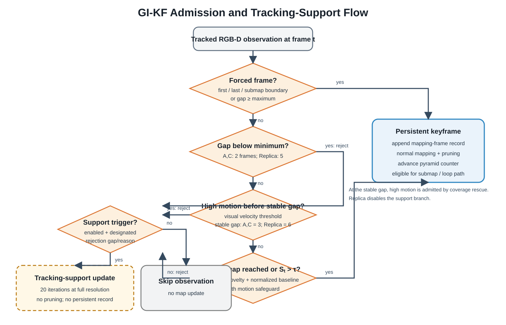

## 3. Method

### 3.1 System overview and representation

We build on LoopSplat's RGB-D tracking, submap construction, Gaussian-to-Gaussian loop registration, and pose-graph correction backend [@zhu2025_loopsplat]. Those inherited components remain unchanged in their purpose. Our additions act at three points in the online pipeline: a weak gyroscope-derived rotation term augments camera tracking when calibrated inertial samples are available; a visibility-aware policy decides which observations become persistent mapping keyframes; and an RGB-D image pyramid schedules mapping supervision from coarse to full resolution. Figure 1 summarizes the resulting data flow.

The active submap is represented by anisotropic 3D Gaussian primitives. For Gaussian \(i\), we retain its center \(\boldsymbol\mu_i\), rotation quaternion \(\mathbf q_i\), positive scale vector \(\mathbf s_i\), opacity \(o_i\), and spherical-harmonic appearance coefficients \(\mathbf c_i\). Its covariance is

$$
\mathcal G_i=\{\boldsymbol\mu_i,\mathbf q_i,\mathbf s_i,o_i,\mathbf c_i\},\qquad
\boldsymbol\Sigma_i=\mathbf R(\mathbf q_i)\operatorname{diag}(\mathbf s_i^2)\mathbf R(\mathbf q_i)^\top .
\tag{1}
$$

Here, \(\mathbf R(\mathbf q_i)\) is the rotation matrix obtained from the normalized quaternion. The implementation optimizes three scale components. A soft scale-consistency penalty is used during mapping, but it does not replace the anisotropic representation with a single-scale primitive.

After projection and depth sorting, the differentiable splatter composites color and depth at pixel \(\mathbf p\) as in 3DGS [@kerbl2023_3dgs]:

$$
\widehat{\mathbf C}(\mathbf p)=\sum_{i=1}^{N_{\mathbf p}}T_i(\mathbf p)\,\alpha_i(\mathbf p)\,\mathbf c_i(\mathbf p),\quad
\widehat D(\mathbf p)=\sum_{i=1}^{N_{\mathbf p}}T_i(\mathbf p)\,\alpha_i(\mathbf p)\,z_i,
\quad T_i(\mathbf p)=\prod_{j<i}\left[1-\alpha_j(\mathbf p)\right].
\tag{2}
$$

\(\alpha_i(\mathbf p)\) combines the learned opacity with the projected Gaussian footprint, \(z_i\) is camera-space depth, and \(T_i\) is accumulated transmittance. The same renderer supplies the color, depth, and alpha maps used by tracking and mapping.

### 3.2 Visual tracking with a weak inertial rotation regularizer

For each incoming RGB-D observation \((\mathbf C_t,D_t)\), the tracker optimizes a relative camera transformation by comparing the rendered active submap with valid observed pixels. Its visual objective is

$$
\mathcal L_{\mathrm{vis}}=
w_c\,\underset{\mathbf p\in\mathcal M_c}{\operatorname{mean}}
\left\lVert\widehat{\mathbf C}_t(\mathbf p)-\mathbf C_t(\mathbf p)\right\rVert_1
+(1-w_c)\,\underset{\mathbf p\in\mathcal M_d}{\operatorname{mean}}
\left|\widehat D_t(\mathbf p)-D_t(\mathbf p)\right| .
\tag{3}
$$

\(\mathcal M_d\) is the finite-depth tracking mask, while \(\mathcal M_c\) follows the configured alpha and invalid-depth masking rules. The color weight \(w_c\) is dataset-specific. Both residuals may be softly weighted by rendered alpha, following the inherited tracker.

When FMDataset provides a calibrated IMU interval between frames \(t-1\) and \(t\), midpoint angular velocities are transformed from the IMU frame to the camera frame and accumulated on \(\mathrm{SO}(3)\). With fixed configured gyroscope bias \(\mathbf b_g\), the rotation prediction is

$$
\Delta\mathbf R_{t-1,t}^{I}
=\prod_{k=0}^{K-2}\operatorname{Exp}
\left(\mathbf R_{CI}\left[\tfrac12(\boldsymbol\omega_k+\boldsymbol\omega_{k+1})-\mathbf b_g\right]\Delta t_k\right).
\tag{4}
$$

This construction follows the standard idea of on-manifold inertial preintegration [@forster2017_preintegration], but its role here is deliberately limited. The formal experiment does not optimize velocity, gravity, or sensor biases jointly with the visual state. Invalid, non-monotonic, overlong, or out-of-range IMU intervals are rejected and contribute no inertial term.

Let \(\Delta\mathbf R_{t-1,t}^{V}\) denote the relative rotation implied by the current visual tracking candidate. The normalized rotational disagreement is

$$
\mathbf r_R=
\frac{1}{s_R}\operatorname{Log}
\left[\left(\Delta\mathbf R_{t-1,t}^{I}\right)^\top
\Delta\mathbf R_{t-1,t}^{V}\right],\qquad s_R=0.01\ \mathrm{rad}.
\tag{5}
$$

To reduce the influence of intermittent inertial disagreement, each component is passed through the Huber penalty [@huber1964_robust]:

$$
\rho_\delta(x)=
\begin{cases}
\tfrac12x^2,&|x|\leq\delta,\\
\delta(|x|-\tfrac12\delta),&|x|>\delta,
\end{cases}
\qquad
\mathcal L_{\mathrm{imu}}=\lambda_R\sum_{j=1}^{3}\rho_{\delta_R/s_R}(r_{R,j}),
\quad \lambda_R=10^{-3},\ \delta_R=0.1\ \mathrm{rad}.
\tag{6}
$$

Although the implementation can calculate a translational preintegration residual for diagnostics, its formal ablation weight is \(\lambda_T=0\). Thus, the optimized tracking loss is

$$
\mathcal L_{\mathrm{track}}=
\mathcal L_{\mathrm{vis}}+\mathcal L_{\mathrm{imu}}
=w_c\mathcal L_C+(1-w_c)\mathcal L_D
+\lambda_R\sum_{j=1}^{3}\rho_{\delta_R/s_R}(r_{R,j}),
\qquad \lambda_R=10^{-3},\ \lambda_T=0.
\tag{7}
$$

We therefore describe the module as a preintegration-derived weak gyroscope rotation regularizer. It is narrower than the full visual-inertial estimators represented by ORB-SLAM3, MM3DGS SLAM, and VINGS-Mono [@campos2021_orbslam3; @sun2024_mm3dgsslam; @wu2025_vingsmono].

### 3.3 Visibility-aware persistent keyframes

The baseline admits mapping frames at a fixed cadence. GI-KF instead evaluates a frame against the most recent persistent keyframe using the Gaussian centers contained in their camera frusta. Let \(\mathcal V_t\) and \(\mathcal V_k\) be these center-index sets for the current frame and reference keyframe. Let \(b_{t,k}\) be camera-center displacement, \(\widetilde d_t\) the median valid depth, and \(v_t,\omega_t\) the linear and angular velocities estimated from consecutive visual poses. The visibility-and-baseline score adapted from GI-SLAM's information-aware principle [@liu2025_gislam] is

$$
S_t=
w_{\mathrm{cov}}\left(1-\frac{|\mathcal V_t\cap\mathcal V_k|}{|\mathcal V_t\cup\mathcal V_k|}\right)
+w_b\frac{b_{t,k}}{\max(\widetilde d_t,\varepsilon)}.
\tag{8}
$$

The formal configurations use \(w_{\mathrm{cov}}=w_b=1\), threshold \(\tau=0.1\), \(v_{\max}=1.5\,\mathrm{m/s}\), and \(\omega_{\max}=120^\circ/\mathrm{s}\). Motion does not enter Eq. (8). It is evaluated first by the hard gate in Eq. (9): high-motion candidates are rejected before the stable gap and accepted by the coverage-rescue branch at that gap. Although an optional gyroscope-assisted motion flag exists in code, it is disabled in all formal GI-KF configurations, so this gate uses velocities derived from visual poses.

Score thresholding is wrapped in interval safeguards. If \(g_t=t-k\) is the gap to the latest persistent keyframe, \(\mathcal F\) contains the first frame, last frame, and submap-boundary frames. High-motion frames are deferred before the stable gap and accepted by a coverage-rescue branch at that gap. The persistent decision \(K_t\) and tracking-support indicator \(U_t\) can be summarized as

$$
K_t=
\begin{cases}
1,&t\in\mathcal F\ \text{or}\ g_t\ge g_{\max},\\
0,&g_t<g_{\min},\\
0,&(v_t>v_{\max}\lor\omega_t>\omega_{\max})\land g_t<g_{\mathrm{stable}},\\
1,&g_t\ge g_{\mathrm{stable}},\\
\mathbb I[S_t>\tau],&\text{otherwise},
\end{cases}
\quad
U_t=\mathbb I[K_t=0]\,\mathbb I[E_t]\,
\mathbb I[(r_t=\text{min},g_t=1)\lor(r_t\in\{\text{low},\text{motion}\},g_t=2)].
\tag{9}
$$

\(E_t\) is the dataset-specific support-update switch, and \(r_t\) records why the frame was rejected. For TUM RGB-D and FMDataset, \(g_{\min}=2\), \(g_{\mathrm{stable}}=3\), and \(g_{\max}=10\). Replica already maps at a five-frame cadence, so it uses \(g_{\min}=5\), \(g_{\mathrm{stable}}=6\), \(g_{\max}=10\), and disables support updates. This budget-matched setting tests information-aware deferral without silently changing Replica into a dense every-frame mapper.

### 3.4 Persistent keyframes versus tracking-support updates

Figure 2 makes the two observation roles explicit. A selected persistent keyframe enters the mapping-frame list, receives normal submap optimization, stores persistent keyframe metadata, and can later support submap checkpointing and loop closure. A support observation is created only on designated rejected frames. It performs 20 optimization iterations on the active Gaussian model, with no pruning and no image pyramid. The observation is then discarded rather than inserted into the persistent records.

This separation addresses a practical failure mode of aggressive keyframe reduction: a tracker may require a recently adapted local appearance/geometry model even when the corresponding observation is redundant for long-term storage. The support path supplies that local adaptation without inflating the persistent-keyframe count. It does not create a hidden second class of loop-closure keyframes.

### 3.5 RGB-D image-pyramid supervision

The third addition changes the resolution schedule of mapping supervision, not the structure of the Gaussian map. For \(L=2\) sublevels, the RGB image is pre-smoothed and downsampled to \(0.25\times\) and \(0.5\times\) resolution; the original observation supplies the final full-resolution level. Depth is downsampled by validity-weighted area averaging so that missing measurements are not mixed into valid depths. If \(n_t\) is the number of times persistent keyframe \(t\) has been sampled for optimization and \(u=8\) is the use budget per sublevel, then

$$
a_\ell=2^{-(L-\ell)},\quad \ell=0,\ldots,L-1;qquad
\ell_t(n_t)=\min\!\left(\left\lfloor\frac{n_t}{u}\right\rfloor,L\right),
\quad L=2,\ u=8,
\tag{10}
$$

where level \(L\) denotes full resolution. The schedule is maintained per persistent keyframe, because sampling across the submap is nonuniform. Camera intrinsics are scaled consistently with the selected raster size. This design is related to classical Gaussian/Laplacian pyramids [@burt1981_fastfilter; @burt1983_pyramid] and Photo-SLAM's multiscale supervision [@huang2024_photoslam], but all levels optimize the same active set of 3D Gaussians.

At the chosen level, mapping minimizes

$$
\mathcal L_{\mathrm{map}}=
(1-\lambda_s)\left\lVert\widehat{\mathbf C}-\mathbf C\right\rVert_{1,\mathcal M}
+\lambda_s\left[1-\operatorname{SSIM}(\widehat{\mathbf C},\mathbf C)\right]
+\left\lVert\widehat D-D\right\rVert_{1,\mathcal M}
+\frac{1}{3N}\sum_{i=1}^{N}\sum_{j=1}^{3}|s_{ij}-\bar s_i|,
\quad \bar s_i=\tfrac13\sum_{j=1}^{3}s_{ij}.
\tag{11}
$$

\(\mathcal M\) contains finite positive observed depths and finite rendered depths, and \(\lambda_s=0.2\) in all experiments. The final term softly discourages extreme scale anisotropy while leaving the three scale parameters trainable. The single-scale SSIM loss follows [@wang2004_ssim]. Support updates bypass Eq. (10), always use the original observation resolution, and do not advance a persistent keyframe's pyramid counter.

### 3.6 Strategy composition

The three modules occupy separate interfaces. The inertial term changes only the camera-pose objective; GI-KF changes persistent observation admission and, where enabled, invokes the isolated support path; and the pyramid changes only persistent-keyframe mapping supervision. TUM RGB-D and Replica contain no inertial ablation. FMDataset evaluates the rotation regularizer both alone and in the complete combination. This arrangement permits single-module and combined comparisons while preserving LoopSplat's inherited submap, registration, and pose-graph functions.
