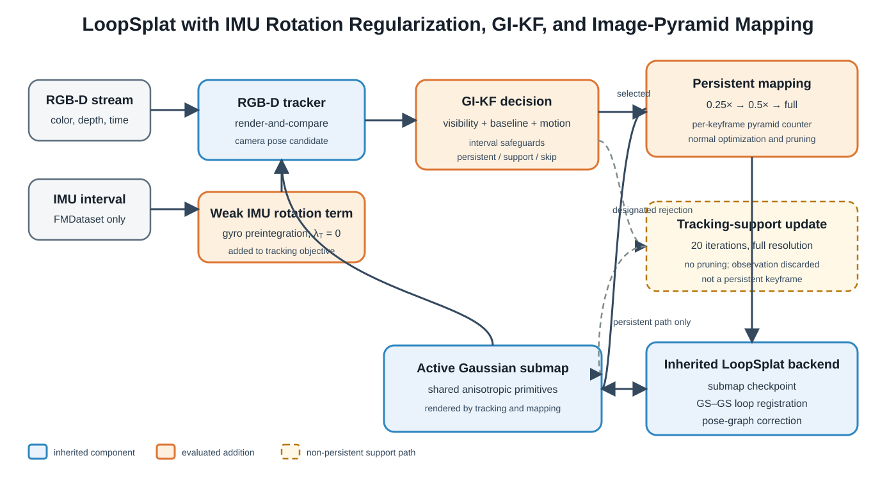
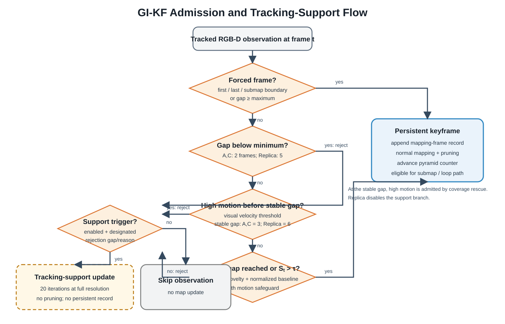

## 3 方法

### 3.1 系统概述与场景表示

本文以 LoopSplat 的 RGB-D 跟踪、子图构建、高斯到高斯回环配准和位姿图校正后端为基础 [@zhu2025_loopsplat]。这些继承模块的功能保持不变，本文的改动位于在线流程中的三个位置：当数据集提供标定后的惯性测量时，在相机跟踪目标中加入由陀螺仪预积分得到的弱旋转约束；利用可见性和运动信息决定哪些观测应保存为持久关键帧；利用 RGB-D 图像金字塔安排由粗到细的建图监督。整体数据流如图 1 所示。

活动子图由具有方向和尺度的三维高斯基元表示。对于第 \(i\) 个高斯，保留中心 \(\boldsymbol\mu_i\)、旋转四元数 \(\mathbf q_i\)、正尺度向量 \(\mathbf s_i\)、不透明度 \(o_i\) 和球谐外观系数 \(\mathbf c_i\)，其协方差为

$$
\mathcal G_i=\{\boldsymbol\mu_i,\mathbf q_i,\mathbf s_i,o_i,\mathbf c_i\},\qquad
\boldsymbol\Sigma_i=\mathbf R(\mathbf q_i)\operatorname{diag}(\mathbf s_i^2)\mathbf R(\mathbf q_i)^\top .
\tag{1}
$$

其中，\(\mathbf R(\mathbf q_i)\) 为归一化四元数对应的旋转矩阵。实现中三个尺度分量均参与优化。建图损失包含柔性的尺度一致性惩罚，但这一正则项不会把三个尺度参数替换成单一尺度。

高斯投影并按深度排序后，可微渲染器按照 3DGS 的前向 alpha 合成方式生成颜色与深度 [@kerbl2023_3dgs]：

$$
\widehat{\mathbf C}(\mathbf p)=\sum_{i=1}^{N_{\mathbf p}}T_i(\mathbf p)\,\alpha_i(\mathbf p)\,\mathbf c_i(\mathbf p),\quad
\widehat D(\mathbf p)=\sum_{i=1}^{N_{\mathbf p}}T_i(\mathbf p)\,\alpha_i(\mathbf p)\,z_i,
\quad T_i(\mathbf p)=\prod_{j<i}\left[1-\alpha_j(\mathbf p)\right].
\tag{2}
$$

\(\alpha_i(\mathbf p)\) 由学习得到的不透明度和投影后的高斯足迹共同决定，\(z_i\) 是高斯在相机坐标系下的深度，\(T_i\) 是累积透射率。跟踪与建图共享渲染器输出的颜色、深度和 alpha 图。

### 3.2 弱惯性旋转正则辅助的视觉跟踪

对每一帧 RGB-D 观测 \((\mathbf C_t,D_t)\)，跟踪器通过比较活动子图的渲染结果与有效观测像素来优化相对相机变换。视觉目标写为

$$
\mathcal L_{\mathrm{vis}}=
w_c\,\underset{\mathbf p\in\mathcal M_c}{\operatorname{mean}}
\left\lVert\widehat{\mathbf C}_t(\mathbf p)-\mathbf C_t(\mathbf p)\right\rVert_1
+(1-w_c)\,\underset{\mathbf p\in\mathcal M_d}{\operatorname{mean}}
\left|\widehat D_t(\mathbf p)-D_t(\mathbf p)\right| .
\tag{3}
$$

\(\mathcal M_d\) 表示有限深度像素掩码，\(\mathcal M_c\) 由配置中的 alpha 阈值和无效深度屏蔽规则确定；颜色权重 \(w_c\) 随数据集配置。继承的跟踪器还可使用渲染 alpha 对两类残差进行软加权。

FMDataset 在相邻帧 \(t-1\) 与 \(t\) 之间提供标定后的 IMU 序列。系统对相邻陀螺仪读数取中值，将其由 IMU 坐标系变换到相机坐标系，并在 \(\mathrm{SO}(3)\) 上累积。采用配置中给定且在优化期间固定的陀螺仪偏置 \(\mathbf b_g\)，旋转预测为

$$
\Delta\mathbf R_{t-1,t}^{I}
=\prod_{k=0}^{K-2}\operatorname{Exp}
\left(\mathbf R_{CI}\left[\tfrac12(\boldsymbol\omega_k+\boldsymbol\omega_{k+1})-\mathbf b_g\right]\Delta t_k\right).
\tag{4}
$$

这一计算借鉴流形上的惯性预积分思想 [@forster2017_preintegration]，但本文仅把它用于弱旋转约束。正式实验不把速度、重力和传感器偏置作为视觉状态的联合优化变量。对于无效、时间戳不递增、跨度过长或测量超限的 IMU 区间，系统直接停用该区间的惯性项。

设 \(\Delta\mathbf R_{t-1,t}^{V}\) 为当前视觉跟踪候选给出的相对旋转，归一化旋转差定义为

$$
\mathbf r_R=
\frac{1}{s_R}\operatorname{Log}
\left[\left(\Delta\mathbf R_{t-1,t}^{I}\right)^\top
\Delta\mathbf R_{t-1,t}^{V}\right],\qquad s_R=0.01\ \mathrm{rad}.
\tag{5}
$$

为限制局部惯性异常值的影响，对每个分量使用 Huber 惩罚 [@huber1964_robust]：

$$
\rho_\delta(x)=
\begin{cases}
\tfrac12x^2,&|x|\leq\delta,\\
\delta(|x|-\tfrac12\delta),&|x|>\delta,
\end{cases}
\qquad
\mathcal L_{\mathrm{imu}}=\lambda_R\sum_{j=1}^{3}\rho_{\delta_R/s_R}(r_{R,j}),
\quad \lambda_R=10^{-3},\ \delta_R=0.1\ \mathrm{rad}.
\tag{6}
$$

实现可以计算平移预积分残差并用于诊断，但正式消融中其权重为 \(\lambda_T=0\)。最终跟踪目标为

$$
\mathcal L_{\mathrm{track}}=
\mathcal L_{\mathrm{vis}}+\mathcal L_{\mathrm{imu}}
=w_c\mathcal L_C+(1-w_c)\mathcal L_D
+10^{-3}\mathcal L_R,\qquad \lambda_T=0.
\tag{7}
$$

因此，本文把该模块称为“预积分导出的弱陀螺仪旋转正则”。它不同于 ORB-SLAM3、MM3DGS SLAM 和 VINGS-Mono 所代表的完整视觉惯性估计系统 [@campos2021_orbslam3; @sun2024_mm3dgsslam; @wu2025_vingsmono]。

### 3.3 可见性感知的持久关键帧选择

基线系统按固定间隔接纳建图帧。GI-KF 则利用当前相机视锥与最近持久关键帧视锥中所包含的高斯中心来评估候选帧。设 \(\mathcal V_t\) 和 \(\mathcal V_k\) 分别为当前帧与参考关键帧的高斯中心索引集合，\(b_{t,k}\) 为相机中心位移，\(\widetilde d_t\) 为当前帧有效深度中位数，\(v_t\) 与 \(\omega_t\) 为相邻视觉位姿估计出的线速度和角速度。依据 GI-SLAM 的可见性与运动信息思想 [@liu2025_gislam]，定义信息分数

$$
S_t=
w_{\mathrm{cov}}\left(1-\frac{|\mathcal V_t\cap\mathcal V_k|}{|\mathcal V_t\cup\mathcal V_k|}\right)
+w_b\frac{b_{t,k}}{\max(\widetilde d_t,\varepsilon)}
-w_m\,\mathbb I\!\left[v_t>v_{\max}\ \lor\ \omega_t>\omega_{\max}\right].
\tag{8}
$$

正式配置采用 \(w_{\mathrm{cov}}=w_b=1\)、\(w_m=2\)、阈值 \(\tau=0.1\)、\(v_{\max}=1.5\,\mathrm{m/s}\) 和 \(\omega_{\max}=120^\circ/\mathrm{s}\)。代码中保留了使用陀螺仪辅助运动判别的可选开关，但所有正式 GI-KF 配置均关闭该开关，因此式（8）的运动信息来自视觉位姿。

分数判定受到关键帧间隔规则保护。令 \(g_t=t-k\) 为当前帧与最近持久关键帧之间的帧号差，\(\mathcal F\) 为首帧、末帧和子图边界帧集合。高运动帧在稳定间隔前被暂缓，而达到稳定间隔后由覆盖保护分支接纳。持久关键帧判定 \(K_t\) 和跟踪支撑更新标志 \(U_t\) 可概括为

$$
K_t=
\begin{cases}
1,&t\in\mathcal F\ \text{or}\ g_t\ge g_{\max},\\
0,&g_t<g_{\min},\\
0,&(v_t>v_{\max}\lor\omega_t>\omega_{\max})\land g_t<g_{\mathrm{stable}},\\
1,&g_t\ge g_{\mathrm{stable}},\\
\mathbb I[S_t>\tau],&\text{otherwise},
\end{cases}
\quad
U_t=\mathbb I[K_t=0]\,\mathbb I[E_t]\,
\mathbb I[(r_t=\mathrm{min},g_t=1)\lor(r_t\in\{\mathrm{low},\mathrm{motion}\},g_t=2)].
\tag{9}
$$

\(E_t\) 表示当前数据集是否启用支撑更新，\(r_t\) 记录候选帧未被接纳的原因。TUM RGB-D 和 FMDataset 采用 \(g_{\min}=2\)、\(g_{\mathrm{stable}}=3\)、\(g_{\max}=10\)。Replica 的基线本身每五帧建图一次，因此使用 \(g_{\min}=5\)、\(g_{\mathrm{stable}}=6\)、\(g_{\max}=10\)，并关闭支撑更新。这一预算匹配设置考察的是信息感知的延后接纳，而不是把 Replica 悄然改成逐帧建图。

### 3.4 持久关键帧与跟踪支撑更新

图 2 区分两类观测。被选中的持久关键帧进入建图帧列表，接受常规子图优化，保存持久元数据，并可参与后续子图检查点和回环流程。支撑观测只在指定的拒绝帧上产生：它对活动高斯执行 20 次优化，不进行剪枝，也不使用图像金字塔；完成后便丢弃该观测，而不写入持久记录。

这一划分针对激进减少关键帧时的实际问题：某个观测对于长期存储可能是冗余的，但跟踪器仍可能需要局部模型及时适应近期外观和几何变化。支撑路径提供短时适应，同时不增加持久关键帧数量，也不会形成另一类隐含的回环关键帧。

### 3.5 RGB-D 图像金字塔监督

第三项改进只改变建图监督的分辨率调度，不改变高斯场景表示。设置 \(L=2\) 个降采样层，RGB 图像先经过平滑，再分别降采样到 \(0.25\times\) 和 \(0.5\times\) 分辨率，原始观测构成最终的全分辨率层。深度采用有效性加权的区域平均，避免把缺失深度混入有效测量。设 \(n_t\) 为持久关键帧 \(t\) 被抽中优化的累计次数，\(u=8\) 为每个降采样层的使用预算，则

$$
a_\ell=2^{-(L-\ell)},\quad \ell=0,\ldots,L-1;\qquad
\ell_t(n_t)=\min\!\left(\left\lfloor\frac{n_t}{u}\right\rfloor,L\right),
\quad L=2,\ u=8.
\tag{10}
$$

其中层 \(L\) 表示全分辨率。由于子图内各关键帧被抽样的次数并不相同，层级计数按持久关键帧分别维护；渲染时相机内参随目标图像尺寸同步缩放。该方法与经典高斯/拉普拉斯图像金字塔 [@burt1981_fastfilter; @burt1983_pyramid] 及 Photo-SLAM 的多尺度监督 [@huang2024_photoslam] 有关，但所有分辨率始终优化同一组活动三维高斯。

在选定分辨率层上，建图目标为

$$
\mathcal L_{\mathrm{map}}=
(1-\lambda_s)\left\lVert\widehat{\mathbf C}-\mathbf C\right\rVert_{1,\mathcal M}
+\lambda_s\left[1-\operatorname{SSIM}(\widehat{\mathbf C},\mathbf C)\right]
+\left\lVert\widehat D-D\right\rVert_{1,\mathcal M}
+\frac{1}{3N}\sum_{i=1}^{N}\sum_{j=1}^{3}|s_{ij}-\bar s_i|,
\quad \bar s_i=\tfrac13\sum_{j=1}^{3}s_{ij}.
\tag{11}
$$

\(\mathcal M\) 包含观测深度为有限正值且渲染深度有限的像素。最后一项以软约束抑制过强的尺度不均衡，同时保留三个独立可训练尺度参数。SSIM 的定义沿用 [@wang2004_ssim]。支撑更新绕过式（10），始终使用原始观测分辨率，也不会推进任何持久关键帧的金字塔计数。

### 3.6 策略组合

三个模块作用于不同接口：惯性项只改变相机位姿优化目标；GI-KF 改变持久观测的接纳规则，并在允许的数据集上调用相互隔离的支撑路径；图像金字塔只改变持久关键帧的建图监督。TUM RGB-D 和 Replica 不包含惯性消融；FMDataset 同时评测单独的旋转正则和三种策略的完整组合。这样的实验设计既能比较单模块与组合效果，又保留 LoopSplat 原有的子图、配准和位姿图功能。
