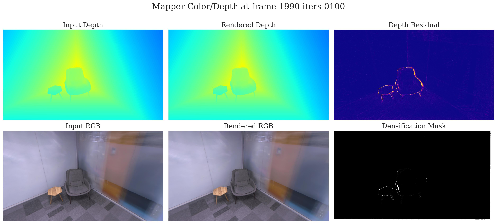
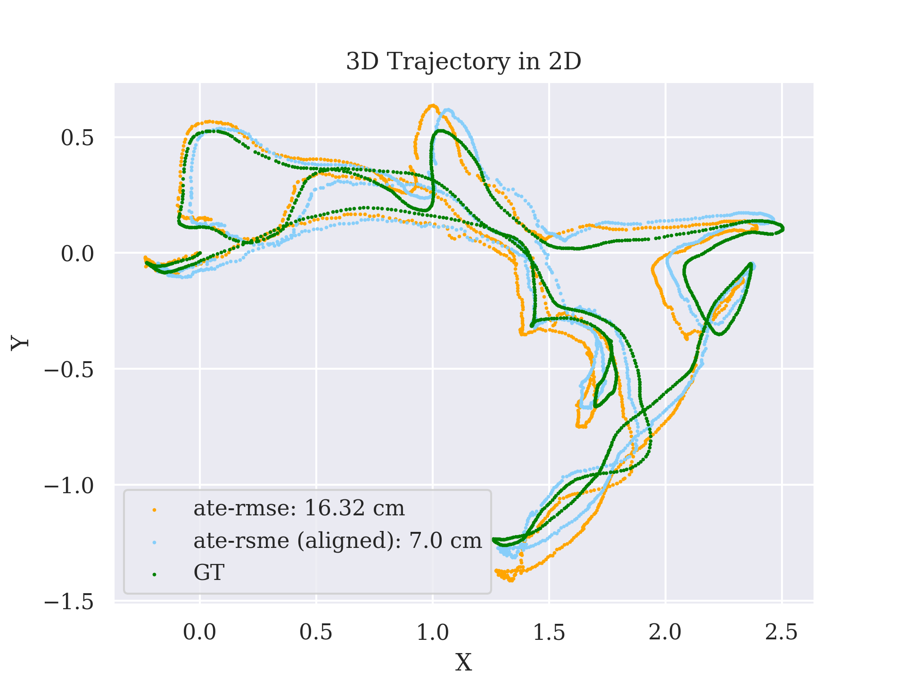

## 5 实验结果与讨论

### 5.1 TUM RGB-D：效率收益伴随场景相关的轨迹代价

完整 TUM 结果见[表 2](../tables/tum-results.md)。从宏平均看，GI-KF+Pyramid 将持久关键帧从 1,690.8 降到 610.4，减少 63.9%。固定观测视角 PSNR 从 13.257 提高到 13.470 dB，MS-SSIM 从 0.4675 提高到 0.4807，LPIPS 从 0.5611 降到 0.5438，Depth L1 从 0.3244 降到 0.3136。与此同时，轨迹指标变差：宏平均 ATE 从 3.309 增至 5.887 cm，RPE-t 从 0.0069 增至 0.0128 m，RPE-r 从 0.441° 增至 0.582°。

这一轨迹均值必须结合逐场景结果解释。在 A2 上，GI-KF+Pyramid 将 ATE 从 3.795 降至 3.322 cm，PSNR 提高 1.093 dB。在 A4 上，其 ATE 为 1.395 cm，Baseline 为 1.264 cm，而关键帧由 3,397 降至 1,136。A1 与 A5 出现中等程度的轨迹退化。A3 是决定性的失败案例：GI-KF 单独使用时的 ATE 达到 563.912 cm，Baseline 仅为 7.005 cm。加入金字塔后，该值降为 18.782 cm，但仍未恢复到基线；Pyramid 单独使用在 A3 上也得到 18.960 cm。现有日志只能证明各策略对该序列的响应不同，尚不能确定唯一物理原因，因此本文不把失败归因于某个未经验证的场景属性。

GI-KF 单独结果说明不能脱离逐场景数据解读平均值。其 TUM 宏平均渲染指标改善到 13.680 dB PSNR、0.4857 MS-SSIM 和 0.5356 LPIPS，但 A3 的轨迹失败使宏平均 ATE 升至 114.970 cm。该策略对资源控制和已观测视角重建有价值，但当前间隔与支撑规则尚不能保证 TUM 轨迹的一致可靠性。组合策略在轨迹上更保守，是本文策略中更合适的 TUM 折中点，不过其 ATE 仍不及 Baseline。

### 5.2 Replica：预算匹配的关键帧策略较稳定

Replica 结果见[表 3](../tables/replica-results.md)。预算匹配的 GI-KF+Pyramid 将宏平均关键帧由 426.5 降至 357.0，减少 16.3%，且没有出现类似 TUM A3 的轨迹失败。宏平均 ATE 从 0.292 降至 0.262 cm，RPE-t 从 0.000632 降至 0.000594 m，RPE-r 则从 0.0202° 略增至 0.0209°。PSNR 同时从 28.168 提高到 28.606 dB，MS-SSIM 从 0.9328 提高到 0.9381，LPIPS 从 0.1164 降到 0.1139，Depth L1 从 0.0291 降到 0.0255。

逐场景结果表明，宏平均并非由单一房间决定。GI-KF+Pyramid 在八个场景中的六个提高了 PSNR，在五个场景中降低了 ATE。R1、R7、R8 的 ATE 略高于 Baseline，R2 与 R7 的 PSNR 低于 Baseline。组合策略在 R4 上取得最大的 Depth L1 降幅，从 0.0513 降到 0.0406。R5 的 PSNR 增益最大，为 0.997 dB，其 Depth L1 从 0.0490 降到 0.0405。

单策略结果进一步解释了模块交互。Pyramid 的宏平均 ATE 最低，为 0.252 cm，但 LPIPS 增至 0.1220。GI-KF 得到 0.271 cm ATE、28.416 dB PSNR 和 0.1096 LPIPS，同时使用 357.2 个关键帧。组合策略取得最高的宏平均 PSNR、MS-SSIM 和最低 Depth L1，但没有同时继承单模块最优的 LPIPS 或 ATE。因此，Replica 上的主要结论是质量与效率的均衡改善，而非所有指标全面占优。

### 5.3 FMDataset：惯性与建图模块消融

FMDataset 的固定观测视角结果见[表 4](../tables/fm-results.md)。由于缺少参考轨迹，本文不对定位精度作结论。ALL 将宏平均 PSNR 从 13.920 提高到 15.080 dB，MS-SSIM 从 0.5903 提高到 0.6107；LPIPS 从 0.7384 降到 0.6722，Depth L1 从 0.9657 降到 0.7181，深度误差减少 25.6%。持久关键帧从 780.0 降到 325.0，减少 58.3%。

完整组合在 C1–C3 上均同时改善 Baseline 的 PSNR、MS-SSIM、LPIPS 与深度，但并非每个单项都为所有策略中最佳。例如 C3 上，ALL 达到 16.186 dB PSNR 和 0.3757 Depth L1，Baseline 分别为 14.081 dB 和 0.6774。C1 上 GI-KF+Pyramid 的 PSNR 略高于 ALL，分别为 13.684 与 13.619 dB；ALL 的 LPIPS 则更低，分别为 0.6772 与 0.7166。

IMU 单独使用呈现混合证据。其宏平均 PSNR 增加 0.230 dB，LPIPS 降低 2.6%，Depth L1 降低 18.6%，但 MS-SSIM 从 0.5903 降到 0.5781。逐场景数据解释了这种分歧：PSNR 在 C1、C2 上提高，却在 C3 上由 14.081 降至 13.730 dB；LPIPS 在 C1 上变差，在 C2、C3 上改善。因此，旋转先验能为部分测量提供有用信息，但单独使用时并非跨指标一致改善。

资源收益主要来自建图模块。GI-KF 单独使用将 C 组关键帧减少 58.5%，宏平均用时减少 14.6%，峰值 PyTorch 已分配显存减少 49.6%；PSNR 提高 0.591 dB，而 Depth L1 仅从 0.9657 变为 0.9534。Pyramid 单独使用不改变关键帧数量，却将 Depth L1 降低 19.1%。GI-KF 与 Pyramid 组合后得到 14.639 dB PSNR、0.6178 MS-SSIM 和 0.7478 Depth L1。在此基础上加入 IMU 形成 ALL，PSNR、LPIPS 与深度继续改善，但 MS-SSIM 从 0.6178 降至 0.6107。

### 5.4 时间、显存与持久地图规模

[表 5](../tables/efficiency-results.md)中的配对测量避免把 GPU 差异误认为策略收益。在五个 TUM 场景上，GI-KF+Pyramid 将持久关键帧减少 55.0%–66.6%，用时减少 9.0%–21.1%；峰值 PyTorch 已分配显存降幅从 A1 的 47.8% 到 A3 的 54.2%。这些资源节省较明显，但第 5.1 节表明其代价是与场景相关的轨迹误差。

Replica 每个场景的所有策略均运行在同一 RTX 4080 SUPER 环境。GI-KF+Pyramid 在 R1–R8 上将持久关键帧减少 14.8%–18.7%，用时减少 2.5%–20.0%。宏平均峰值 PyTorch 已分配显存仅由 6.947 降到 6.875 GiB，说明 Replica 的峰值 PyTorch 已分配显存并不主要由这部分持久帧数量决定；即使保留观测减少，渲染器和活动高斯状态仍常驻显存。

全部 FMDataset 配置均使用 22-GiB RTX 2080 Ti 环境。ALL 在宏平均上将峰值 PyTorch 已分配显存从 7.197 降到 3.770 GiB，关键帧从 780.0 降到 325.0。其用时为 2.576 小时，Baseline 为 2.607 小时，但逐场景变化从 C1 减少 7.5% 到 C3 增加 6.9%。IMU 单独使用使时间增加 13.7%、显存增加 7.5%，因此 ALL 接近不变的总体用时反映的是 GI-KF 节省与惯性、建图额外开销的抵消。

表 5 还报告了临时支撑路径。TUM GI-KF+Pyramid 平均包含 610.4 个持久关键帧和 1080.4 次支撑更新，两者合计对应 1690.8 个处理帧；支撑更新耗时为 351.4 s。FMDataset ALL 平均包含 325.0 个持久关键帧和 455.0 次支撑更新，合计对应 780.0 帧，支撑更新耗时为 154.0 s。每次支撑更新仅执行 20 次迭代，随后丢弃该观测。因此，关键帧降幅衡量的是持久存储与完整关键帧优化的减少，并不表示所有地图更新事件按同等比例减少。

持久关键帧数量不能等同于子图数量。Replica 所有策略的宏平均子图数均为 33.25，尽管关键帧预算不同。TUM 上 GI-KF 单独使用把宏平均子图数从 20.2 增至 46.6，而 GI-KF+Pyramid 为 20.6。子图创建仍受既有边界逻辑控制，减少持久建图帧并不必然减少子图。

### 5.5 策略交互与实际选择

图 3 表明，实验改善不能由某个单一模块完全解释。金字塔几乎不改变关键帧数量，但能明显改善 FMDataset 深度。GI-KF 贡献了主要的持久地图和显存节省，其 TUM 轨迹表现却依赖场景。惯性正则的权重较弱，不同质量指标的变化方向并不一致。三者组合在 FMDataset 上取得最强总体质量，在 Replica 上形成较均衡结果，而 TUM 仍保留轨迹代价。

当部署资源受限时，GI-KF+Pyramid 或 ALL 可作为候选工作点，但应先针对目标运动模式验证。对于重视轨迹的 TUM 类应用，现有证据下 Baseline 更稳妥；A3 是不能忽略的反例，排除了普遍鲁棒性的表述。Azure Kinect 序列可以展示工程运行情况，但因无参考轨迹，不能消除这一限制。

### 5.6 定性诊断

图 5 和图 6 给出 Replica R5 在第 1990 帧保存的最终在线建图诊断。Baseline 面板显示其日志中的迭代计数 1000，GI-KF+Pyramid 则在其配置的建图预算下显示 100。每个面板并列展示输入与渲染的 RGB-D 观测、深度残差和致密化掩码。这些图是已观测帧上的优化快照，不是留出视角结果或完整全局地图渲染。

图 7 和图 8 展示 A3 轨迹反例。Baseline 经刚性对齐后的 ATE 为 7.005 cm，GI-KF 则发散至 563.912 cm。这一对照也说明，已观测视角渲染分数不能代替全局轨迹精度。

### 5.7 有效性边界

实验比较了 70 个受控的场景-策略配置。跨场景宏平均用于描述本实验集合，但不能衡量随机不确定性。固定观测视角协议评测的是输入采样视角上的重建一致性，不代表未知视角泛化。FMDataset 可以支持带 IMU 的质量消融，但不能支持轨迹结论。最后，两种 GPU 型号使不同运行环境场景之间的绝对用时不可直接比较，因此效率讨论只依据同场景差值。
