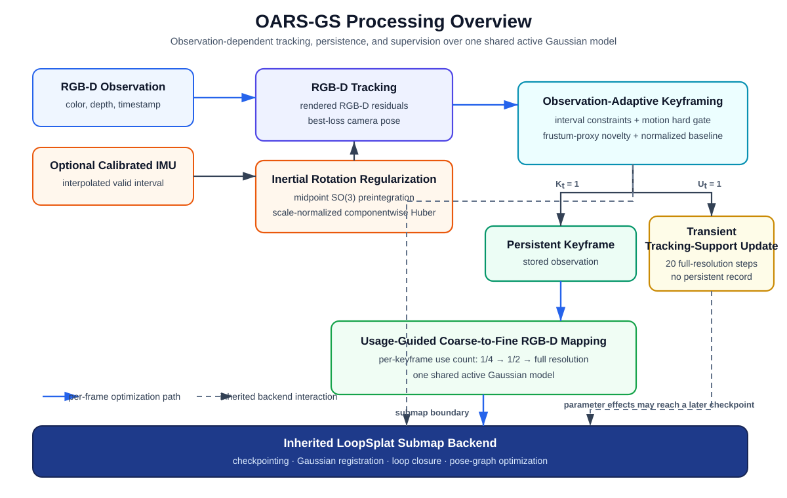
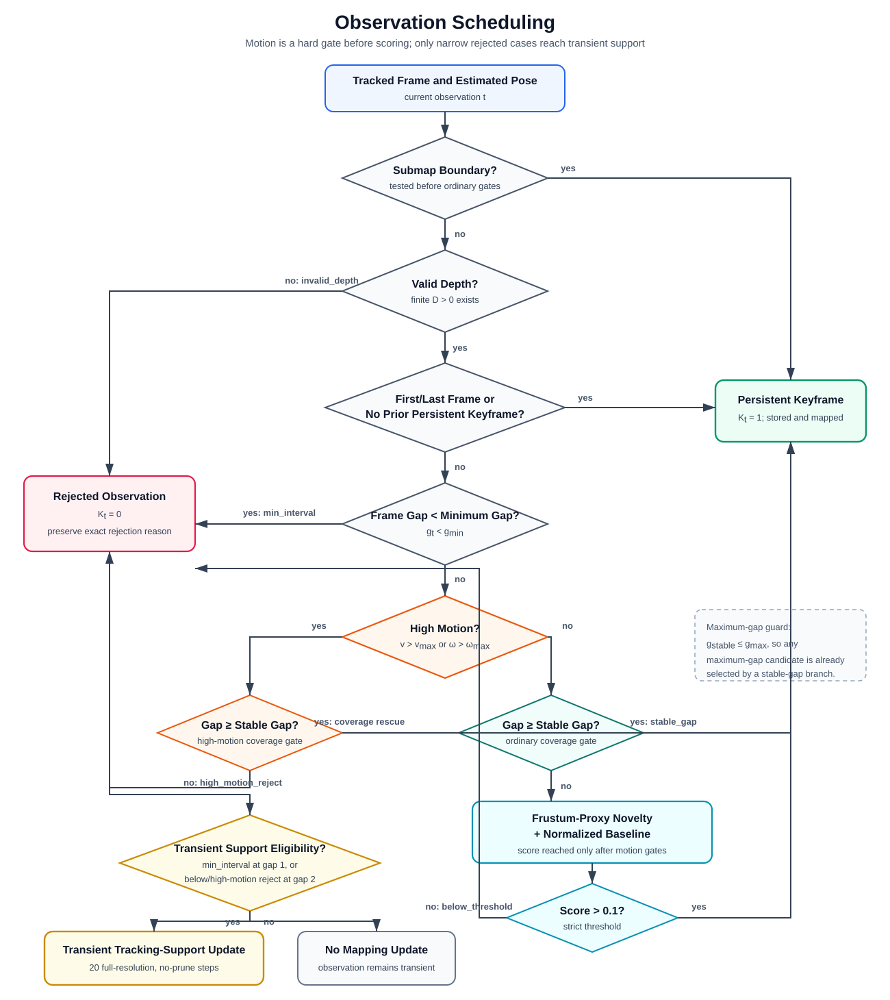
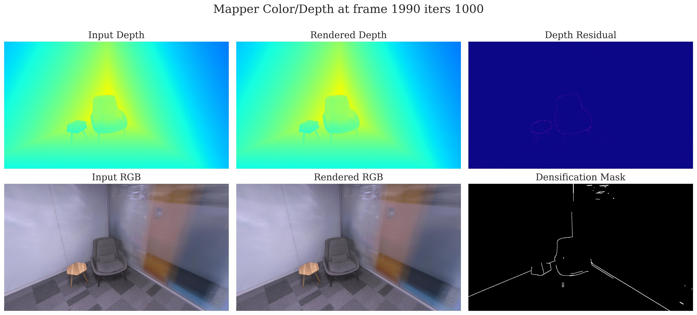

# OARS-GS: Observation-Adaptive Keyframing, Inertial Rotation Regularization, and Coarse-to-Fine RGB-D Mapping for Gaussian SLAM

## Abstract

Online Gaussian SLAM must decide how much trust, persistence, and optimization effort to assign to each RGB-D observation. Treating all observations similarly leaves three practical gaps: a visual tracker has no independent rotational cue during difficult motion, every selected view can remain a persistent mapping burden, and repeated full-resolution supervision spends early mapping effort on detail before coarse structure has settled. This paper asks whether those decisions can be adapted to observation state and optimization history without changing the inherited global SLAM backend. We present OARS-GS, a front-end method for Gaussian SLAM with three coupled decisions. It applies gyroscope midpoint preintegration as a weak SO(3) rotation regularizer, admits persistent keyframes through validity, spacing, and motion gates followed by a current-map frustum and baseline score, and schedules RGB-D supervision for each persistent keyframe from coarse to full resolution according to its completed optimizer uses. A narrowly defined rejected observation may provide a transient full-resolution tracking-support update without entering persistent records. The renderer, submap registration, loop closure, and pose-graph correction are inherited from LoopSplat. On eight Replica scenes, GI-KF+Pyramid reduces persistent keyframes by 16.30%, raises fixed-observed-view PSNR by 0.438 dB, and lowers Depth L1 by 12.59% relative to the inherited Baseline. On three FMDataset sequences, the full configuration raises fixed-observed-view PSNR by 1.159 dB and reduces Depth L1 and persistent keyframes by 25.64% and 58.33%. These are fixed-seed, observed-view comparisons; FMDataset records contain no trajectory ground truth. TUM A3 is a counterexample in which GI-KF reaches 563.912 cm aligned ATE versus 7.005 cm for Baseline, so the method does not support a general tracking-improvement claim.

# 1. Introduction

Online dense SLAM has to turn a stream of RGB-D measurements into pose estimates and a map before the next measurement arrives. Explicit 3-D Gaussian splatting makes a useful representation for this setting because it renders a scene by optimizing directly parameterized Gaussian primitives [@kerbl2023_3dgs]. LoopSplat provides a Gaussian-submap backend that registers submaps and applies loop closure and pose-graph correction [@zhu2025_loopsplat]. Recent Gaussian SLAM systems show that this representation can support online tracking and mapping with different choices of map growth, supervision, and camera optimization [@keetha2024_splatam; @yan2024_gsslam; @matsuki2024_gaussiansplatting; @huang2024_photoslam]. The present work retains the LoopSplat backend operations and asks a narrower question about the front end: how should it decide which incoming observations deserve rotational trust, persistent storage, and mapping work?

Online mapping is governed by the observation stream as much as by the scene representation. Earlier dense RGB-D systems established real-time fusion and deformable surfel mapping [@newcombe2011_kinectfusion; @whelan2016_elasticfusion], while sparse systems made keyframe retention central to tracking and loop maintenance [@murartal2017_orbslam2]. Neural dense SLAM moved the same trade-off into active-frame selection, local scene representations, and joint optimization [@sucar2021_imap; @zhu2022_niceslam; @sandstrom2023_pointslam; @yang2022_voxfusion; @wang2023_coslam; @johari2023_eslam; @tang2023_mipsfusion]. Systems that pursue global consistency likewise separate local mapping from later loop and global optimization [@liso2024_loopyslam; @zhang2023_goslam]. None of these choices removes the need to decide, at the time an observation arrives, whether it should constrain the current pose, persist as a keyframe, or receive repeated high-resolution supervision.

We identify three observation-use problems in the inherited online Gaussian setting. First, purely visual RGB-D tracking can be rotationally ambiguous during rapid motion or visual degradation. Full visual-inertial systems address a broader estimation problem by including inertial state variables, biases, gravity, and temporal constraints [@campos2021_orbslam3; @forster2017_preintegration; @leutenegger2015_keyframevio], and Gaussian systems have also combined visual, depth, and inertial data [@sun2024_mm3dgsslam; @wu2025_vingsmono]. Our configuration does not attempt that estimator. Instead, it tests whether a calibrated gyroscope interval can add a robust, weak SO(3) preference during visual pose optimization. The penalty follows midpoint preintegration and a componentwise Huber construction [@huber1964_robust], while the formal translation weight is zero.

Second, a fixed keyframe cadence cannot distinguish a view with little map novelty from one that supplies a useful baseline. Persisting both is costly because a persistent keyframe affects stored observations and later full mapping optimization; rejecting every near-term view is also unsafe because local map updates may become sparse. Third, applying full-resolution RGB-D supervision each time a keyframe is sampled overlooks the staged character of online optimization. Classical filtered image pyramids support a coarse-to-fine progression [@burt1981_fastfilter; @burt1983_pyramid], whereas hierarchical Gaussian rendering changes the representation itself [@kerbl2024_hierarchical]. OARS-GS changes neither the active Gaussian representation nor its level of detail. It schedules only the rasterized RGB-D targets used to supervise one Gaussian model.

We study whether an online Gaussian SLAM front end can adapt rotational regularization, persistent observation admission, and supervision resolution to the current observation and its optimization history while preserving useful reconstruction and resource trade-offs. OARS-GS, Observation-Adaptive and Rotation-Regularized Scheduling for Gaussian Splatting SLAM, combines a valid-interval gyroscope rotation residual, a gate-first persistent-keyframe policy with a transient support alternative, and a per-keyframe usage-guided RGB-D schedule. The three choices act on a shared live Gaussian map and are evaluated independently before their compatibility is examined together.

The evaluation uses five TUM RGB-D sequences, eight Replica scenes, and three FMDataset sequences. TUM provides aligned trajectory metrics under rigid SE(3) alignment [@sturm2012_tumrgbd; @horn1987_absoluteorientation]. FMDataset contributes synchronized RGB-D and inertial observations [@zhu2019_fmdataset], but its experiment records do not contain trajectory truth. We report fixed-observed-view PSNR, MS-SSIM, LPIPS, and Depth L1, following their respective image-quality definitions [@wang2003_msssim; @wang2004_ssim; @zhang2018_lpips]. Each scene and strategy uses a fixed selected seed, so cross-scene macro values are descriptive rather than multi-seed estimates. GI-KF+Pyramid can reduce persistent observations while retaining or improving several observed-view measures on the Replica group, and the FMDataset full configuration improves several reconstruction measures under the recorded protocol. The material failure on TUM A3 sets an explicit limit on any tracking claim.

This paper makes four contributions:

1. A gyroscope midpoint-preintegration rotation regularizer for RGB-D Gaussian tracking, with validity rejection, SO(3) residuals, scale-normalized componentwise Huber penalties, and a formal inertial translation weight of zero.
2. An observation-adaptive persistent-keyframe rule that combines validity, spacing, and motion hard gates with a current-center frustum proxy and depth-normalized baseline. It also defines transient tracking-support updates that alter the live map without becoming persistent keyframes.
3. A usage-guided coarse-to-fine RGB-D supervision schedule that generates valid-depth-aware targets and advances each persistent keyframe through resolution levels only when that keyframe is sampled for completed mapping updates.
4. An evaluation over TUM RGB-D, Replica, and FMDataset that reports single-component ablations, combined compatibility, paired resource measurements on compatible hardware, and the TUM A3 failure case alongside fixed-observed-view reconstruction results.

The rest of the paper places OARS-GS in the dense, visual-inertial, observation-management, and multiresolution literature; derives the method; evaluates it under the stated protocol; and returns to the boundary exposed by the counterexample.

# 2. Related Work

## 2.1. Dense and Gaussian SLAM

Dense SLAM systems differ in how they trade geometric fidelity, rendering quality, and online optimization cost. Volumetric fusion established real-time RGB-D reconstruction with a geometric map, while surfel systems coupled dense tracking and fusion with local and global deformation [@newcombe2011_kinectfusion; @whelan2016_elasticfusion]. Neural implicit systems subsequently represented geometry and appearance with continuous functions or learned spatial encodings. Their designs range from a single jointly optimized scene function to hierarchical grids, sparse voxels, hybrid coordinate encodings, neural points, and local implicit submaps [@sucar2021_imap; @zhu2022_niceslam; @yang2022_voxfusion; @wang2023_coslam; @johari2023_eslam; @sandstrom2023_pointslam; @tang2023_mipsfusion]. These representations improve different aspects of locality and reconstruction, but their online cost still depends on which observations remain active and how often they are revisited.

Differentiable 3-D Gaussian splatting provides an explicit scene representation with fast rasterization and direct appearance optimization [@kerbl2023_3dgs]. Published Gaussian SLAM systems adapt it to RGB-D or direct visual tracking through different choices of map growth, geometric supervision, Gaussian selection, and camera optimization [@keetha2024_splatam; @yan2024_gsslam; @matsuki2024_gaussiansplatting; @huang2024_photoslam]. Global consistency remains a separate systems problem: dense methods use loop detection and global optimization, while LoopSplat registers Gaussian submaps and corrects their poses through its loop-closing backend [@zhang2023_goslam; @liso2024_loopyslam; @zhu2025_loopsplat]. OARS-GS retains that backend. Its target is the unresolved front-end question of how an online Gaussian system should use incoming observations before inherited submap registration and pose-graph correction.

## 2.2. Visual-inertial tracking

Visual-inertial estimation usually introduces an inertial state, biases, gravity, and temporal constraints into a joint estimator. Keyframe-based visual-inertial odometry and ORB-SLAM3 exemplify bounded nonlinear optimization and multimap visual-inertial SLAM, while on-manifold preintegration summarizes high-rate inertial samples between image timestamps [@leutenegger2015_keyframevio; @campos2021_orbslam3; @forster2017_preintegration]. Gaussian systems have also incorporated vision, depth, and inertial measurements, including multimodal RGB-D Gaussian SLAM and large-scene monocular visual-inertial Gaussian mapping [@sun2024_mm3dgsslam; @wu2025_vingsmono].

Those systems define a broader estimation problem than the one studied here. OARS-GS asks whether calibrated gyroscope intervals can supply a weak rotation regularizer inside an existing RGB-D Gaussian tracker without recasting the inherited backend as a full visual-inertial estimator. The formal method fixes the gyroscope bias and gives the computed inertial translation loss zero optimization weight. Its evidence must therefore be interpreted as an ablation of rotation regularization, not as evidence for joint velocity, gravity, bias, or inertial-translation estimation.

## 2.3. Keyframe and observation management

Keyframes limit repeated optimization and retain observations needed for tracking, mapping, and loop closure. Sparse SLAM makes this persistence decision central to map maintenance, and neural dense systems commonly optimize selected active frames rather than every past image [@murartal2017_orbslam2; @sucar2021_imap; @wang2023_coslam]. In Gaussian RGB-D SLAM, overlap-based selection provides a direct way to favor views that share map content [@keetha2024_splatam]. Overlap alone, however, does not settle how to combine cadence, motion state, persistent storage, and the short-term value of a rejected observation.

OARS-GS addresses that gap by separating two decisions. Observation-adaptive keyframing first applies hard validity, spacing, and motion gates before a current-Gaussian frustum-overlap and normalized-baseline score admits a persistent keyframe. A narrowly eligible rejected frame may then update the live Gaussian parameters through a transient tracking-support path without entering the keyframe record, checkpoint observation list, or loop database. This lifecycle distinction is specific to OARS-GS; the cited literature supplies the keyframe and overlap context, not evidence that prior systems use the same support policy.

## 2.4. Coarse-to-fine optimization

Image pyramids use filtered, progressively sampled representations to expose low-frequency structure before fine detail [@burt1981_fastfilter; @burt1983_pyramid]. Dense neural SLAM has exploited hierarchical or multiscale encodings to distribute representation capacity, and Gaussian SLAM has used coarse-to-fine Gaussian selection or multi-level Gaussian structures during tracking and mapping [@zhu2022_niceslam; @johari2023_eslam; @yan2024_gsslam; @huang2024_photoslam]. Hierarchical 3-D Gaussian rendering instead organizes the Gaussian representation itself for scale-dependent rendering [@kerbl2024_hierarchical].

OARS-GS uses a different control variable: the number of times each persistent keyframe has actually been selected for optimization. That count chooses coarse, intermediate, or full-resolution RGB-D supervision for a single active Gaussian model. The method neither creates a Gaussian level-of-detail hierarchy nor assumes that a finite online budget lets every keyframe complete every stage. The experiments test whether this usage-guided supervision schedule complements observation admission under a fixed online mapping budget.

# 3. OARS-GS

OARS-GS changes how an online Gaussian SLAM system uses incoming observations. It adds a weak gyroscope-derived rotation regularizer to camera tracking, admits persistent keyframes according to the current observation and motion state, assigns a narrow class of rejected observations to transient tracking-support updates, and schedules persistent-keyframe supervision from coarse to full resolution. Figure 1 summarizes these paths. The renderer, Gaussian parameterization, submap construction, Gaussian-to-Gaussian registration, loop closure, and pose-graph optimization are inherited from LoopSplat [@zhu2025_loopsplat]; they are not introduced by OARS-GS.

{#fig:oars-gs-overview}

## 3.1. System overview and preliminaries

At frame \(t\), the system receives an RGB-D observation \(\mathcal{O}_t=(C_t,D_t,\tau_t)\), where \(C_t\in[0,1]^{3\times H\times W}\) is color, \(D_t\in\mathbb{R}^{H\times W}\) is metric depth, and \(\tau_t\) is the camera timestamp. On sequences that provide calibrated inertial data, the interval \((\tau_{t-1},\tau_t)\) also supplies accelerometer and gyroscope samples \((a_k^I,\omega_k^I,\tau_k^I)\) expressed in the IMU frame \(I\). We write \(T_t^{CW}\in SE(3)\) for the world-to-camera pose, \(T_t^{WC}=(T_t^{CW})^{-1}\), and \(c_t\in\mathbb{R}^3\) for the camera center in world coordinates. An active submap contains \(N\) 3-D Gaussians [@kerbl2023_3dgs]:

\[
\Theta_G=\{g_i\}_{i=1}^{N},\qquad
g_i=(\mu_i,q_i,s_i,o_i,h_i),
\quad
\mathcal{R}(\Theta_G,T_t^{CW})=(\widehat C_t,\widehat D_t,\widehat A_t),
\tag{1}
\]

where \(\mu_i\in\mathbb{R}^3\), \(q_i\), \(s_i\in\mathbb{R}_{+}^{3}\), \(o_i\in[0,1]\), and \(h_i\) denote center, rotation quaternion, scale, opacity, and color features, respectively. The shared differentiable renderer \(\mathcal{R}\) returns color, depth, and alpha images. Tracking optimizes only the current relative camera transform (and exposure parameters when enabled) against the fixed active Gaussian parameters. Its objective is

\[
\mathcal{L}_{\mathrm{track}}=
w_C\mathcal{L}^{\mathrm{trk}}_{1,C}
{} +(1-w_C)\mathcal{L}^{\mathrm{trk}}_{1,D}
{} +\mathcal{L}_{R}+\mathcal{L}_{T},
\tag{2}
\]

where the RGB and depth terms are renderer residuals over the tracker validity mask, \(w_C=0.6\) in the FMDataset configuration, and \(\mathcal{L}_{R}\) and \(\mathcal{L}_{T}\) are the inertial rotation and translation terms defined below. The best-loss pose seen during the tracking iterations is retained. Persistent mapping then updates the same \(\Theta_G\), may seed Gaussians from a selected keyframe, and stores that observation in the inherited submap record. At a submap boundary, the inherited backend checkpoints the previous active submap, performs loop processing and any pose-graph correction, and initializes the next active model.

## 3.2. Inertial rotation regularization

The inertial path is enabled only when the dataset exposes an interval interface and \(t>0\). For FMDataset, the RGB-D endpoints, after the configured time offset \(o_\tau\), are inserted by componentwise linear interpolation; strictly internal IMU samples are retained. Thus

\[
\begin{aligned}
\mathcal{I}_t
&=\big((\widetilde a_{t,k}^I,\widetilde\omega_{t,k}^I,
\widetilde\tau_{t,k})\big)_{k=0}^{m_t-1},\\
\widetilde\tau_{t,0}&=\tau_{t-1}+o_\tau,\qquad
\widetilde\tau_{t,m_t-1}=\tau_t+o_\tau,\\
\{\widetilde\tau_{t,k}\}_{k=1}^{m_t-2}
&=\{\tau_j^I:\tau_{t-1}+o_\tau<\tau_j^I<\tau_t+o_\tau\}
\quad\text{in increasing order},
\end{aligned}
\tag{3}
\]

where \(m_t=|\mathcal{I}_t|\) is the ordered interval sample count. The endpoint measurements \((\widetilde a_{t,0}^I,\widetilde\omega_{t,0}^I)\) and \((\widetilde a_{t,m_t-1}^I,\widetilde\omega_{t,m_t-1}^I)\) are obtained by componentwise linear interpolation; internal tilded values equal their retained IMU samples. An interval is rejected if it is not covered by the IMU stream, has fewer than two samples, contains non-finite values, has non-increasing timestamps, exceeds \(0.2\,\mathrm{s}\), or exceeds the configured acceleration or angular-rate bounds (\(50\,\mathrm{m\,s^{-2}}\) and \(20\,\mathrm{rad\,s^{-1}}\) in the formal configuration). Rejection sets both inertial contributions in Eq. (2) to zero.

Let \(T_{CI}=[R_{CI},t_{CI};0,1]\) be the fixed IMU-to-camera calibration and \(b_g\) the fixed gyroscope bias. For adjacent ordered samples \(k,k+1\), midpoint SO(3) preintegration [@forster2017_preintegration] is

\[
\bar\omega_{t,k}^C=
R_{CI}\!\left(
\frac{\widetilde\omega_{t,k}^I+\widetilde\omega_{t,k+1}^I}{2}-b_g
\right),
\qquad
\Delta\widehat R_t^C=\prod_{k=0}^{m_t-2}
\operatorname{Exp}\!\left(\bar\omega_{t,k}^C\Delta\widetilde\tau_{t,k}\right),
\tag{4}
\]

where \(\Delta\widetilde\tau_{t,k}=\widetilde\tau_{t,k+1}-\widetilde\tau_{t,k}\), and the product right-multiplies increments in increasing time order. The superscript \(C\) states that the prediction is expressed in camera coordinates after applying \(R_{CI}\); the hat distinguishes the inertial prediction from the visual relative motion. The formal runs use \(b_g=(0,0,0)^\top\), and the bias is not optimized. The visual relative motion evaluated at each differentiable tracking iteration is

\[
\Delta T_t^V=T_{t-1}^{CW}T_t^{WC},
\qquad
r_{R,t}=\operatorname{Log}\!\left((\Delta\widehat R_t^C)^\top\Delta R_t^V\right)\in\mathbb{R}^{3},
\tag{5}
\]

where \(\Delta R_t^V\) is the rotation block of \(\Delta T_t^V\), and \(\operatorname{Exp}\) and \(\operatorname{Log}\) are the SO(3) exponential and logarithm maps. We use the scalar Huber function [@huber1964_robust]

\[
\rho_\kappa(x)=
\begin{cases}
\tfrac{1}{2}x^2, & |x|\le\kappa,\\
\kappa(|x|-\tfrac{1}{2}\kappa), & |x|>\kappa,
\end{cases}
\tag{6}
\]

componentwise after physical-scale normalization:

\[
\mathcal{L}_{R}=\lambda_R
\sum_{j=1}^{3}
\rho_{\delta_R/s_R}\!\left(\frac{r_{R,t,j}}{s_R}\right),
\qquad
(\lambda_R,s_R,\delta_R)=(10^{-3},0.01\,\mathrm{rad},0.1\,\mathrm{rad}).
\tag{7}
\]

This is a sum of three robust scalar residuals, not a Huber penalty on the vector norm. When a stationary interval has initialized a fixed gravity direction, the implementation can also integrate acceleration, include the calibrated lever arm, and form a camera-coordinate translation prediction \(\widehat p_t^C\). A valid translation residual and its loss are

\[
r_{p,t}=\Delta t_t^V-\widehat p_t^C,
\qquad
\mathcal{L}_{T}=\lambda_T
\sum_{j=1}^{3}\rho_{\delta_T/s_T}\!\left(\frac{r_{p,t,j}}{s_T}\right),
\qquad
(\lambda_T,s_T,\delta_T)=(0,0.05\,\mathrm{m},0.1\,\mathrm{m}).
\tag{8}
\]

Here \(\Delta t_t^V\) is the translation block of \(\Delta T_t^V\). Equation (8) may be evaluated for diagnostics, but its formal optimization contribution is exactly zero because \(\lambda_T=0\). OARS-GS therefore uses inertial data as a rotation regularizer; it does not jointly optimize velocity, gravity, or sensor bias. The regularizer acts inside each valid tracking iteration, and the final visual pose is then used to update the diagnostic inertial state.

## 3.3. Observation-adaptive keyframing

Overlap-based observation selection already appears in published Gaussian RGB-D SLAM; SplaTAM, for example, uses overlap information in its keyframe management [@keetha2024_splatam]. OARS-GS does not treat overlap itself as the distinguishing mechanism. The implementation studied here places submap, depth, interval, and motion hard gates before a current-center frustum-proxy score, and couples persistent admission to the separately defined transient support lifecycle in Section 3.4.

After tracking, persistent-keyframe admission compares the observation with the temporally latest persistent keyframe \(k\). The visibility proxy projects the centers of the *current* active Gaussians into each camera. With \(\pi_i(T,D)=1\) when center \(\mu_i\) has positive camera-space depth and lies inside the image frustum used with depth image \(D\), define

\[
V_t=\{i\in\{1,\ldots,N\}:\pi_i(T_t^{CW},D_t)=1\},
\qquad
V_k=\{i\in\{1,\ldots,N\}:\pi_i(T_k^{CW},D_k)=1\}.
\tag{9}
\]

These sets are a Gaussian-center frustum proxy. They do not use opacity, rendered occlusion, footprint coverage, or a historical snapshot of the Gaussian parameters. Their intersection-over-union and novelty are

\[
J_{t,k}=
\begin{cases}
\dfrac{|V_t\cap V_k|}{|V_t\cup V_k|}, & |V_t\cup V_k|>0,\\
1, & |V_t\cup V_k|=0,
\end{cases}
\qquad
\nu_{t,k}=1-J_{t,k}.
\tag{10}
\]

Let \(\mathcal{P}_t^+=\{p:D_t(p)>0\ \wedge\ D_t(p)\text{ is finite}\}\). The normalized baseline is

\[
b_{t,k}=\frac{\|c_t-c_k\|_2}
{\max\!\left(\operatorname{median}_{p\in\mathcal{P}_t^+}D_t(p),10^{-6}\right)},
\tag{11}
\]

and the score reached after all earlier gates is

\[
S_{t,k}=w_{\mathrm{cov}}\nu_{t,k}+w_{\mathrm{base}}b_{t,k},
\qquad
(w_{\mathrm{cov}},w_{\mathrm{base}},\tau_S)=(1,1,0.1),
\tag{12}
\]

with score admission only when \(S_{t,k}>\tau_S\). Although the implementation records a motion-penalty diagnostic, high motion cannot reach Eq. (12): it is handled by a preceding hard gate. Let \(\Delta\tau_t^{\mathrm{cam}}\) be the adjacent camera timestamp difference (or the reciprocal configured frame rate if unavailable), and let \(v_t\) and \(\omega_t^V\) be the linear and angular speeds computed from the adjacent estimated poses. The formal runs disable the optional gyroscope aid in this gate. High motion is

\[
h_t=\mathbf{1}\!\left[v_t>v_{\max}\ \vee\
\omega_t^V>\omega_{\max}\right],
\qquad
(v_{\max},\omega_{\max})=(1.5\,\mathrm{m\,s^{-1}},120^\circ\,\mathrm{s^{-1}}).
\tag{13}
\]

Let \(g_t=t-k\), and let \(g_{\min}\), \(g_{\mathrm{stable}}\), and \(g_{\max}\) be the minimum, stable-coverage, and maximum gaps. The formal values are \((2,3,10)\) on TUM/FMDataset and \((5,6,10)\) on Replica. Subject to \(g_{\min}\le g_{\mathrm{stable}}\le g_{\max}\), the reachable decision is

\[
K_t=
\begin{cases}
1, & \text{submap boundary},\\
0, & \mathcal{P}_t^+=\varnothing,\\
1, & \text{first/last frame or no prior persistent keyframe},\\
0, & g_t<g_{\min},\\
0, & h_t=1\ \wedge\ g_t<g_{\mathrm{stable}},\\
1, & h_t=1\ \wedge\ g_t\ge g_{\mathrm{stable}},\\
1, & h_t=0\ \wedge\ g_t\ge g_{\mathrm{stable}},\\
\mathbf{1}[S_{t,k}>\tau_S], & \text{otherwise}.
\end{cases}
\tag{14}
\]

The submap-boundary test occurs outside the ordinary decision function and therefore precedes invalid-depth rejection. Inside that function, valid depth is required before any forced-frame result is returned. A candidate at \(g_t\ge g_{\max}\) is also at or beyond the stable gap and is therefore selected by one of the two coverage branches before scoring. Figure 2 shows this ordering and separates the persistent and transient outcomes.

{#fig:observation-scheduling}

## 3.4. Transient tracking-support update

Rejecting redundant observations reduces persistent storage and full mapping events, but a small subset can still provide useful local supervision. OARS-GS audits the keyframe rejection reason \(r_t\) and permits an update only for narrowly specified early gaps. With \(E\in\{0,1\}\) denoting whether support updates are enabled, eligibility is

\[
U_t=E(1-K_t)\,\mathbf{1}\!\left[
(r_t=\texttt{min\_interval}\ \wedge\ g_t=1)
\ \vee\
(r_t\in\{\texttt{below\_threshold},\texttt{high\_motion\_reject}\}\ \wedge\ g_t=2)
\right].
\tag{15}
\]

If \(U_t=1\), the observation runs 20 optimizer steps on the live Gaussian parameters at full resolution. The branch does not seed or grow Gaussians, does not prune them, and does not use or advance the pyramid schedule. It is mutually exclusive with persistent mapping. Replica disables this branch in the formal runs; TUM and FMDataset enable it.

The support observation is transient: its identifier and RGB-D data are absent from the persistent keyframe collection, submap checkpoint keyframe list, and loop database. The parameter update itself is not rolled back. Its effect on the live Gaussians can carry into a later checkpoint of that active submap. We reserve **persistent keyframe** for \(K_t=1\) and **transient tracking-support update** for \(U_t=1\) throughout.

## 3.5. Usage-guided coarse-to-fine RGB-D mapping

Classical image-pyramid processing establishes low-pass filtering and multiresolution image representations [@burt1981_fastfilter; @burt1983_pyramid], while Photo-SLAM applies a different multi-level mechanism to photorealistic Gaussian mapping [@huang2024_photoslam]. These precedents motivate coarse-to-fine supervision but do not define the construction or schedule below. OARS-GS uses valid-depth-weighted sublevels generated from each original observation and selects their resolution from an executed-optimizer-use count maintained independently for each persistent keyframe; the schedule changes supervision only, not the active Gaussian representation.

For every persistent keyframe, OARS-GS independently constructs \(L\) sub-resolution targets from the original RGB-D observation. At sublevel \(\ell\in\{0,\ldots,L-1\}\), from coarsest to finest, the scale and raster dimensions are

\[
a_\ell=2^{-(L-\ell)},\qquad
(H_\ell,W_\ell)=
\big(\max(1,\lfloor a_\ell H\rfloor),
\max(1,\lfloor a_\ell W\rfloor)\big),
\qquad
C_\ell=\mathcal{B}_{H_\ell,W_\ell}\!\left(\mathcal{A}_{k_\ell}(C)\right),
\tag{16}
\]

where \(\mathcal{B}\) is bilinear resize with unaligned corners. For \(a_\ell<1\), \(\sigma_\ell=0.5/a_\ell-0.5\) and \(k_\ell=\max(3,2\lfloor2\sigma_\ell\rfloor+1)\); \(\mathcal{A}_{k_\ell}\) is stride-one average pooling when \(\sigma_\ell>0.1\), and the identity otherwise. Each \(C_\ell\) is generated directly from \(C\), not recursively from the preceding sublevel.

Depth downsampling excludes invalid measurements. With \(M(p)=\mathbf{1}[D(p)>0\ \wedge\ D(p)\text{ finite}]\) and \(\mathcal{Q}_{H_\ell,W_\ell}\) denoting area resize,

\[
q_\ell=\mathcal{Q}_{H_\ell,W_\ell}(M),\qquad
M_\ell=\mathbf{1}[q_\ell>0],\qquad
D_\ell=M_\ell\odot
\frac{\mathcal{Q}_{H_\ell,W_\ell}(D\odot M)}
{\max(q_\ell,\varepsilon)},
\tag{17}
\]

where \(\varepsilon\) is the floating-point positive floor and invalid output pixels are set to zero. For the corresponding renderer, the implementation changes only \(\texttt{image\_width}\) and \(\texttt{image\_height}\) to \((W_\ell,H_\ell)\). It retains the full-resolution \(\texttt{tanfovx}\), \(\texttt{tanfovy}\), view matrix, projection matrix, and camera position:

\[
\mathcal{S}_\ell=
\operatorname{replace}(\mathcal{S}_{\mathrm{full}},
\texttt{image\_width}=W_\ell,
\texttt{image\_height}=H_\ell),
\quad
(\tan\phi_x,\tan\phi_y,V,P,c)_\ell
=(\tan\phi_x,\tan\phi_y,V,P,c)_{\mathrm{full}}.
\tag{18}
\]

Reduced raster dimensions with preserved normalized field of view induce the effective pixel-coordinate scale used by the lower-resolution supervision. The code does **not** explicitly rescale \(f_x,f_y,c_x,c_y\), and it does not rebuild the projection matrix for a sublevel.

The level is selected per persistent keyframe, not by global time. Let \(n_t\) be the number of completed optimizer steps in which keyframe \(t\) has actually been sampled, \(u\) the uses per level, and let level \(L\) denote full resolution. Before the next sampled optimization step,

\[
\ell_t(n_t)=\min\!\left(\left\lfloor\frac{n_t}{u}\right\rfloor,L\right),
\qquad
n_t\leftarrow n_t+1\ \text{only after an optimizer step is executed}.
\tag{19}
\]

The formal setting \(L=2,u=8\) gives \(1/4\) resolution for uses 1--8, \(1/2\) resolution for uses 9--16, and full resolution thereafter. A finite mapping budget and stochastic keyframe sampling do not guarantee that every keyframe reaches full resolution. Counts reset for a new submap, and support updates do not advance them. All levels optimize the same \(\Theta_G\); only the rasterized supervision changes.

At the selected resolution, let \(\widehat C_t^\ell,\widehat D_t^\ell\) be the render and let \(\Omega_t^\ell=\{p:M_t^\ell(p)=1,\widehat D_t^\ell(p)\text{ finite}\}\). The mapping loss is

\[
\begin{aligned}
\mathcal{L}_{\mathrm{map}}^\ell={}&
(1-\lambda_{\mathrm{ssim}})
\operatorname*{mean}_{c,\,p\in\Omega_t^\ell}
|\widehat C_t^\ell(c,p)-C_t^\ell(c,p)|\\
&+\lambda_{\mathrm{ssim}}
\big(1-\operatorname{SSIM}(\widehat C_t^\ell,C_t^\ell)\big)
{} +\operatorname*{mean}_{p\in\Omega_t^\ell}
|\widehat D_t^\ell(p)-D_t^\ell(p)|
{} +\mathcal{L}_{\mathrm{iso}},
\qquad \lambda_{\mathrm{ssim}}=0.2,
\end{aligned}
\tag{20}
\]

where \(\mathcal{L}_{\mathrm{iso}}\) is the inherited soft scale-isotropy penalty. The RGB and depth L1 terms share the valid-depth mask, whereas SSIM [@wang2004_ssim] is computed on the complete RGB image at the selected resolution.

## 3.6. Online algorithm

Algorithm 1 records the executed branch order. Inertial prediction is prepared before visual optimization and its valid rotation term is evaluated inside tracking. Keyframe and support decisions are made from the resulting pose. A submap boundary invokes the inherited backend before the boundary keyframe initializes and optimizes the new active submap.

**Algorithm 1: OARS-GS online processing**

~~~text
Input: RGB-D sequence {O_t}; optional calibrated IMU stream;
       active Gaussian submap Theta_G; inherited LoopSplat backend
Output: estimated poses and inherited persistent submap records

for t = 0, ..., T - 1 do
    if a non-GT tracking path is active then
        form interpolated IMU interval I_t when available
        validate I_t and midpoint-preintegrate Delta Rhat_t^C
        optimize the relative camera pose with L_track
            (L_R is active only for a valid interval; formal L_T = 0)
        retain the best-loss pose and commit inertial diagnostics
    else
        take the dataset/GT pose; do not apply the inertial regularizer
    end if

    detect whether t starts a new submap
    evaluate the persistent-keyframe gates in Eq. (14)
    audit transient support eligibility U_t using Eq. (15)

    if t starts a new submap then
        checkpoint the previous active submap and persistent keyframes
        update loop information, run inherited loop closure/PGO, if any
        initialize the next active Gaussian submap; reset pyramid counts
    end if

    if K_t = 1 then
        seed/grow Gaussians from the persistent keyframe
        for each allocated mapping step do
            sample a persistent keyframe; select its level by Eq. (19)
            optimize shared Theta_G with Eq. (20)
            advance that keyframe's count only after the optimizer step
        end for
        store t as a persistent keyframe and frustum reference
    else if U_t = 1 then
        optimize shared Theta_G for 20 full-resolution, no-prune steps
        do not seed points, store a persistent keyframe, or advance counts
    end if
end for

checkpoint any remaining active submap and its persistent keyframes
run the inherited final loop-closure path when configured
~~~

The algorithm preserves the inherited distinction between an active submap and the globally corrected trajectory. OARS-GS changes the rotation term, observation admission, transient update path, and supervision schedule; registration, loop detection, checkpoint structure, and graph correction remain backend operations.

# 4. Experiments

## 4.1. Experimental setup

**Datasets.** We evaluate three indoor RGB-D groups. TUM RGB-D supplies real sequences and trajectory ground truth [@sturm2012_tumrgbd]. The five sequences are fr1/desk, fr1/desk2, fr1/room, fr2/xyz, and fr3/long_office_household, denoted A1--A5. Replica contributes eight synthetic scenes, office0--office4 and room0--room2, denoted R1--R8. Because its dataset report is not an accepted DOI-bearing formal reference in our audit, we cite published Gaussian and RGB-D SLAM work for the adopted evaluation convention rather than treating that report as formal literature [@keetha2024_splatam; @yan2024_gsslam; @sandstrom2023_pointslam]. FMDataset supplies synchronized RGB-D and inertial measurements [@zhu2019_fmdataset]; dorm1_fast1, dorm2_fast, and hotel_fast1 form C1--C3. The experiment records contain no FMDataset trajectory ground truth, and their ATE and RPE cells remain missing rather than being replaced by zeros. Separately captured Azure Kinect material is an engineering illustration only and is not part of the ablation.

**Strategies.** Baseline is the inherited LoopSplat configuration with the three OARS-GS decisions disabled. TUM and Replica compare Baseline, GI-KF, Pyramid, and GI-KF+Pyramid. FMDataset additionally includes IMU and ALL, where ALL enables inertial rotation regularization, GI-KF, and Pyramid.

**Table 1. Ablation strategy matrix.**

| Dataset group | Strategy | Inertial rotation | GI-KF | Pyramid |
|---|---|---:|---:|---:|
| TUM, Replica, FM | Baseline |  |  |  |
| FM | IMU | ✓ |  |  |
| TUM, Replica, FM | GI-KF |  | ✓ |  |
| TUM, Replica, FM | Pyramid |  |  | ✓ |
| TUM, Replica, FM | GI-KF+Pyramid |  | ✓ | ✓ |
| FM | ALL | ✓ | ✓ | ✓ |

Replica uses a budget-matched keyframe cadence relative to its inherited baseline, and its transient support path is disabled. TUM and FMDataset enable the audited support policy. All other strategy semantics and formal parameters follow Section 3. The IMU setting is a rotation-only optimization contribution, and the pyramid changes RGB-D supervision rather than the Gaussian representation.

**Selection and aggregation protocol.** The normalized evidence uses a fixed selected seed for each scene and strategy: twenty TUM records, thirty-two Replica records, and eighteen FMDataset records. Every selected record uses seed 0. A strategy's macro value is the unweighted arithmetic mean of its scene values, with scenes rather than random seeds as the averaging units. The results are descriptive comparisons for this fixed selection; they are not random-seed averages, uncertainty estimates, or significance tests. All percentage changes use the corresponding Baseline value for the same scene or, for a stated dataset macro comparison, the Baseline macro over the identical scene set.

**Hardware and resource protocol.** TUM A1, A2, A3, and A5 and all FMDataset strategies were recorded on an NVIDIA GeForce RTX 2080 Ti; TUM A4 and all Replica strategies were recorded on an NVIDIA GeForce RTX 4080 SUPER. Every within-scene strategy comparison preserves the recorded hardware. We therefore use paired within-scene changes for resource interpretation and treat absolute values across different GPU models only as environment descriptions. Runtime is end-to-end SLAM elapsed time. Peak memory means the maximum PyTorch allocation returned by torch.cuda.max_memory_allocated(), not whole-device occupancy. Persistent-keyframe counts exclude transient tracking-support updates, whose counts and elapsed time are recorded separately.

**Metrics.** TUM and Replica tracking use root-mean-square absolute trajectory error (ATE), relative translation error (RPE-t), and relative rotation error (RPE-r). ATE is reported after rigid (SE(3)) alignment without scale correction [@horn1987_absoluteorientation]; lower values are better. FMDataset has no tracking result because the required reference trajectory is absent from the records.

Rendering uses a fixed list of sampled input observations under each method's own estimated trajectory. PSNR and MS-SSIM measure photometric and multiscale structural agreement, LPIPS measures perceptual distance, and Depth L1 measures valid-pixel rendered-depth error [@wang2003_msssim; @zhang2018_lpips]. PSNR and MS-SSIM are higher-is-better; LPIPS and Depth L1 are lower-is-better. The evaluated images are observed views rendered from the direct, unrefined submap concatenation. These measurements do not establish unseen-view generalization, independent global-map geometry, or mesh accuracy.

The detailed scene results are provided in [Table 2](../tables/tum-results.md), [Table 3](../tables/replica-results.md), [Table 4](../tables/fm-results.md), and [Table 5](../tables/efficiency-results.md).

## 4.2. Tracking accuracy

**TUM RGB-D.** The non-A3 scenes show that the tracking response is scene dependent. GI-KF+Pyramid lowers ATE relative to Baseline on A2, while A1, A4, and A5 have higher ATE; Pyramid alone gives the lowest A1 ATE but does not carry that behavior across the group. On A2, GI-KF+Pyramid changes ATE from 3.795 to 3.322 cm, PSNR from 12.501 to 13.594 dB, and persistent keyframes from 635 to 286, a 54.96% reduction.

A3 is the required counterexample: aligned ATE is 7.005 cm for Baseline, 563.912 cm for GI-KF, and 18.782 cm for GI-KF+Pyramid; the combined value remains 168.13% above Baseline. This failure rules out a general TUM tracking-improvement or divergence-prevention claim. The available records establish the outcome but do not identify a physical cause.

**Replica.** Across the eight scenes, GI-KF+Pyramid changes macro ATE from 0.292 to 0.262 cm, a 10.30% reduction, and RPE-t from 0.000632 to 0.000594 m, a 6.10% reduction, while RPE-r rises from 0.02019 to 0.02092 degrees, a 3.61% increase. Pyramid alone has the lowest macro ATE, so the combined strategy is not the tracking optimum on every metric. Under the budget-matched Replica protocol, deferring some persistent observations remains compatible with similar tracking behavior in this synthetic group.

## 4.3. Rendering and depth reconstruction

On TUM, GI-KF+Pyramid reduces persistent keyframes by 63.90% while changing fixed-observed-view macro PSNR by +0.213 dB, MS-SSIM by +2.83%, LPIPS by -3.07%, and Depth L1 by -3.33% relative to Baseline. These rendering changes coexist with the A3 tracking failure described immediately above; they cannot substitute for trajectory accuracy.

On Replica, GI-KF+Pyramid reduces persistent keyframes by 16.30%, raises macro PSNR by 0.438 dB, and reduces Depth L1 by 12.59% relative to Baseline. Its RPE-r is higher than Baseline, Pyramid has lower ATE, and GI-KF has lower LPIPS. The combined result reflects a trade-off between quality and budget without across-metric dominance.

FMDataset supports reconstruction and resource claims only. Relative to its Baseline macro, ALL raises fixed-observed-view PSNR by 1.159 dB and MS-SSIM by 3.47%, while reducing LPIPS by 8.97%, Depth L1 by 25.64%, and persistent keyframes by 58.33%. There is no trajectory reference in these records, so these differences do not demonstrate improved localization, drift, or visual-inertial odometry.

{#fig:metric-deltas}

## 4.4. Resource efficiency

The paired resource measurements isolate strategy changes from hardware differences. On Replica, GI-KF+Pyramid reduces macro elapsed time by 11.94%, with same-scene reductions ranging from 2.5% to 20.0%; macro peak PyTorch allocation changes from 6.947 to 6.875 GiB. The small allocation change indicates that persistent observation count is not the only contributor to the resident Replica workload.

On FMDataset, ALL reduces macro peak PyTorch allocation by 47.61% and macro elapsed time by 1.18%. Its scene-level elapsed-time changes are -7.5% on C1, -0.6% on C2, and +6.9% on C3, so the macro result is not a consistent per-scene speedup. All of these comparisons are within the shared RTX 2080 Ti environment; they do not define a cross-GPU benchmark.

Persistent storage and update accounting must also remain separate. The TUM combined macro contains 610.4 persistent keyframes and 1080.4 transient support updates, for 1690.8 processed frames. The reported persistent-keyframe reduction does not imply an equal reduction in mapping or update events: support updates perform a shorter, non-persistent optimization on the live map and are timed separately.

{#fig:quality-efficiency}

## 4.5. Ablation study

**Inertial rotation.** On FMDataset, IMU-only changes macro PSNR by +0.230 dB, Depth L1 by -18.55%, and LPIPS by -2.56%, but changes MS-SSIM by -2.06%; its elapsed time and peak PyTorch allocation increase by 13.71% and 7.45%, respectively. It also worsens C1 LPIPS and C3 PSNR. The component therefore provides mixed reconstruction evidence and has measurable cost. Because FMDataset lacks trajectory ground truth, this ablation cannot establish a localization or drift benefit.

**Observation-adaptive keyframes.** FMDataset GI-KF reduces persistent keyframes by 58.50% and raises PSNR by 0.591 dB, while Depth L1 falls by only 1.27% relative to Baseline. GI-KF's principal evidence concerns persistent-observation and resource control; it does not justify a no-cost reconstruction claim. The Replica rows, where support is disabled and cadence is budget matched, show that the admission rule can reduce the persistent set without relying on transient updates.

**Usage-guided coarse-to-fine supervision.** FMDataset Pyramid leaves the macro persistent-keyframe count unchanged, raises PSNR by 0.081 dB, and reduces Depth L1 by 19.12% relative to Baseline. The supervision schedule is separate from admission: its clearest single-component signal is depth reconstruction, not storage reduction. The scene rows remain mixed, so the result does not imply that the pyramid improves every sequence or metric.

**Compatibility.** FMDataset GI-KF+Pyramid raises macro PSNR by 0.718 dB and MS-SSIM by 4.67%, reduces LPIPS by 5.28% and Depth L1 by 22.56%, and reduces persistent keyframes by 58.50% relative to Baseline. ALL changes the balance again after inertial rotation is enabled, improving some macro measures while giving lower MS-SSIM than GI-KF+Pyramid. The decisions can operate together, but these combinations do not show that every component improves every metric.

## 4.6. Qualitative and failure analysis

The Replica R5 mapper panels show the sampled input, rendered RGB-D output, depth residual, and densification mask for the same observed frame under Baseline and GI-KF+Pyramid. They are optimization diagnostics, not held-out renderings or complete global-map evaluations.

{#fig:r5-baseline}

{#fig:r5-combined}

The A3 trajectories visualize the failure already quantified in Section 4.2. Baseline remains near the aligned reference, whereas GI-KF departs substantially. This contrast shows why fixed-observed-view rendering agreement cannot stand in for global trajectory accuracy, and why a safer fallback for observation admission remains necessary in trajectory-sensitive settings.

{#fig:a3-baseline}

{#fig:a3-gikf}

The failure boundary is empirical. The records do not isolate whether motion, overlap estimation, map state, or another factor causes A3, so assigning a physical mechanism would exceed the evidence. Likewise, Azure Kinect material without a controlled reference remains an engineering illustration rather than an ablation or accuracy result.

# 5. Conclusion

This paper examined whether online Gaussian SLAM can use incoming observations differently according to motion state, information value, and mapping history. OARS-GS keeps the LoopSplat renderer and global backend intact and changes only the front-end decisions that govern rotational regularization, persistent admission, transient local support, and RGB-D supervision resolution. The method derives a valid-interval gyroscope SO(3) regularizer, a gate-first keyframe rule that scores a current-map frustum proxy and normalized baseline only after hard checks, and a per-keyframe coarse-to-fine supervision schedule driven by completed optimizer uses. A rejected frame can contribute a bounded tracking-support update, yet it never becomes part of the persistent keyframe, checkpoint, or loop record.

The ablations give separate, qualified evidence for these decisions. On FMDataset, the rotation-only IMU setting yields mixed fixed-observed-view reconstruction changes and added resource cost; because the records lack trajectory ground truth, it is not evidence of visual-inertial odometry or drift reduction. GI-KF supplies the strongest storage-control effect, while the usage-guided schedule changes depth reconstruction without changing persistent-keyframe count. Their combined configurations show that the decisions can operate together. For example, GI-KF+Pyramid lowers the persistent-keyframe count by 16.30% and Depth L1 by 12.59% on the eight Replica scenes, while the FMDataset ALL configuration lowers persistent keyframes by 58.33% and raises observed-view PSNR by 1.159 dB. These comparisons follow the fixed selected-seed protocol for each scene and strategy, and their image metrics concern fixed observed views under each method's estimated trajectory.

TUM A3 directly limits the method's scope: GI-KF reaches 563.912 cm aligned ATE against 7.005 cm for Baseline, and GI-KF+Pyramid remains at 18.782 cm. OARS-GS therefore does not establish a general improvement in trajectory accuracy, and observed-view rendering gains do not offset a trajectory failure. The resource conclusions are likewise limited to same-scene, compatible-hardware pairs; a persistent-keyframe reduction is not an equal reduction in all update events because transient support work is counted separately. Future front-end work should retain the observation-adaptive objective while adding a safer fallback when keyframe admission interacts poorly with trajectory-sensitive conditions.
