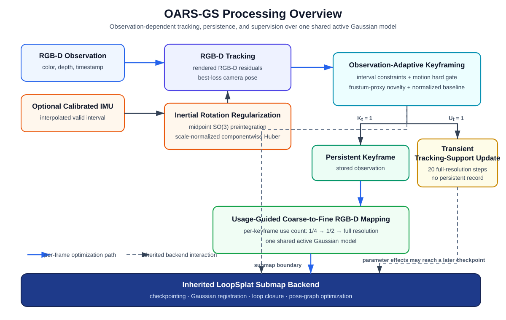
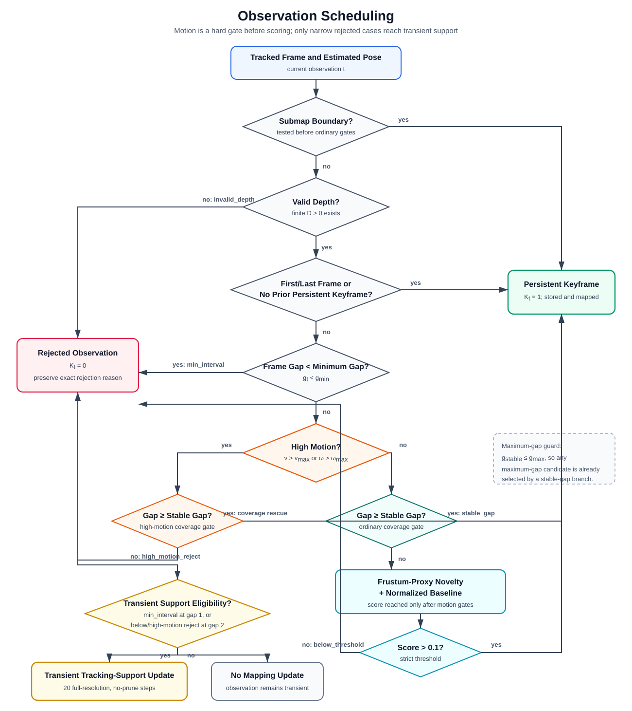
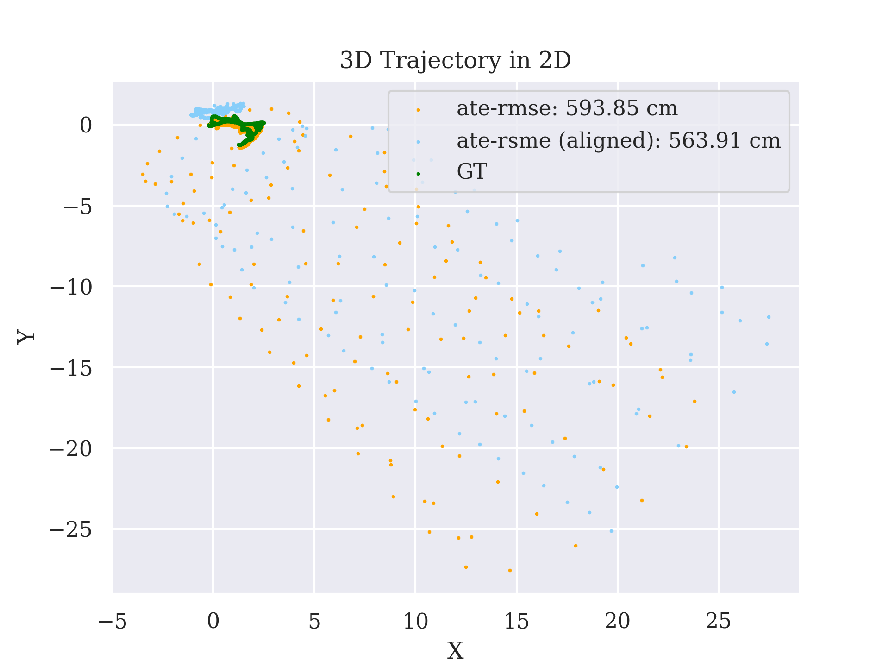

# OARS-GS：面向高斯 SLAM 的观测自适应关键帧、惯性旋转正则与粗到细 RGB-D 建图

## 摘要

在线高斯 SLAM 必须决定为每一帧 RGB-D 观测分配多少信任、持久性和优化工作量。若以相同方式处理所有观测，会留下三个实际问题：视觉跟踪器在困难运动中没有独立的旋转线索；每个被选中的视图都会成为持久建图负担；反复的全分辨率监督会在粗略结构尚未稳定时过早消耗建图计算于细节。本文研究：在不改变继承的全局 SLAM 后端的前提下，能否依据观测状态和优化历史调整这些决策。我们提出 OARS-GS，它在高斯 SLAM 前端中联合作出三类决策：以陀螺仪中点预积分构造弱 SO(3) 旋转正则；先经有效性、间隔和运动门控，再以当前地图的视锥与基线分数接纳持久关键帧；并按每个持久关键帧已完成的优化使用次数，安排其 RGB-D 监督从粗分辨率逐步至全分辨率。满足严格条件的被拒观测可进行一次全分辨率的临时跟踪支撑更新，但不会进入持久记录。渲染器、子图配准、回环和位姿图校正均继承自 LoopSplat。在八个 Replica 场景上，GI-KF+Pyramid 相比继承的 Baseline 将持久关键帧减少 16.30%，将固定已观测视角 PSNR 提高 0.438 dB，并将 Depth L1 降低 12.59%。在三个 FMDataset 序列上，完整配置将固定已观测视角 PSNR 提高 1.159 dB，并将 Depth L1 和持久关键帧分别降低 25.64% 与 58.33%。这些比较使用固定种子和已观测视角；FMDataset 记录不含轨迹真值。TUM A3 是一个反例：GI-KF 的对齐 ATE 为 563.912 cm，而 Baseline 为 7.005 cm，因此该方法不支持一般性的跟踪改进主张。

# 1. 引言

在线稠密 SLAM 必须在下一帧到来之前，将连续的 RGB-D 测量转化为位姿估计和地图。显式三维高斯泼溅适合这一场景，因为它通过直接优化参数化高斯基元来渲染场景 [@kerbl2023_3dgs]。LoopSplat 提供了一个高斯子图后端，用于子图配准、回环和位姿图校正 [@zhu2025_loopsplat]。近期高斯 SLAM 系统表明，通过不同的地图增长、监督和相机优化选择，这一表示能够支持在线跟踪和建图 [@keetha2024_splatam; @yan2024_gsslam; @matsuki2024_gaussiansplatting; @huang2024_photoslam]。本文保留 LoopSplat 的后端操作，聚焦一个更窄的前端问题：面对新到达的观测，系统应如何决定其旋转可信度、持久存储资格和建图工作量？

这一问题同时取决于场景表示和观测流本身。早期稠密 RGB-D 系统已建立实时融合与可变形 surfel 建图 [@newcombe2011_kinectfusion; @whelan2016_elasticfusion]；稀疏系统则把关键帧保留作为跟踪和回环维护的核心 [@murartal2017_orbslam2]。神经稠密 SLAM 将同一权衡转移到活动帧选择、局部场景表示和联合优化中 [@sucar2021_imap; @zhu2022_niceslam; @sandstrom2023_pointslam; @yang2022_voxfusion; @wang2023_coslam; @johari2023_eslam; @tang2023_mipsfusion]。追求全局一致性的系统同样把局部建图与后续回环和全局优化分开处理 [@liso2024_loopyslam; @zhang2023_goslam]。这些设计都不能免除一个即时决策：观测到达时，它应当约束当前位姿、持久化为关键帧，还是接受重复的高分辨率监督。

我们在继承的在线高斯设置中识别出三个观测使用问题。第一，纯视觉 RGB-D 跟踪在快速运动或视觉退化时可能存在旋转歧义。完整视觉惯性系统通过纳入惯性状态、偏置、重力和时间约束来处理更广泛的估计问题 [@campos2021_orbslam3; @forster2017_preintegration; @leutenegger2015_keyframevio]，高斯系统也已结合视觉、深度和惯性数据 [@sun2024_mm3dgsslam; @wu2025_vingsmono]。本文配置不试图构建这样的估计器，而是检验经过标定的陀螺仪区间能否在视觉位姿优化中提供稳健、弱的 SO(3) 偏好。该惩罚采用中点预积分和逐分量 Huber 构造 [@huber1964_robust]，其形式化平移权重为零。

第二，固定的关键帧节奏无法区分地图新颖性很低的视图和能提供有效基线的视图。两者都持久化会带来代价，因为持久关键帧会影响观测存储和后续完整建图优化；但拒绝所有短间隔视图也并不安全，因为局部地图更新可能变得稀疏。第三，每次采样关键帧时均施加全分辨率 RGB-D 监督，忽略了在线优化的阶段性特征。经典的滤波图像金字塔支持由粗到细的过程 [@burt1981_fastfilter; @burt1983_pyramid]，而层次化高斯渲染改变的是表示本身 [@kerbl2024_hierarchical]。OARS-GS 不改变活动高斯表示及其细节层级，只调度用于监督同一高斯模型的栅格化 RGB-D 目标。

本文研究在线高斯 SLAM 前端能否在保留有用的重建与资源权衡的同时，依据当前观测及其优化历史，自适应地安排旋转正则、持久观测接纳和监督分辨率。OARS-GS，即 Observation-Adaptive and Rotation-Regularized Scheduling for Gaussian Splatting SLAM，结合有效区间的陀螺仪旋转残差、具有临时支撑替代路径的门控优先持久关键帧策略，以及按关键帧使用次数驱动的 RGB-D 调度。三项决策作用于同一实时高斯地图，并先分别评估，再考察其联合兼容性。

评测覆盖五个 TUM RGB-D 序列、八个 Replica 场景和三个 FMDataset 序列。TUM 在刚性 SE(3) 对齐后提供轨迹指标 [@sturm2012_tumrgbd; @horn1987_absoluteorientation]。FMDataset 提供同步 RGB-D 和惯性观测 [@zhu2019_fmdataset]，但实验记录中没有轨迹真值。我们报告固定已观测视角的 PSNR、MS-SSIM、LPIPS 和 Depth L1，并遵循相应的图像质量定义 [@wang2003_msssim; @wang2004_ssim; @zhang2018_lpips]。每个场景和策略均使用固定的已选种子，因此跨场景宏值是描述性结果，而非多种子估计。GI-KF+Pyramid 在 Replica 组上可减少持久观测，同时保持或改善多项已观测视角指标；FMDataset 的完整配置也在记录协议下改善了多项重建指标。TUM A3 的实质性失败则明确限制了任何跟踪主张。

本文有四项贡献：

1. 面向 RGB-D 高斯跟踪的陀螺仪中点预积分旋转正则，包括有效性拒绝、SO(3) 残差、物理尺度归一化的逐分量 Huber 惩罚，以及形式上为零的惯性平移权重。
2. 一种观测自适应持久关键帧规则，将有效性、间隔和运动硬门控与当前中心视锥代理和深度归一化基线结合；同时定义临时跟踪支撑更新，它们改变实时地图但不成为持久关键帧。
3. 一种按使用次数推进的粗到细 RGB-D 监督调度，为每个持久关键帧生成关注有效深度的目标，并且只在该关键帧被采样执行完成的建图更新时推进其分辨率层级。
4. 在 TUM RGB-D、Replica 和 FMDataset 上进行评测，报告单组件消融、组合兼容性、兼容硬件上的成对资源测量，以及固定已观测视角重建结果与 TUM A3 失败案例。

后文先将 OARS-GS 置于稠密、视觉惯性、观测管理和多分辨率研究的脉络中；随后推导方法，并在所述协议下评测，最后回到该反例揭示的边界。

# 2. 相关工作

## 2.1. 稠密与高斯 SLAM

稠密 SLAM 系统在几何保真度、渲染质量和在线优化成本之间采用不同的权衡。体积融合确立了基于几何地图的实时 RGB-D 重建，surfel 系统则将稠密跟踪与融合同局部和全局形变结合 [@newcombe2011_kinectfusion; @whelan2016_elasticfusion]。随后，神经隐式系统利用连续函数或学习到的空间编码来表示几何与外观，其设计从单个联合优化的场景函数扩展至层次网格、稀疏体素、混合坐标编码、神经点和局部隐式子图 [@sucar2021_imap; @zhu2022_niceslam; @yang2022_voxfusion; @wang2023_coslam; @johari2023_eslam; @sandstrom2023_pointslam; @tang2023_mipsfusion]。这些表示分别改善了局部性或重建的不同方面，但其在线成本仍取决于哪些观测保持活动状态以及它们被重访的频率。

可微三维高斯泼溅提供了一个具有快速栅格化和直接外观优化能力的显式场景表示 [@kerbl2023_3dgs]。已发表的高斯 SLAM 系统通过不同的地图增长、几何监督、高斯选择和相机优化方案，将它适配到 RGB-D 或直接视觉跟踪中 [@keetha2024_splatam; @yan2024_gsslam; @matsuki2024_gaussiansplatting; @huang2024_photoslam]。全局一致性仍是独立的系统问题：稠密方法采用回环检测与全局优化，LoopSplat 则通过其回环后端注册高斯子图并校正其位姿 [@zhang2023_goslam; @liso2024_loopyslam; @zhu2025_loopsplat]。OARS-GS 保留该后端，关注的是继承的子图配准和位姿图校正之前，在线高斯系统应如何使用到达观测这一尚未解决的前端问题。

## 2.2. 视觉惯性跟踪

视觉惯性估计通常将惯性状态、偏置、重力和时间约束纳入联合估计器。基于关键帧的视觉惯性里程计和 ORB-SLAM3 分别展示了有界非线性优化与多地图视觉惯性 SLAM；流形上的预积分则概括图像时间戳之间的高频惯性样本 [@leutenegger2015_keyframevio; @campos2021_orbslam3; @forster2017_preintegration]。高斯系统也已纳入视觉、深度和惯性测量，包括多模态 RGB-D 高斯 SLAM 和大场景单目视觉惯性高斯建图 [@sun2024_mm3dgsslam; @wu2025_vingsmono]。

这些系统所定义的估计问题比本文研究的范围更广。OARS-GS 考察经过标定的陀螺仪区间能否在现有 RGB-D 高斯跟踪器内部提供弱旋转正则，而不把继承后端改写为完整视觉惯性估计器。形式化方法固定陀螺仪偏置，并将所计算的惯性平移损失赋予零优化权重。因此，其证据应被解释为旋转正则消融，而非联合速度、重力、偏置或惯性平移估计的证据。

## 2.3. 关键帧与观测管理

关键帧限制重复优化，并保留跟踪、建图和回环所需的观测。稀疏 SLAM 将这一持久性决策置于地图维护的中心，神经稠密系统也常优化选出的活动帧，而非全部历史图像 [@murartal2017_orbslam2; @sucar2021_imap; @wang2023_coslam]。在高斯 RGB-D SLAM 中，基于重叠的选择提供了直接偏好共享地图内容视图的方式 [@keetha2024_splatam]。但仅有重叠并不能决定如何组合节奏、运动状态、持久存储，以及被拒观测的短期价值。

OARS-GS 通过区分两项决策处理这一缺口。观测自适应关键帧首先施加有效性、间隔和运动硬门控，之后才通过当前高斯的视锥重叠与归一化基线分数接纳持久关键帧。满足严格资格的被拒帧随后可通过临时跟踪支撑路径更新实时高斯参数，但不会进入关键帧记录、子图检查点观测列表或回环数据库。这种生命周期区分是 OARS-GS 特有的；所引文献提供关键帧和重叠的背景，并不证明先前系统使用同样的支撑策略。

## 2.4. 粗到细优化

图像金字塔使用经过滤波、逐步采样的表示，在细节之前显露低频结构 [@burt1981_fastfilter; @burt1983_pyramid]。稠密神经 SLAM 已利用层次或多尺度编码来分配表示容量，高斯 SLAM 也在跟踪和建图中采用粗到细的高斯选择或多层高斯结构 [@zhu2022_niceslam; @johari2023_eslam; @yan2024_gsslam; @huang2024_photoslam]。层次化三维高斯渲染则为随尺度变化的渲染组织高斯表示本身 [@kerbl2024_hierarchical]。

OARS-GS 采用不同的控制变量：每个持久关键帧实际被选中优化的次数。该计数为单一活动高斯模型选择粗、中间或全分辨率 RGB-D 监督。该方法既不创建高斯细节层级，也不假定有限在线预算能让每个关键帧完成所有阶段。实验检验这种按使用次数推进的监督调度能否在固定在线建图预算下与观测接纳互补。

# 3. OARS-GS

OARS-GS 改变在线高斯 SLAM 系统使用到达观测的方式：它向相机跟踪加入弱的陀螺仪旋转正则，根据当前观测和运动状态接纳持久关键帧，将一类严格限定的被拒观测用于临时跟踪支撑更新，并将持久关键帧监督从粗分辨率调度至全分辨率。图 1 概括了这些路径。渲染器、高斯参数化、子图构建、高斯到高斯配准、回环和位姿图优化均继承自 LoopSplat [@zhu2025_loopsplat]，并非 OARS-GS 新增。

{#fig:oars-gs-overview}

## 3.1. 系统概览与预备定义

在帧 \(t\)，系统接收 RGB-D 观测 \(\mathcal{O}_t=(C_t,D_t,\tau_t)\)，其中 \(C_t\in[0,1]^{3\times H\times W}\) 为颜色，\(D_t\in\mathbb{R}^{H\times W}\) 为度量深度，\(\tau_t\) 为相机时间戳。对于提供已标定惯性数据的序列，区间 \((\tau_{t-1},\tau_t)\) 还提供在 IMU 坐标系 \(I\) 中表达的加速度计和陀螺仪样本 \((a_k^I,\omega_k^I,\tau_k^I)\)。记 \(T_t^{CW}\in SE(3)\) 为世界到相机位姿，\(T_t^{WC}=(T_t^{CW})^{-1}\)，并以 \(c_t\in\mathbb{R}^3\) 表示世界坐标中的相机中心。一个活动子图包含 \(N\) 个三维高斯 [@kerbl2023_3dgs]：

\[
\Theta_G=\{g_i\}_{i=1}^{N},\qquad
g_i=(\mu_i,q_i,s_i,o_i,h_i),
\quad
\mathcal{R}(\Theta_G,T_t^{CW})=(\widehat C_t,\widehat D_t,\widehat A_t),
\tag{1}
\]

其中，\(\mu_i\in\mathbb{R}^3\)、\(q_i\)、\(s_i\in\mathbb{R}_{+}^{3}\)、\(o_i\in[0,1]\) 和 \(h_i\) 分别表示中心、旋转四元数、尺度、不透明度和颜色特征。共享的可微渲染器 \(\mathcal{R}\) 返回颜色、深度和 alpha 图像。跟踪仅针对固定活动高斯参数优化当前相对相机变换（以及启用时的曝光参数），目标为

\[
\mathcal{L}_{\mathrm{track}}=
w_C\mathcal{L}^{\mathrm{trk}}_{1,C}
{} +(1-w_C)\mathcal{L}^{\mathrm{trk}}_{1,D}
{} +\mathcal{L}_{R}+\mathcal{L}_{T},
\tag{2}
\]

其中 RGB 与深度项是跟踪器有效掩码上的渲染残差；在 FMDataset 配置中 \(w_C=0.6\)；\(\mathcal{L}_{R}\) 和 \(\mathcal{L}_{T}\) 是下文定义的惯性旋转与平移项。跟踪迭代中见到的最小损失位姿被保留。随后，持久建图更新同一 \(\Theta_G\)，可由被选中的关键帧播种高斯，并在继承的子图记录中存储该观测。到达子图边界时，继承后端检查点保存先前活动子图，执行回环处理及其位姿图校正，并初始化下一活动模型。

## 3.2. 惯性旋转正则

惯性路径只在数据集提供区间接口且 \(t>0\) 时启用。对 FMDataset，经配置时间偏移 \(o_\tau\) 后的 RGB-D 两端点通过逐分量线性插值加入，严格位于区间内部的 IMU 样本予以保留。因此

\[
\begin{aligned}
\mathcal{I}_t
&=\big((\widetilde a_{t,k}^I,\widetilde\omega_{t,k}^I,
\widetilde\tau_{t,k})\big)_{k=0}^{m_t-1},\\
\widetilde\tau_{t,0}&=\tau_{t-1}+o_\tau,\qquad
\widetilde\tau_{t,m_t-1}=\tau_t+o_\tau,\\
\{\widetilde\tau_{t,k}\}_{k=1}^{m_t-2}
&=\{\tau_j^I:\tau_{t-1}+o_\tau<\tau_j^I<\tau_t+o_\tau\}
\quad\text{in increasing order},
\end{aligned}
\tag{3}
\]

其中 \(m_t=|\mathcal{I}_t|\) 是有序区间样本数。端点测量 \((\widetilde a_{t,0}^I,\widetilde\omega_{t,0}^I)\) 与 \((\widetilde a_{t,m_t-1}^I,\widetilde\omega_{t,m_t-1}^I)\) 通过逐分量线性插值得到；内部带波浪号的值等于其被保留的 IMU 样本。若区间不被 IMU 流覆盖、少于两个样本、含非有限值、时间戳不递增、超过 \(0.2\,\mathrm{s}\)，或超过配置的加速度或角速度界限（形式化配置为 \(50\,\mathrm{m\,s^{-2}}\) 和 \(20\,\mathrm{rad\,s^{-1}}\)），则拒绝该区间。拒绝时，式 (2) 中两项惯性贡献均置零。

令 \(T_{CI}=[R_{CI},t_{CI};0,1]\) 为固定的 IMU 到相机标定，\(b_g\) 为固定陀螺仪偏置。对于相邻有序样本 \(k,k+1\)，中点 SO(3) 预积分 [@forster2017_preintegration] 为

\[
\bar\omega_{t,k}^C=
R_{CI}\!\left(
\frac{\widetilde\omega_{t,k}^I+\widetilde\omega_{t,k+1}^I}{2}-b_g
\right),
\qquad
\Delta\widehat R_t^C=\prod_{k=0}^{m_t-2}
\operatorname{Exp}\!\left(\bar\omega_{t,k}^C\Delta\widetilde\tau_{t,k}\right),
\tag{4}
\]

其中 \(\Delta\widetilde\tau_{t,k}=\widetilde\tau_{t,k+1}-\widetilde\tau_{t,k}\)，乘积按递增时间顺序右乘各增量。上标 \(C\) 表示应用 \(R_{CI}\) 后预测在相机坐标中表达；帽号用于区分惯性预测与视觉相对运动。形式化运行使用 \(b_g=(0,0,0)^\top\)，且不优化偏置。每个可微跟踪迭代中评估的视觉相对运动为

\[
\Delta T_t^V=T_{t-1}^{CW}T_t^{WC},
\qquad
r_{R,t}=\operatorname{Log}\!\left((\Delta\widehat R_t^C)^\top\Delta R_t^V\right)\in\mathbb{R}^{3},
\tag{5}
\]

其中 \(\Delta R_t^V\) 为 \(\Delta T_t^V\) 的旋转块，\(\operatorname{Exp}\) 与 \(\operatorname{Log}\) 分别为 SO(3) 指数映射和对数映射。我们使用标量 Huber 函数 [@huber1964_robust]

\[
\rho_\kappa(x)=
\begin{cases}
\tfrac{1}{2}x^2, & |x|\le\kappa,\\
\kappa(|x|-\tfrac{1}{2}\kappa), & |x|>\kappa,
\end{cases}
\tag{6}
\]

并在物理尺度归一化后逐分量施加：

\[
\mathcal{L}_{R}=\lambda_R
\sum_{j=1}^{3}
\rho_{\delta_R/s_R}\!\left(\frac{r_{R,t,j}}{s_R}\right),
\qquad
(\lambda_R,s_R,\delta_R)=(10^{-3},0.01\,\mathrm{rad},0.1\,\mathrm{rad}).
\tag{7}
\]

该项是三个稳健标量残差之和，而非对向量范数施加 Huber 惩罚。当静止区间已初始化固定重力方向时，实现还可积分加速度、纳入标定杠杆臂，并形成相机坐标的平移预测 \(\widehat p_t^C\)。一个有效平移残差及其损失为

\[
r_{p,t}=\Delta t_t^V-\widehat p_t^C,
\qquad
\mathcal{L}_{T}=\lambda_T
\sum_{j=1}^{3}\rho_{\delta_T/s_T}\!\left(\frac{r_{p,t,j}}{s_T}\right),
\qquad
(\lambda_T,s_T,\delta_T)=(0,0.05\,\mathrm{m},0.1\,\mathrm{m}).
\tag{8}
\]

这里 \(\Delta t_t^V\) 是 \(\Delta T_t^V\) 的平移块。式 (8) 可为诊断而计算，但其形式化优化贡献严格为零，因为 \(\lambda_T=0\)。因此，OARS-GS 将惯性数据用作旋转正则，而不联合优化速度、重力或传感器偏置。该正则作用于每个有效跟踪迭代，随后再用最终视觉位姿更新诊断惯性状态。

## 3.3. 观测自适应关键帧

已发表的高斯 RGB-D SLAM 中已有基于重叠的观测选择；例如 SplaTAM 在关键帧管理中使用重叠信息 [@keetha2024_splatam]。OARS-GS 不将重叠本身视为区别机制。这里研究的实现将子图、深度、间隔和运动硬门控置于当前中心视锥代理分数之前，并将持久接纳与第 3.4 节单独定义的临时支撑生命周期耦合。

跟踪后，持久关键帧接纳将当前观测与时间上最近的持久关键帧 \(k\) 比较。可见性代理把*当前*活动高斯的中心投影到每个相机中。当中心 \(\mu_i\) 具有正的相机坐标深度且位于与深度图 \(D\) 一同使用的图像视锥内时，令 \(\pi_i(T,D)=1\)，定义

\[
V_t=\{i\in\{1,\ldots,N\}:\pi_i(T_t^{CW},D_t)=1\},
\qquad
V_k=\{i\in\{1,\ldots,N\}:\pi_i(T_k^{CW},D_k)=1\}.
\tag{9}
\]

这些集合是高斯中心视锥代理，不使用不透明度、渲染遮挡、足迹覆盖或高斯参数的历史快照。它们的交并比与新颖度为

\[
J_{t,k}=
\begin{cases}
\dfrac{|V_t\cap V_k|}{|V_t\cup V_k|}, & |V_t\cup V_k|>0,\\
1, & |V_t\cup V_k|=0,
\end{cases}
\qquad
\nu_{t,k}=1-J_{t,k}.
\tag{10}
\]

令 \(\mathcal{P}_t^+=\{p:D_t(p)>0\ \wedge\ D_t(p)\text{ is finite}\}\)。归一化基线为

\[
b_{t,k}=\frac{\|c_t-c_k\|_2}
{\max\!\left(\operatorname{median}_{p\in\mathcal{P}_t^+}D_t(p),10^{-6}\right)},
\tag{11}
\]

经过此前全部门控后才可到达的分数为

\[
S_{t,k}=w_{\mathrm{cov}}\nu_{t,k}+w_{\mathrm{base}}b_{t,k},
\qquad
(w_{\mathrm{cov}},w_{\mathrm{base}},\tau_S)=(1,1,0.1),
\tag{12}
\]

仅当 \(S_{t,k}>\tau_S\) 时由分数接纳。尽管实现记录了运动惩罚诊断，高运动无法到达式 (12)，而是由之前的硬门控处理。令 \(\Delta\tau_t^{\mathrm{cam}}\) 为相邻相机时间戳之差（若不可得则使用配置帧率的倒数），\(v_t\) 与 \(\omega_t^V\) 分别为由相邻估计位姿计算的线速度和角速度。形式化运行中，此门控关闭可选的陀螺仪辅助。高运动定义为

\[
h_t=\mathbf{1}\!\left[v_t>v_{\max}\ \vee\
\omega_t^V>\omega_{\max}\right],
\qquad
(v_{\max},\omega_{\max})=(1.5\,\mathrm{m\,s^{-1}},120^\circ\,\mathrm{s^{-1}}).
\tag{13}
\]

令 \(g_t=t-k\)，并令 \(g_{\min}\)、\(g_{\mathrm{stable}}\) 和 \(g_{\max}\) 分别为最小、稳定覆盖和最大间隔。在满足 \(g_{\min}\le g_{\mathrm{stable}}\le g_{\max}\) 的条件下，TUM/FMDataset 的形式化取值为 \((2,3,10)\)，Replica 为 \((5,6,10)\)，可达决策为

\[
K_t=
\begin{cases}
1, & \text{submap boundary},\\
0, & \mathcal{P}_t^+=\varnothing,\\
1, & \text{first/last frame or no prior persistent keyframe},\\
0, & g_t<g_{\min},\\
0, & h_t=1\ \wedge\ g_t<g_{\mathrm{stable}},\\
1, & h_t=1\ \wedge\ g_t\ge g_{\mathrm{stable}},\\
1, & h_t=0\ \wedge\ g_t\ge g_{\mathrm{stable}},\\
\mathbf{1}[S_{t,k}>\tau_S], & \text{otherwise}.
\end{cases}
\tag{14}
\]

子图边界测试位于普通决策函数之外，因此先于无效深度拒绝执行。在函数内部，有效深度是返回任何强制帧结果之前的必要条件。候选帧在 \(g_t\ge g_{\max}\) 时也已经达到稳定间隔，故会在评分之前由两个覆盖分支之一选中。图 2 展示该顺序，并区分持久与临时结果。

{#fig:observation-scheduling}

## 3.4. 临时跟踪支撑更新

拒绝冗余观测可减少持久存储和完整建图事件，但其中一小部分仍可能提供有用的局部监督。OARS-GS 审计关键帧拒绝原因 \(r_t\)，只允许严格指定的早期间隔触发更新。令 \(E\in\{0,1\}\) 表示是否启用支撑更新，则其资格为

\[
U_t=E(1-K_t)\,\mathbf{1}\!\left[
(r_t=\texttt{min\_interval}\ \wedge\ g_t=1)
\ \vee\
(r_t\in\{\texttt{below\_threshold},\texttt{high\_motion\_reject}\}\ \wedge\ g_t=2)
\right].
\tag{15}
\]

若 \(U_t=1\)，该观测在全分辨率下对实时高斯参数执行 20 个优化器步骤。该分支不播种或增长高斯、不剪枝，也不使用或推进金字塔调度；它与持久建图互斥。形式化运行中，Replica 禁用这一分支，TUM 和 FMDataset 启用它。

支撑观测是临时的：其标识符和 RGB-D 数据不出现在持久关键帧集合、子图检查点关键帧列表或回环数据库中。参数更新本身不会回滚，其对实时高斯的影响可被带入该活动子图后续的检查点。下文中，**持久关键帧**专指 \(K_t=1\)，**临时跟踪支撑更新**专指 \(U_t=1\)。

## 3.5. 按使用次数推进的粗到细 RGB-D 建图

经典图像金字塔处理建立了低通滤波与多分辨率图像表示 [@burt1981_fastfilter; @burt1983_pyramid]，Photo-SLAM 则采用不同的多层机制进行照片级高斯建图 [@huang2024_photoslam]。这些工作为粗到细监督提供动机，却不定义下述构造或调度。OARS-GS 由每个原始观测生成有效深度加权的子层级，并根据为每个持久关键帧独立维护的、已执行的优化器使用次数选择分辨率；该调度只改变监督，不改变活动高斯表示。

对于每个持久关键帧，OARS-GS 从原始 RGB-D 观测独立构造 \(L\) 个子分辨率目标。在从最粗到最细的子层级 \(\ell\in\{0,\ldots,L-1\}\)，缩放比例和栅格尺寸为

\[
a_\ell=2^{-(L-\ell)},\qquad
(H_\ell,W_\ell)=
\big(\max(1,\lfloor a_\ell H\rfloor),
\max(1,\lfloor a_\ell W\rfloor)\big),
\qquad
C_\ell=\mathcal{B}_{H_\ell,W_\ell}\!\left(\mathcal{A}_{k_\ell}(C)\right),
\tag{16}
\]

其中 \(\mathcal{B}\) 为不对齐角点的双线性缩放。对 \(a_\ell<1\)，\(\sigma_\ell=0.5/a_\ell-0.5\)，\(k_\ell=\max(3,2\lfloor2\sigma_\ell\rfloor+1)\)；当 \(\sigma_\ell>0.1\) 时，\(\mathcal{A}_{k_\ell}\) 是步长为一的平均池化，否则为恒等操作。每个 \(C_\ell\) 直接由 \(C\) 生成，而不从前一子层级递归生成。

深度下采样排除无效测量。令 \(M(p)=\mathbf{1}[D(p)>0\ \wedge\ D(p)\text{ finite}]\)，\(\mathcal{Q}_{H_\ell,W_\ell}\) 表示面积缩放，则

\[
q_\ell=\mathcal{Q}_{H_\ell,W_\ell}(M),\qquad
M_\ell=\mathbf{1}[q_\ell>0],\qquad
D_\ell=M_\ell\odot
\frac{\mathcal{Q}_{H_\ell,W_\ell}(D\odot M)}
{\max(q_\ell,\varepsilon)},
\tag{17}
\]

其中 \(\varepsilon\) 是浮点数正下限，无效输出像素设为零。对于对应渲染器，实现只将 \(\texttt{image\_width}\) 和 \(\texttt{image\_height}\) 改为 \((W_\ell,H_\ell)\)，同时保留全分辨率 \(\texttt{tanfovx}\)、\(\texttt{tanfovy}\)、视图矩阵、投影矩阵和相机位置：

\[
\mathcal{S}_\ell=
\operatorname{replace}(\mathcal{S}_{\mathrm{full}},
\texttt{image\_width}=W_\ell,
\texttt{image\_height}=H_\ell),
\quad
(\tan\phi_x,\tan\phi_y,V,P,c)_\ell
=(\tan\phi_x,\tan\phi_y,V,P,c)_{\mathrm{full}}.
\tag{18}
\]

在保持归一化视场角时缩小栅格尺寸，会诱导低分辨率监督使用的有效像素坐标尺度。代码**不会**显式重缩放 \(f_x,f_y,c_x,c_y\)，也不会为子层级重建投影矩阵。

层级按每个持久关键帧选择，而不由全局时间决定。令 \(n_t\) 为关键帧 \(t\) 实际被采样并完成优化器步骤的次数，\(u\) 为每层使用次数，并令层级 \(L\) 表示全分辨率。在下一次被采样的优化器步骤之前，

\[
\ell_t(n_t)=\min\!\left(\left\lfloor\frac{n_t}{u}\right\rfloor,L\right),
\qquad
n_t\leftarrow n_t+1\ \text{only after an optimizer step is executed}.
\tag{19}
\]

形式化设置 \(L=2,u=8\) 使第 1--8 次使用采用 \(1/4\) 分辨率，第 9--16 次采用 \(1/2\) 分辨率，之后采用全分辨率。有限建图预算和随机关键帧采样并不保证每个关键帧均达到全分辨率。新子图开始时计数重置，支撑更新不推进计数。所有层级均优化同一 \(\Theta_G\)，变化的只有栅格化监督。

在选定分辨率上，令 \(\widehat C_t^\ell,\widehat D_t^\ell\) 为渲染，令 \(\Omega_t^\ell=\{p:M_t^\ell(p)=1,\widehat D_t^\ell(p)\text{ finite}\}\)。建图损失为

\[
\begin{aligned}
\mathcal{L}_{\mathrm{map}}^\ell={}&
(1-\lambda_{\mathrm{ssim}})
\operatorname*{mean}_{c,\,p\in\Omega_t^\ell}
|\widehat C_t^\ell(c,p)-C_t^\ell(c,p)|\\
&+\lambda_{\mathrm{ssim}}
\big(1-\operatorname{SSIM}(\widehat C_t^\ell,C_t^\ell)\big)
{} +\operatorname*{mean}_{p\in\Omega_t^\ell}
|\widehat D_t^\ell(p)-D_t^\ell(p)|
{} +\mathcal{L}_{\mathrm{iso}},
\qquad \lambda_{\mathrm{ssim}}=0.2,
\end{aligned}
\tag{20}
\]

其中 \(\mathcal{L}_{\mathrm{iso}}\) 是继承的软尺度各向同性惩罚。RGB 和深度 L1 项共享有效深度掩码，而 SSIM [@wang2004_ssim] 在所选分辨率的完整 RGB 图像上计算。

## 3.6. 在线算法

算法 1 记录实际执行的分支顺序。视觉优化前先准备惯性预测，并在跟踪内部评估有效旋转项。关键帧与支撑决策均基于所得位姿作出。子图边界会先调用继承后端，再由边界关键帧初始化并优化新的活动子图。

**算法 1：OARS-GS 在线处理**

~~~text
Input: RGB-D sequence {O_t}; optional calibrated IMU stream;
       active Gaussian submap Theta_G; inherited LoopSplat backend
Output: estimated poses and inherited persistent submap records

for t = 0, ..., T - 1 do
    if a non-GT tracking path is active then
        form interpolated IMU interval I_t when available
        validate I_t and midpoint-preintegrate Delta Rhat_t^C
        optimize the relative camera pose with L_track
            (L_R is active only for a valid interval; formal L_T = 0)
        retain the best-loss pose and commit inertial diagnostics
    else
        take the dataset/GT pose; do not apply the inertial regularizer
    end if

    detect whether t starts a new submap
    evaluate the persistent-keyframe gates in Eq. (14)
    audit transient support eligibility U_t using Eq. (15)

    if t starts a new submap then
        checkpoint the previous active submap and persistent keyframes
        update loop information, run inherited loop closure/PGO, if any
        initialize the next active Gaussian submap; reset pyramid counts
    end if

    if K_t = 1 then
        seed/grow Gaussians from the persistent keyframe
        for each allocated mapping step do
            sample a persistent keyframe; select its level by Eq. (19)
            optimize shared Theta_G with Eq. (20)
            advance that keyframe's count only after the optimizer step
        end for
        store t as a persistent keyframe and frustum reference
    else if U_t = 1 then
        optimize shared Theta_G for 20 full-resolution, no-prune steps
        do not seed points, store a persistent keyframe, or advance counts
    end if
end for

checkpoint any remaining active submap and its persistent keyframes
run the inherited final loop-closure path when configured
~~~

该算法保持继承系统对活动子图和全局校正轨迹的区分。OARS-GS 修改旋转项、观测接纳、临时更新路径和监督调度；配准、回环检测、检查点结构和图校正仍是后端操作。

# 4. 实验

## 4.1. 实验设置

**数据集。** 我们评测三组室内 RGB-D 数据。TUM RGB-D 提供真实序列和轨迹真值 [@sturm2012_tumrgbd]。五个序列为 fr1/desk、fr1/desk2、fr1/room、fr2/xyz 和 fr3/long_office_household，记为 A1--A5。Replica 包含八个合成场景 office0--office4 与 room0--room2，记为 R1--R8。由于其数据集报告在本次审计中不是带 DOI 的已接受正式参考文献，我们引用已发表的高斯和 RGB-D SLAM 工作来说明所采用的评测惯例，而不将该报告作为正式文献 [@keetha2024_splatam; @yan2024_gsslam; @sandstrom2023_pointslam]。FMDataset 提供同步 RGB-D 和惯性测量 [@zhu2019_fmdataset]；dorm1_fast1、dorm2_fast 和 hotel_fast1 构成 C1--C3。实验记录不包含 FMDataset 轨迹真值，因而其 ATE 和 RPE 单元保持缺失，不以零代替。另行采集的 Azure Kinect 材料仅为工程说明，不属于消融实验。

**策略。** Baseline 是关闭三项 OARS-GS 决策的继承 LoopSplat 配置。TUM 和 Replica 比较 Baseline、GI-KF、Pyramid 及 GI-KF+Pyramid。FMDataset 还包括 IMU 和 ALL，其中 ALL 启用惯性旋转正则、GI-KF 和 Pyramid。

**表 1. 消融策略矩阵。**

| 数据集组 | 策略 | 惯性旋转 | GI-KF | Pyramid |
|---|---|---:|---:|---:|
| TUM, Replica, FM | Baseline |  |  |  |
| FM | IMU | ✓ |  |  |
| TUM, Replica, FM | GI-KF |  | ✓ |  |
| TUM, Replica, FM | Pyramid |  |  | ✓ |
| TUM, Replica, FM | GI-KF+Pyramid |  | ✓ | ✓ |
| FM | ALL | ✓ | ✓ | ✓ |

Replica 相对其继承基线使用预算匹配的关键帧节奏，并禁用临时支撑路径。TUM 和 FMDataset 启用经审计的支撑策略。其余策略语义和形式化参数均遵循第 3 节。其中，IMU 设置的优化贡献仅为旋转，而金字塔改变 RGB-D 监督，不改变高斯表示。

**选择与聚合协议。** 规范化证据中，每个场景和策略均使用固定的已选种子。每条被选记录均使用 seed 0；TUM、Replica 与 FMDataset 分别有 20、32 和 18 条记录。策略宏值是场景值的无权算术平均，场景而非随机种子是平均单位。结果是对这一固定选择的描述性比较，不是随机种子平均、不确定性估计或显著性检验。所有百分比变化以同场景 Baseline 值为分母；若为指定数据集宏比较，则以相同场景集合上的 Baseline 宏值为分母。

**硬件与资源协议。** TUM A1、A2、A3、A5 以及所有 FMDataset 策略记录于 NVIDIA GeForce RTX 2080 Ti；TUM A4 和所有 Replica 策略记录于 NVIDIA GeForce RTX 4080 SUPER。每个同场景策略比较保持所记录的硬件一致。因此，我们以同场景配对变化解释资源结果，而不同 GPU 型号上的绝对值只作环境描述。运行时间是端到端 SLAM 耗时。峰值内存指 torch.cuda.max_memory_allocated() 返回的最大 PyTorch 分配量，而非整个设备占用。持久关键帧计数不包括临时跟踪支撑更新；后者的次数和耗时另行记录。

**指标。** TUM 与 Replica 的跟踪使用均方根绝对轨迹误差 (ATE)、相对平移误差 (RPE-t) 和相对旋转误差 (RPE-r)。ATE 在无尺度校正的刚性 (SE(3)) 对齐后报告 [@horn1987_absoluteorientation]，数值越低越好。因所需参考轨迹不在记录中，FMDataset 没有跟踪结果。

渲染在每种方法自身估计轨迹下的固定采样输入观测列表上进行。PSNR 和 MS-SSIM 衡量光度与多尺度结构一致性，LPIPS 衡量感知距离，Depth L1 衡量有效像素上的渲染深度误差 [@wang2003_msssim; @zhang2018_lpips]。PSNR 和 MS-SSIM 越高越好；LPIPS 和 Depth L1 越低越好。被评测图像是由直接、未经细化的子图拼接渲染出的已观测视角。这些测量不证明未观测视角泛化、独立全局地图几何或网格精度。

详细的逐场景结果见 [表 2](../tables/tum-results.md)、[表 3](../tables/replica-results.md)、[表 4](../tables/fm-results.md) 和[表 5](../tables/efficiency-results.md)。

## 4.2. 跟踪精度

**TUM RGB-D。** 非 A3 场景表明跟踪响应依赖于场景。GI-KF+Pyramid 在 A2 上相对 Baseline 降低 ATE，但 A1、A4 和 A5 的 ATE 更高；Pyramid 单独取得最低 A1 ATE，却未在整个组中保持这一行为。在 A2，GI-KF+Pyramid 将 ATE 从 3.795 改为 3.322 cm，将 PSNR 从 12.501 改为 13.594 dB，并将持久关键帧从 635 改为 286，即减少 54.96%。

A3 是必须报告的反例：Baseline 的对齐 ATE 为 7.005 cm，GI-KF 为 563.912 cm，GI-KF+Pyramid 为 18.782 cm；组合值仍比 Baseline 高 168.13%。这一失败排除了关于一般 TUM 跟踪改进或防止发散的主张。现有记录确立了结果，但未识别其物理原因。

**Replica。** 在八个场景上，GI-KF+Pyramid 将宏 ATE 从 0.292 改为 0.262 cm，即降低 10.30%；将 RPE-t 从 0.000632 改为 0.000594 m，即降低 6.10%；但 RPE-r 从 0.02019 升至 0.02092 degrees，即增加 3.61%。Pyramid 单独具有最低宏 ATE，因此组合策略并非每个指标上的跟踪最优项。在预算匹配的 Replica 协议下，延后部分持久观测仍可与这一合成组中相近的跟踪行为兼容。

## 4.3. 渲染与深度重建

在 TUM 上，GI-KF+Pyramid 将持久关键帧减少 63.90%，同时相对 Baseline 将固定已观测视角宏 PSNR 改变 +0.213 dB、MS-SSIM 改变 +2.83%、LPIPS 改变 -3.07%、Depth L1 改变 -3.33%。这些渲染变化与上文 A3 跟踪失败并存，不能替代轨迹精度。

在 Replica 上，GI-KF+Pyramid 将持久关键帧减少 16.30%，将宏 PSNR 提高 0.438 dB，并将 Depth L1 降低 12.59%。其 RPE-r 高于 Baseline，Pyramid 有更低 ATE，GI-KF 有更低 LPIPS。组合结果体现了质量与预算之间的权衡，但未在各项指标上占优。

FMDataset 只支持重建和资源主张。相对其 Baseline 宏，ALL 将固定已观测视角 PSNR 提高 1.159 dB、MS-SSIM 提高 3.47%，并将 LPIPS 降低 8.97%、Depth L1 降低 25.64%、持久关键帧降低 58.33%。记录中没有轨迹参考，因此这些差异不证明定位、漂移或视觉惯性里程计得到改善。

{#fig:metric-deltas}

## 4.4. 资源效率

配对资源测量将策略变化与硬件差异分离。在 Replica 上，GI-KF+Pyramid 将宏耗时降低 11.94%，同场景降幅介于 2.5% 至 20.0%；宏峰值 PyTorch 分配量从 6.947 改为 6.875 GiB。很小的分配量变化说明，持久观测数量并非常驻 Replica 工作负载的唯一组成。

在 FMDataset 上，ALL 将宏峰值 PyTorch 分配量降低 47.61%，将宏耗时降低 1.18%。其逐场景耗时变化为 C1 的 -7.5%、C2 的 -0.6% 和 C3 的 +6.9%，所以该宏结果不是一致的逐场景加速。所有这些比较均在同一 RTX 2080 Ti 环境中进行，不构成跨 GPU 基准。

持久存储与更新核算也必须分开。TUM 组合宏包含 610.4 个持久关键帧和 1080.4 次临时支撑更新，共处理 1690.8 帧。报告的持久关键帧减少并不意味着建图或更新事件等比例减少：支撑更新在实时地图上执行更短、非持久的优化，并单独计时。

{#fig:quality-efficiency}

## 4.5. 消融研究

**惯性旋转。** 在 FMDataset 上，仅 IMU 将宏 PSNR 改变 +0.230 dB、Depth L1 改变 -18.55%、LPIPS 改变 -2.56%，但将 MS-SSIM 改变 -2.06%；其耗时和峰值 PyTorch 分配量分别增加 13.71% 和 7.45%。它还使 C1 LPIPS 和 C3 PSNR 变差。该组件因而给出混合的重建证据，并具有可测量的成本。由于 FMDataset 缺少轨迹真值，此消融无法证明定位或漂移收益。

**观测自适应关键帧。** FMDataset GI-KF 将持久关键帧减少 58.50%，并将 PSNR 提高 0.591 dB，而相对 Baseline 的 Depth L1 仅降低 1.27%。GI-KF 的主要证据在于持久观测与资源控制，并不支持无代价重建主张。Replica 的行中支撑被禁用且节奏预算匹配，表明接纳规则可不依赖临时更新而减少持久集合。

**按使用次数推进的粗到细监督。** FMDataset Pyramid 保持宏持久关键帧数量不变，将 PSNR 提高 0.081 dB，并将相对 Baseline 的 Depth L1 降低 19.12%。该结果将监督调度与接纳的作用分开：其最清晰的单组件信号是深度重建，而非存储减少。逐场景结果仍然混合，不能由此推断金字塔会改善每个序列或指标。

**兼容性。** FMDataset GI-KF+Pyramid 将宏 PSNR 提高 0.718 dB、MS-SSIM 提高 4.67%，将 LPIPS 降低 5.28%、Depth L1 降低 22.56%，并将相对 Baseline 的持久关键帧降低 58.50%。启用惯性旋转后，ALL 再次改变这一平衡，改善部分宏指标，但 MS-SSIM 低于 GI-KF+Pyramid。这些决策可以共同运行，但上述组合不能说明每个组件会改善每项指标。

## 4.6. 定性与失败分析

Replica R5 建图器面板展示了同一已观测帧在 Baseline 与 GI-KF+Pyramid 下的采样输入、渲染 RGB-D 输出、深度残差和增密掩码。它们是优化诊断，而非留出渲染或完整全局地图评测。

{#fig:r5-baseline}

{#fig:r5-combined}

A3 轨迹可视化了第 4.2 节已量化的失败。Baseline 保持在对齐参考附近，而 GI-KF 显著偏离。这一对照说明，固定已观测视角的渲染一致性不能代替全局轨迹精度，也说明在轨迹敏感设置中，观测接纳仍需要更安全的回退机制。

{#fig:a3-baseline}

{#fig:a3-gikf}

失败边界来自经验结果。记录没有分离运动、重叠估计、地图状态或其他因素是否导致 A3，因此归因于某种物理机制将超出证据。类似地，没有受控参考的 Azure Kinect 材料仍是工程说明，而非消融或精度结果。

# 5. 结论

本文考察在线高斯 SLAM 能否依据运动状态、信息价值和建图历史，以不同方式使用到达观测。OARS-GS 保持 LoopSplat 渲染器和全局后端不变，只修改支配旋转正则、持久接纳、临时局部支撑和 RGB-D 监督分辨率的前端决策。方法推导了有效区间的陀螺仪 SO(3) 正则、一个仅在硬检查之后才对当前地图视锥代理与归一化基线评分的门控优先关键帧规则，以及一个由已完成优化器使用次数驱动的按关键帧粗到细监督调度。被拒帧可以提供有限的跟踪支撑更新，但从不进入持久关键帧、检查点或回环记录。

消融为这些决策提供了彼此独立且受限定的证据。在 FMDataset 上，仅旋转的 IMU 设置带来混合的固定已观测视角重建变化和额外资源成本；由于记录缺少轨迹真值，它不是视觉惯性里程计或漂移降低的证据。GI-KF 提供了最显著的存储控制效应，按使用次数推进的调度则在不改变持久关键帧数量的情况下改变深度重建。其组合配置表明这些决策可以共同运行。例如，在八个 Replica 场景上，GI-KF+Pyramid 将持久关键帧数量降低 16.30%、Depth L1 降低 12.59%；FMDataset ALL 配置则将持久关键帧降低 58.33%，并将已观测视角 PSNR 提高 1.159 dB。这些比较中，每个场景和策略均使用固定的已选种子，图像指标针对各方法估计轨迹下的固定已观测视角。

TUM A3 直接界定了方法的适用范围：GI-KF 的对齐 ATE 为 563.912 cm，而 Baseline 为 7.005 cm，GI-KF+Pyramid 仍为 18.782 cm。因此，OARS-GS 不证明轨迹精度得到一般性改善，已观测视角渲染收益也不能抵消轨迹失败。资源结论同样限定于同场景、兼容硬件对；持久关键帧减少不等于所有更新事件等量减少，因为临时支撑工作被单独计数。后续前端研究应保留观测自适应目标，同时在关键帧接纳与轨迹敏感条件发生不良交互时加入更安全的回退机制。
