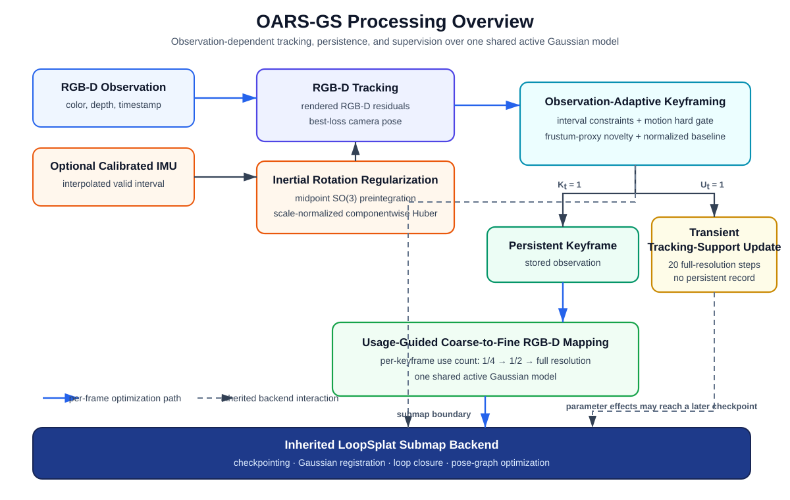
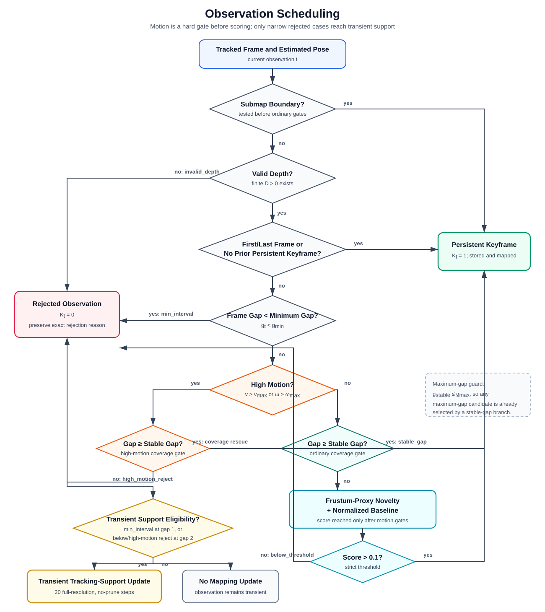

# 3. OARS-GS

OARS-GS changes how an online Gaussian SLAM system uses incoming observations. It adds a weak gyroscope-derived rotation regularizer to camera tracking, admits persistent keyframes according to the current observation and motion state, assigns a narrow class of rejected observations to transient tracking-support updates, and schedules persistent-keyframe supervision from coarse to full resolution. Figure 1 summarizes these paths. The renderer, Gaussian parameterization, submap construction, Gaussian-to-Gaussian registration, loop closure, and pose-graph optimization are inherited from LoopSplat [@zhu2025_loopsplat]; they are not introduced by OARS-GS.

{#fig:oars-gs-overview}

## 3.1. System overview and preliminaries

At frame \(t\), the system receives an RGB-D observation \(\mathcal{O}_t=(C_t,D_t,\tau_t)\), where \(C_t\in[0,1]^{3\times H\times W}\) is color, \(D_t\in\mathbb{R}^{H\times W}\) is metric depth, and \(\tau_t\) is the camera timestamp. On sequences that provide calibrated inertial data, the interval \((\tau_{t-1},\tau_t)\) also supplies accelerometer and gyroscope samples \((a_k^I,\omega_k^I,\tau_k^I)\) expressed in the IMU frame \(I\). We write \(T_t^{CW}\in SE(3)\) for the world-to-camera pose, \(T_t^{WC}=(T_t^{CW})^{-1}\), and \(c_t\in\mathbb{R}^3\) for the camera center in world coordinates. An active submap contains \(N\) 3-D Gaussians [@kerbl2023_3dgs]:

\[
\Theta_G=\{g_i\}_{i=1}^{N},\qquad
g_i=(\mu_i,q_i,s_i,o_i,h_i),
\quad
\mathcal{R}(\Theta_G,T_t^{CW})=(\widehat C_t,\widehat D_t,\widehat A_t),
\tag{1}
\]

where \(\mu_i\in\mathbb{R}^3\), \(q_i\), \(s_i\in\mathbb{R}_{+}^{3}\), \(o_i\in[0,1]\), and \(h_i\) denote center, rotation quaternion, scale, opacity, and color features, respectively. The shared differentiable renderer \(\mathcal{R}\) returns color, depth, and alpha images. Tracking optimizes only the current relative camera transform (and exposure parameters when enabled) against the fixed active Gaussian parameters. Its objective is

\[
\mathcal{L}_{\mathrm{track}}=
w_C\mathcal{L}^{\mathrm{trk}}_{1,C}
{} +(1-w_C)\mathcal{L}^{\mathrm{trk}}_{1,D}
{} +\mathcal{L}_{R}+\mathcal{L}_{T},
\tag{2}
\]

where the RGB and depth terms are renderer residuals over the tracker validity mask, \(w_C=0.6\) in the FMDataset configuration, and \(\mathcal{L}_{R}\) and \(\mathcal{L}_{T}\) are the inertial rotation and translation terms defined below. The best-loss pose seen during the tracking iterations is retained. Persistent mapping then updates the same \(\Theta_G\), may seed Gaussians from a selected keyframe, and stores that observation in the inherited submap record. At a submap boundary, the inherited backend checkpoints the previous active submap, performs loop processing and any pose-graph correction, and initializes the next active model.

## 3.2. Inertial rotation regularization

The inertial path is enabled only when the dataset exposes an interval interface and \(t>0\). For FMDataset, the RGB-D endpoints, after the configured time offset \(o_\tau\), are inserted by componentwise linear interpolation; strictly internal IMU samples are retained. Thus

\[
\begin{aligned}
\mathcal{I}_t
&=\big((\widetilde a_{t,k}^I,\widetilde\omega_{t,k}^I,
\widetilde\tau_{t,k})\big)_{k=0}^{m_t-1},\\
\widetilde\tau_{t,0}&=\tau_{t-1}+o_\tau,\qquad
\widetilde\tau_{t,m_t-1}=\tau_t+o_\tau,\\
\{\widetilde\tau_{t,k}\}_{k=1}^{m_t-2}
&=\{\tau_j^I:\tau_{t-1}+o_\tau<\tau_j^I<\tau_t+o_\tau\}
\quad\text{in increasing order},
\end{aligned}
\tag{3}
\]

where \(m_t=|\mathcal{I}_t|\) is the ordered interval sample count. The endpoint measurements \((\widetilde a_{t,0}^I,\widetilde\omega_{t,0}^I)\) and \((\widetilde a_{t,m_t-1}^I,\widetilde\omega_{t,m_t-1}^I)\) are obtained by componentwise linear interpolation; internal tilded values equal their retained IMU samples. An interval is rejected if it is not covered by the IMU stream, has fewer than two samples, contains non-finite values, has non-increasing timestamps, exceeds \(0.2\,\mathrm{s}\), or exceeds the configured acceleration or angular-rate bounds (\(50\,\mathrm{m\,s^{-2}}\) and \(20\,\mathrm{rad\,s^{-1}}\) in the formal configuration). Rejection sets both inertial contributions in Eq. (2) to zero.

Let \(T_{CI}=[R_{CI},t_{CI};0,1]\) be the fixed IMU-to-camera calibration and \(b_g\) the fixed gyroscope bias. For adjacent ordered samples \(k,k+1\), midpoint SO(3) preintegration [@forster2017_preintegration] is

\[
\bar\omega_{t,k}^C=
R_{CI}\!\left(
\frac{\widetilde\omega_{t,k}^I+\widetilde\omega_{t,k+1}^I}{2}-b_g
\right),
\qquad
\Delta\widehat R_t^C=\prod_{k=0}^{m_t-2}
\operatorname{Exp}\!\left(\bar\omega_{t,k}^C\Delta\widetilde\tau_{t,k}\right),
\tag{4}
\]

where \(\Delta\widetilde\tau_{t,k}=\widetilde\tau_{t,k+1}-\widetilde\tau_{t,k}\), and the product right-multiplies increments in increasing time order. The superscript \(C\) states that the prediction is expressed in camera coordinates after applying \(R_{CI}\); the hat distinguishes the inertial prediction from the visual relative motion. The formal runs use \(b_g=(0,0,0)^\top\), and the bias is not optimized. The visual relative motion evaluated at each differentiable tracking iteration is

\[
\Delta T_t^V=T_{t-1}^{CW}T_t^{WC},
\qquad
r_{R,t}=\operatorname{Log}\!\left((\Delta\widehat R_t^C)^\top\Delta R_t^V\right)\in\mathbb{R}^{3},
\tag{5}
\]

where \(\Delta R_t^V\) is the rotation block of \(\Delta T_t^V\), and \(\operatorname{Exp}\) and \(\operatorname{Log}\) are the SO(3) exponential and logarithm maps. We use the scalar Huber function [@huber1964_robust]

\[
\rho_\kappa(x)=
\begin{cases}
\tfrac{1}{2}x^2, & |x|\le\kappa,\\
\kappa(|x|-\tfrac{1}{2}\kappa), & |x|>\kappa,
\end{cases}
\tag{6}
\]

componentwise after physical-scale normalization:

\[
\mathcal{L}_{R}=\lambda_R
\sum_{j=1}^{3}
\rho_{\delta_R/s_R}\!\left(\frac{r_{R,t,j}}{s_R}\right),
\qquad
(\lambda_R,s_R,\delta_R)=(10^{-3},0.01\,\mathrm{rad},0.1\,\mathrm{rad}).
\tag{7}
\]

This is a sum of three robust scalar residuals, not a Huber penalty on the vector norm. When a stationary interval has initialized a fixed gravity direction, the implementation can also integrate acceleration, include the calibrated lever arm, and form a camera-coordinate translation prediction \(\widehat p_t^C\). A valid translation residual and its loss are

\[
r_{p,t}=\Delta t_t^V-\widehat p_t^C,
\qquad
\mathcal{L}_{T}=\lambda_T
\sum_{j=1}^{3}\rho_{\delta_T/s_T}\!\left(\frac{r_{p,t,j}}{s_T}\right),
\qquad
(\lambda_T,s_T,\delta_T)=(0,0.05\,\mathrm{m},0.1\,\mathrm{m}).
\tag{8}
\]

Here \(\Delta t_t^V\) is the translation block of \(\Delta T_t^V\). Equation (8) may be evaluated for diagnostics, but its formal optimization contribution is exactly zero because \(\lambda_T=0\). OARS-GS therefore uses inertial data as a rotation regularizer; it does not jointly optimize velocity, gravity, or sensor bias. The regularizer acts inside each valid tracking iteration, and the final visual pose is then used to update the diagnostic inertial state.

## 3.3. Observation-adaptive keyframing

Overlap-based observation selection already appears in published Gaussian RGB-D SLAM; SplaTAM, for example, uses overlap information in its keyframe management [@keetha2024_splatam]. OARS-GS does not treat overlap itself as the distinguishing mechanism. The implementation studied here places submap, depth, interval, and motion hard gates before a current-center frustum-proxy score, and couples persistent admission to the separately defined transient support lifecycle in Section 3.4.

After tracking, persistent-keyframe admission compares the observation with the temporally latest persistent keyframe \(k\). The visibility proxy projects the centers of the *current* active Gaussians into each camera. With \(\pi_i(T,D)=1\) when center \(\mu_i\) has positive camera-space depth and lies inside the image frustum used with depth image \(D\), define

\[
V_t=\{i\in\{1,\ldots,N\}:\pi_i(T_t^{CW},D_t)=1\},
\qquad
V_k=\{i\in\{1,\ldots,N\}:\pi_i(T_k^{CW},D_k)=1\}.
\tag{9}
\]

These sets are a Gaussian-center frustum proxy. They do not use opacity, rendered occlusion, footprint coverage, or a historical snapshot of the Gaussian parameters. Their intersection-over-union and novelty are

\[
J_{t,k}=
\begin{cases}
\dfrac{|V_t\cap V_k|}{|V_t\cup V_k|}, & |V_t\cup V_k|>0,\\
1, & |V_t\cup V_k|=0,
\end{cases}
\qquad
\nu_{t,k}=1-J_{t,k}.
\tag{10}
\]

Let \(\mathcal{P}_t^+=\{p:D_t(p)>0\ \wedge\ D_t(p)\text{ is finite}\}\). The normalized baseline is

\[
b_{t,k}=\frac{\|c_t-c_k\|_2}
{\max\!\left(\operatorname{median}_{p\in\mathcal{P}_t^+}D_t(p),10^{-6}\right)},
\tag{11}
\]

and the score reached after all earlier gates is

\[
S_{t,k}=w_{\mathrm{cov}}\nu_{t,k}+w_{\mathrm{base}}b_{t,k},
\qquad
(w_{\mathrm{cov}},w_{\mathrm{base}},\tau_S)=(1,1,0.1),
\tag{12}
\]

with score admission only when \(S_{t,k}>\tau_S\). Although the implementation records a motion-penalty diagnostic, high motion cannot reach Eq. (12): it is handled by a preceding hard gate. Let \(\Delta\tau_t^{\mathrm{cam}}\) be the adjacent camera timestamp difference (or the reciprocal configured frame rate if unavailable), and let \(v_t\) and \(\omega_t^V\) be the linear and angular speeds computed from the adjacent estimated poses. The formal runs disable the optional gyroscope aid in this gate. High motion is

\[
h_t=\mathbf{1}\!\left[v_t>v_{\max}\ \vee\
\omega_t^V>\omega_{\max}\right],
\qquad
(v_{\max},\omega_{\max})=(1.5\,\mathrm{m\,s^{-1}},120^\circ\,\mathrm{s^{-1}}).
\tag{13}
\]

Let \(g_t=t-k\), and let \(g_{\min}\), \(g_{\mathrm{stable}}\), and \(g_{\max}\) be the minimum, stable-coverage, and maximum gaps. The formal values are \((2,3,10)\) on TUM/FMDataset and \((5,6,10)\) on Replica. Subject to \(g_{\min}\le g_{\mathrm{stable}}\le g_{\max}\), the reachable decision is

\[
K_t=
\begin{cases}
1, & \text{submap boundary},\\
0, & \mathcal{P}_t^+=\varnothing,\\
1, & \text{first/last frame or no prior persistent keyframe},\\
0, & g_t<g_{\min},\\
0, & h_t=1\ \wedge\ g_t<g_{\mathrm{stable}},\\
1, & h_t=1\ \wedge\ g_t\ge g_{\mathrm{stable}},\\
1, & h_t=0\ \wedge\ g_t\ge g_{\mathrm{stable}},\\
\mathbf{1}[S_{t,k}>\tau_S], & \text{otherwise}.
\end{cases}
\tag{14}
\]

The submap-boundary test occurs outside the ordinary decision function and therefore precedes invalid-depth rejection. Inside that function, valid depth is required before any forced-frame result is returned. A candidate at \(g_t\ge g_{\max}\) is also at or beyond the stable gap and is therefore selected by one of the two coverage branches before scoring. Figure 2 exposes this ordering and separates the persistent and transient outcomes.

{#fig:observation-scheduling}

## 3.4. Transient tracking-support update

Rejecting redundant observations reduces persistent storage and full mapping events, but a small subset can still provide useful local supervision. OARS-GS therefore audits the keyframe rejection reason \(r_t\) and permits an update only for narrowly specified early gaps. With \(E\in\{0,1\}\) denoting whether support updates are enabled, eligibility is

\[
U_t=E(1-K_t)\,\mathbf{1}\!\left[
(r_t=\texttt{min\_interval}\ \wedge\ g_t=1)
\ \vee\
(r_t\in\{\texttt{below\_threshold},\texttt{high\_motion\_reject}\}\ \wedge\ g_t=2)
\right].
\tag{15}
\]

If \(U_t=1\), the observation runs 20 optimizer steps on the live Gaussian parameters at full resolution. The branch does not seed or grow Gaussians, does not prune them, and does not use or advance the pyramid schedule. It is mutually exclusive with persistent mapping. Replica disables this branch in the formal runs; TUM and FMDataset enable it.

The support observation is transient: its identifier and RGB-D data are absent from the persistent keyframe collection, submap checkpoint keyframe list, and loop database. The parameter update itself is not rolled back, however. Its effect on the live Gaussians can consequently be carried into a later checkpoint of that active submap. We reserve **persistent keyframe** for \(K_t=1\) and **transient tracking-support update** for \(U_t=1\) throughout.

## 3.5. Usage-guided coarse-to-fine RGB-D mapping

Classical image-pyramid processing establishes low-pass filtering and multiresolution image representations [@burt1981_fastfilter; @burt1983_pyramid], while Photo-SLAM applies a different multi-level mechanism to photorealistic Gaussian mapping [@huang2024_photoslam]. These precedents motivate coarse-to-fine supervision but do not define the construction or schedule below. OARS-GS uses valid-depth-weighted sublevels generated from each original observation and selects their resolution from an executed-optimizer-use count maintained independently for each persistent keyframe; the schedule changes supervision only, not the active Gaussian representation.

For every persistent keyframe, OARS-GS independently constructs \(L\) sub-resolution targets from the original RGB-D observation. At sublevel \(\ell\in\{0,\ldots,L-1\}\), from coarsest to finest, the scale and raster dimensions are

\[
a_\ell=2^{-(L-\ell)},\qquad
(H_\ell,W_\ell)=
\big(\max(1,\lfloor a_\ell H\rfloor),
\max(1,\lfloor a_\ell W\rfloor)\big),
\qquad
C_\ell=\mathcal{B}_{H_\ell,W_\ell}\!\left(\mathcal{A}_{k_\ell}(C)\right),
\tag{16}
\]

where \(\mathcal{B}\) is bilinear resize with unaligned corners. For \(a_\ell<1\), \(\sigma_\ell=0.5/a_\ell-0.5\) and \(k_\ell=\max(3,2\lfloor2\sigma_\ell\rfloor+1)\); \(\mathcal{A}_{k_\ell}\) is stride-one average pooling when \(\sigma_\ell>0.1\), and the identity otherwise. Each \(C_\ell\) is generated directly from \(C\), not recursively from the preceding sublevel.

Depth downsampling excludes invalid measurements. With \(M(p)=\mathbf{1}[D(p)>0\ \wedge\ D(p)\text{ finite}]\) and \(\mathcal{Q}_{H_\ell,W_\ell}\) denoting area resize,

\[
q_\ell=\mathcal{Q}_{H_\ell,W_\ell}(M),\qquad
M_\ell=\mathbf{1}[q_\ell>0],\qquad
D_\ell=M_\ell\odot
\frac{\mathcal{Q}_{H_\ell,W_\ell}(D\odot M)}
{\max(q_\ell,\varepsilon)},
\tag{17}
\]

where \(\varepsilon\) is the floating-point positive floor and invalid output pixels are set to zero. For the corresponding renderer, the implementation changes only \(\texttt{image\_width}\) and \(\texttt{image\_height}\) to \((W_\ell,H_\ell)\). It retains the full-resolution \(\texttt{tanfovx}\), \(\texttt{tanfovy}\), view matrix, projection matrix, and camera position:

\[
\mathcal{S}_\ell=
\operatorname{replace}(\mathcal{S}_{\mathrm{full}},
\texttt{image\_width}=W_\ell,
\texttt{image\_height}=H_\ell),
\quad
(\tan\phi_x,\tan\phi_y,V,P,c)_\ell
=(\tan\phi_x,\tan\phi_y,V,P,c)_{\mathrm{full}}.
\tag{18}
\]

Reduced raster dimensions with preserved normalized field of view induce the effective pixel-coordinate scale used by the lower-resolution supervision. The code does **not** explicitly rescale \(f_x,f_y,c_x,c_y\), and it does not rebuild the projection matrix for a sublevel.

The level is selected per persistent keyframe, not by global time. Let \(n_t\) be the number of completed optimizer steps in which keyframe \(t\) has actually been sampled, \(u\) the uses per level, and let level \(L\) denote full resolution. Before the next sampled optimization step,

\[
\ell_t(n_t)=\min\!\left(\left\lfloor\frac{n_t}{u}\right\rfloor,L\right),
\qquad
n_t\leftarrow n_t+1\ \text{only after an optimizer step is executed}.
\tag{19}
\]

The formal setting \(L=2,u=8\) gives \(1/4\) resolution for uses 1--8, \(1/2\) resolution for uses 9--16, and full resolution thereafter. A finite mapping budget and stochastic keyframe sampling do not guarantee that every keyframe reaches full resolution. Counts reset for a new submap, and support updates do not advance them. All levels optimize the same \(\Theta_G\); only the rasterized supervision changes.

At the selected resolution, let \(\widehat C_t^\ell,\widehat D_t^\ell\) be the render and let \(\Omega_t^\ell=\{p:M_t^\ell(p)=1,\widehat D_t^\ell(p)\text{ finite}\}\). The mapping loss is

\[
\begin{aligned}
\mathcal{L}_{\mathrm{map}}^\ell={}&
(1-\lambda_{\mathrm{ssim}})
\operatorname*{mean}_{c,\,p\in\Omega_t^\ell}
|\widehat C_t^\ell(c,p)-C_t^\ell(c,p)|\\
&+\lambda_{\mathrm{ssim}}
\big(1-\operatorname{SSIM}(\widehat C_t^\ell,C_t^\ell)\big)
{} +\operatorname*{mean}_{p\in\Omega_t^\ell}
|\widehat D_t^\ell(p)-D_t^\ell(p)|
{} +\mathcal{L}_{\mathrm{iso}},
\qquad \lambda_{\mathrm{ssim}}=0.2,
\end{aligned}
\tag{20}
\]

where \(\mathcal{L}_{\mathrm{iso}}\) is the inherited soft scale-isotropy penalty. The RGB and depth L1 terms share the valid-depth mask, whereas SSIM [@wang2004_ssim] is computed on the complete RGB image at the selected resolution.

## 3.6. Online algorithm

Algorithm 1 records the executed branch order. Inertial prediction is prepared before visual optimization and its valid rotation term is evaluated inside tracking. Keyframe and support decisions are made from the resulting pose. A submap boundary invokes the inherited backend before the boundary keyframe initializes and optimizes the new active submap.

**Algorithm 1: OARS-GS online processing**

~~~text
Input: RGB-D sequence {O_t}; optional calibrated IMU stream;
       active Gaussian submap Theta_G; inherited LoopSplat backend
Output: estimated poses and inherited persistent submap records

for t = 0, ..., T - 1 do
    if a non-GT tracking path is active then
        form interpolated IMU interval I_t when available
        validate I_t and midpoint-preintegrate Delta Rhat_t^C
        optimize the relative camera pose with L_track
            (L_R is active only for a valid interval; formal L_T = 0)
        retain the best-loss pose and commit inertial diagnostics
    else
        take the dataset/GT pose; do not apply the inertial regularizer
    end if

    detect whether t starts a new submap
    evaluate the persistent-keyframe gates in Eq. (14)
    audit transient support eligibility U_t using Eq. (15)

    if t starts a new submap then
        checkpoint the previous active submap and persistent keyframes
        update loop information, run inherited loop closure/PGO, if any
        initialize the next active Gaussian submap; reset pyramid counts
    end if

    if K_t = 1 then
        seed/grow Gaussians from the persistent keyframe
        for each allocated mapping step do
            sample a persistent keyframe; select its level by Eq. (19)
            optimize shared Theta_G with Eq. (20)
            advance that keyframe's count only after the optimizer step
        end for
        store t as a persistent keyframe and frustum reference
    else if U_t = 1 then
        optimize shared Theta_G for 20 full-resolution, no-prune steps
        do not seed points, store a persistent keyframe, or advance counts
    end if
end for

checkpoint any remaining active submap and its persistent keyframes
run the inherited final loop-closure path when configured
~~~

The algorithm preserves the inherited distinction between an active submap and the globally corrected trajectory. OARS-GS changes the rotation term, observation admission, transient update path, and supervision schedule; registration, loop detection, checkpoint structure, and graph correction remain backend operations.
