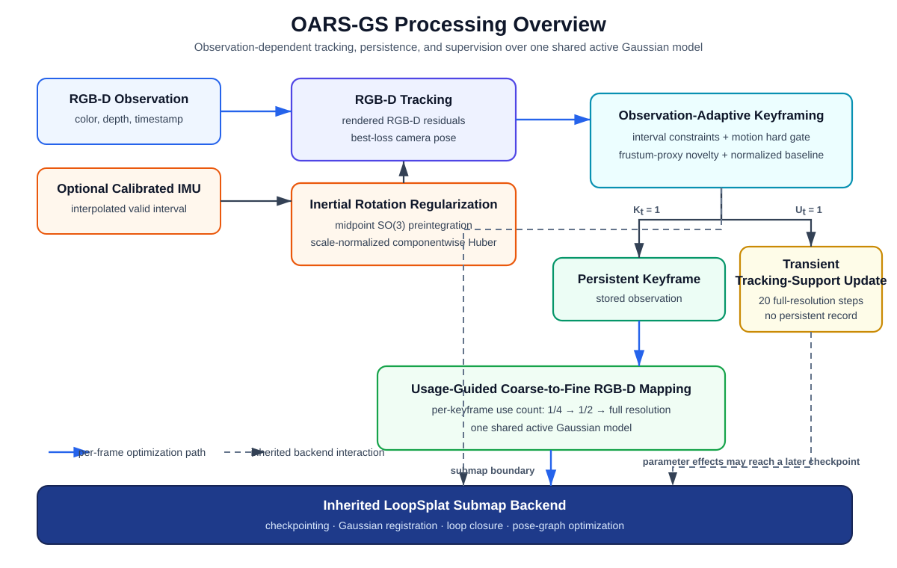
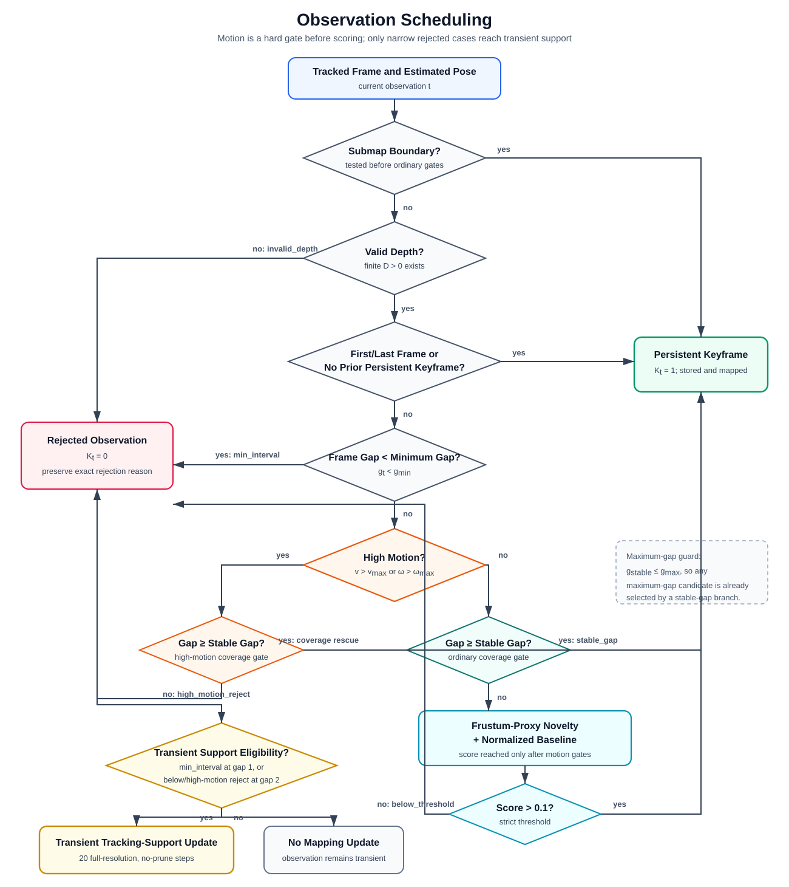

# 3. OARS-GS

OARS-GS 改变在线高斯 SLAM 系统使用到达观测的方式：它向相机跟踪加入弱的陀螺仪旋转正则，根据当前观测和运动状态接纳持久关键帧，将一类严格限定的被拒观测用于临时跟踪支撑更新，并将持久关键帧监督从粗分辨率调度至全分辨率。图 1 概括了这些路径。渲染器、高斯参数化、子图构建、高斯到高斯配准、回环和位姿图优化均继承自 LoopSplat [@zhu2025_loopsplat]，并非 OARS-GS 新增。

{#fig:oars-gs-overview}

## 3.1. 系统概览与预备定义

在帧 \(t\)，系统接收 RGB-D 观测 \(\mathcal{O}_t=(C_t,D_t,\tau_t)\)，其中 \(C_t\in[0,1]^{3\times H\times W}\) 为颜色，\(D_t\in\mathbb{R}^{H\times W}\) 为度量深度，\(\tau_t\) 为相机时间戳。对于提供已标定惯性数据的序列，区间 \((\tau_{t-1},\tau_t)\) 还提供在 IMU 坐标系 \(I\) 中表达的加速度计和陀螺仪样本 \((a_k^I,\omega_k^I,\tau_k^I)\)。记 \(T_t^{CW}\in SE(3)\) 为世界到相机位姿，\(T_t^{WC}=(T_t^{CW})^{-1}\)，并以 \(c_t\in\mathbb{R}^3\) 表示世界坐标中的相机中心。一个活动子图包含 \(N\) 个三维高斯 [@kerbl2023_3dgs]：

\[
\Theta_G=\{g_i\}_{i=1}^{N},\qquad
g_i=(\mu_i,q_i,s_i,o_i,h_i),
\quad
\mathcal{R}(\Theta_G,T_t^{CW})=(\widehat C_t,\widehat D_t,\widehat A_t),
\tag{1}
\]

其中，\(\mu_i\in\mathbb{R}^3\)、\(q_i\)、\(s_i\in\mathbb{R}_{+}^{3}\)、\(o_i\in[0,1]\) 和 \(h_i\) 分别表示中心、旋转四元数、尺度、不透明度和颜色特征。共享的可微渲染器 \(\mathcal{R}\) 返回颜色、深度和 alpha 图像。跟踪仅针对固定活动高斯参数优化当前相对相机变换（以及启用时的曝光参数），目标为

\[
\mathcal{L}_{\mathrm{track}}=
w_C\mathcal{L}^{\mathrm{trk}}_{1,C}
{} +(1-w_C)\mathcal{L}^{\mathrm{trk}}_{1,D}
{} +\mathcal{L}_{R}+\mathcal{L}_{T},
\tag{2}
\]

其中 RGB 与深度项是跟踪器有效掩码上的渲染残差；在 FMDataset 配置中 \(w_C=0.6\)；\(\mathcal{L}_{R}\) 和 \(\mathcal{L}_{T}\) 是下文定义的惯性旋转与平移项。跟踪迭代中见到的最小损失位姿被保留。随后，持久建图更新同一 \(\Theta_G\)，可由被选中的关键帧播种高斯，并在继承的子图记录中存储该观测。到达子图边界时，继承后端检查点保存先前活动子图，执行回环处理及其位姿图校正，并初始化下一活动模型。

## 3.2. 惯性旋转正则

惯性路径只在数据集提供区间接口且 \(t>0\) 时启用。对 FMDataset，经配置时间偏移 \(o_\tau\) 后的 RGB-D 两端点通过逐分量线性插值加入，严格位于区间内部的 IMU 样本予以保留。因此

\[
\begin{aligned}
\mathcal{I}_t
&=\big((\widetilde a_{t,k}^I,\widetilde\omega_{t,k}^I,
\widetilde\tau_{t,k})\big)_{k=0}^{m_t-1},\\
\widetilde\tau_{t,0}&=\tau_{t-1}+o_\tau,\qquad
\widetilde\tau_{t,m_t-1}=\tau_t+o_\tau,\\
\{\widetilde\tau_{t,k}\}_{k=1}^{m_t-2}
&=\{\tau_j^I:\tau_{t-1}+o_\tau<\tau_j^I<\tau_t+o_\tau\}
\quad\text{in increasing order},
\end{aligned}
\tag{3}
\]

其中 \(m_t=|\mathcal{I}_t|\) 是有序区间样本数。端点测量 \((\widetilde a_{t,0}^I,\widetilde\omega_{t,0}^I)\) 与 \((\widetilde a_{t,m_t-1}^I,\widetilde\omega_{t,m_t-1}^I)\) 通过逐分量线性插值得到；内部带波浪号的值等于其被保留的 IMU 样本。若区间不被 IMU 流覆盖、少于两个样本、含非有限值、时间戳不递增、超过 \(0.2\,\mathrm{s}\)，或超过配置的加速度或角速度界限（形式化配置为 \(50\,\mathrm{m\,s^{-2}}\) 和 \(20\,\mathrm{rad\,s^{-1}}\)），则拒绝该区间。拒绝时，式 (2) 中两项惯性贡献均置零。

令 \(T_{CI}=[R_{CI},t_{CI};0,1]\) 为固定的 IMU 到相机标定，\(b_g\) 为固定陀螺仪偏置。对于相邻有序样本 \(k,k+1\)，中点 SO(3) 预积分 [@forster2017_preintegration] 为

\[
\bar\omega_{t,k}^C=
R_{CI}\!\left(
\frac{\widetilde\omega_{t,k}^I+\widetilde\omega_{t,k+1}^I}{2}-b_g
\right),
\qquad
\Delta\widehat R_t^C=\prod_{k=0}^{m_t-2}
\operatorname{Exp}\!\left(\bar\omega_{t,k}^C\Delta\widetilde\tau_{t,k}\right),
\tag{4}
\]

其中 \(\Delta\widetilde\tau_{t,k}=\widetilde\tau_{t,k+1}-\widetilde\tau_{t,k}\)，乘积按递增时间顺序右乘各增量。上标 \(C\) 表示应用 \(R_{CI}\) 后预测在相机坐标中表达；帽号用于区分惯性预测与视觉相对运动。形式化运行使用 \(b_g=(0,0,0)^\top\)，且不优化偏置。每个可微跟踪迭代中评估的视觉相对运动为

\[
\Delta T_t^V=T_{t-1}^{CW}T_t^{WC},
\qquad
r_{R,t}=\operatorname{Log}\!\left((\Delta\widehat R_t^C)^\top\Delta R_t^V\right)\in\mathbb{R}^{3},
\tag{5}
\]

其中 \(\Delta R_t^V\) 为 \(\Delta T_t^V\) 的旋转块，\(\operatorname{Exp}\) 与 \(\operatorname{Log}\) 分别为 SO(3) 指数映射和对数映射。我们使用标量 Huber 函数 [@huber1964_robust]

\[
\rho_\kappa(x)=
\begin{cases}
\tfrac{1}{2}x^2, & |x|\le\kappa,\\
\kappa(|x|-\tfrac{1}{2}\kappa), & |x|>\kappa,
\end{cases}
\tag{6}
\]

并在物理尺度归一化后逐分量施加：

\[
\mathcal{L}_{R}=\lambda_R
\sum_{j=1}^{3}
\rho_{\delta_R/s_R}\!\left(\frac{r_{R,t,j}}{s_R}\right),
\qquad
(\lambda_R,s_R,\delta_R)=(10^{-3},0.01\,\mathrm{rad},0.1\,\mathrm{rad}).
\tag{7}
\]

该项是三个稳健标量残差之和，而非对向量范数施加 Huber 惩罚。当静止区间已初始化固定重力方向时，实现还可积分加速度、纳入标定杠杆臂，并形成相机坐标的平移预测 \(\widehat p_t^C\)。一个有效平移残差及其损失为

\[
r_{p,t}=\Delta t_t^V-\widehat p_t^C,
\qquad
\mathcal{L}_{T}=\lambda_T
\sum_{j=1}^{3}\rho_{\delta_T/s_T}\!\left(\frac{r_{p,t,j}}{s_T}\right),
\qquad
(\lambda_T,s_T,\delta_T)=(0,0.05\,\mathrm{m},0.1\,\mathrm{m}).
\tag{8}
\]

这里 \(\Delta t_t^V\) 是 \(\Delta T_t^V\) 的平移块。式 (8) 可为诊断而计算，但其形式化优化贡献严格为零，因为 \(\lambda_T=0\)。因此，OARS-GS 将惯性数据用作旋转正则，而不联合优化速度、重力或传感器偏置。该正则作用于每个有效跟踪迭代，随后再用最终视觉位姿更新诊断惯性状态。

## 3.3. 观测自适应关键帧

已发表的高斯 RGB-D SLAM 中已有基于重叠的观测选择；例如 SplaTAM 在关键帧管理中使用重叠信息 [@keetha2024_splatam]。OARS-GS 不将重叠本身视为区别机制。这里研究的实现将子图、深度、间隔和运动硬门控置于当前中心视锥代理分数之前，并将持久接纳与第 3.4 节单独定义的临时支撑生命周期耦合。

跟踪后，持久关键帧接纳将当前观测与时间上最近的持久关键帧 \(k\) 比较。可见性代理把*当前*活动高斯的中心投影到每个相机中。当中心 \(\mu_i\) 具有正的相机坐标深度且位于与深度图 \(D\) 一同使用的图像视锥内时，令 \(\pi_i(T,D)=1\)，定义

\[
V_t=\{i\in\{1,\ldots,N\}:\pi_i(T_t^{CW},D_t)=1\},
\qquad
V_k=\{i\in\{1,\ldots,N\}:\pi_i(T_k^{CW},D_k)=1\}.
\tag{9}
\]

这些集合是高斯中心视锥代理，不使用不透明度、渲染遮挡、足迹覆盖或高斯参数的历史快照。它们的交并比与新颖度为

\[
J_{t,k}=
\begin{cases}
\dfrac{|V_t\cap V_k|}{|V_t\cup V_k|}, & |V_t\cup V_k|>0,\\
1, & |V_t\cup V_k|=0,
\end{cases}
\qquad
\nu_{t,k}=1-J_{t,k}.
\tag{10}
\]

令 \(\mathcal{P}_t^+=\{p:D_t(p)>0\ \wedge\ D_t(p)\text{ is finite}\}\)。归一化基线为

\[
b_{t,k}=\frac{\|c_t-c_k\|_2}
{\max\!\left(\operatorname{median}_{p\in\mathcal{P}_t^+}D_t(p),10^{-6}\right)},
\tag{11}
\]

经过此前全部门控后才可到达的分数为

\[
S_{t,k}=w_{\mathrm{cov}}\nu_{t,k}+w_{\mathrm{base}}b_{t,k},
\qquad
(w_{\mathrm{cov}},w_{\mathrm{base}},\tau_S)=(1,1,0.1),
\tag{12}
\]

仅当 \(S_{t,k}>\tau_S\) 时由分数接纳。尽管实现记录了运动惩罚诊断，高运动无法到达式 (12)，而是由之前的硬门控处理。令 \(\Delta\tau_t^{\mathrm{cam}}\) 为相邻相机时间戳之差（若不可得则使用配置帧率的倒数），\(v_t\) 与 \(\omega_t^V\) 分别为由相邻估计位姿计算的线速度和角速度。形式化运行中，此门控关闭可选的陀螺仪辅助。高运动定义为

\[
h_t=\mathbf{1}\!\left[v_t>v_{\max}\ \vee\
\omega_t^V>\omega_{\max}\right],
\qquad
(v_{\max},\omega_{\max})=(1.5\,\mathrm{m\,s^{-1}},120^\circ\,\mathrm{s^{-1}}).
\tag{13}
\]

令 \(g_t=t-k\)，并令 \(g_{\min}\)、\(g_{\mathrm{stable}}\) 和 \(g_{\max}\) 分别为最小、稳定覆盖和最大间隔。在满足 \(g_{\min}\le g_{\mathrm{stable}}\le g_{\max}\) 的条件下，TUM/FMDataset 的形式化取值为 \((2,3,10)\)，Replica 为 \((5,6,10)\)，可达决策为

\[
K_t=
\begin{cases}
1, & \text{submap boundary},\\
0, & \mathcal{P}_t^+=\varnothing,\\
1, & \text{first/last frame or no prior persistent keyframe},\\
0, & g_t<g_{\min},\\
0, & h_t=1\ \wedge\ g_t<g_{\mathrm{stable}},\\
1, & h_t=1\ \wedge\ g_t\ge g_{\mathrm{stable}},\\
1, & h_t=0\ \wedge\ g_t\ge g_{\mathrm{stable}},\\
\mathbf{1}[S_{t,k}>\tau_S], & \text{otherwise}.
\end{cases}
\tag{14}
\]

子图边界测试位于普通决策函数之外，因此先于无效深度拒绝执行。在函数内部，有效深度是返回任何强制帧结果之前的必要条件。候选帧在 \(g_t\ge g_{\max}\) 时也已经达到稳定间隔，故会在评分之前由两个覆盖分支之一选中。图 2 展示该顺序，并区分持久与临时结果。

{#fig:observation-scheduling}

## 3.4. 临时跟踪支撑更新

拒绝冗余观测可减少持久存储和完整建图事件，但其中一小部分仍可能提供有用的局部监督。因此，OARS-GS 审计关键帧拒绝原因 \(r_t\)，只允许严格指定的早期间隔触发更新。令 \(E\in\{0,1\}\) 表示是否启用支撑更新，则其资格为

\[
U_t=E(1-K_t)\,\mathbf{1}\!\left[
(r_t=\texttt{min\_interval}\ \wedge\ g_t=1)
\ \vee\
(r_t\in\{\texttt{below\_threshold},\texttt{high\_motion\_reject}\}\ \wedge\ g_t=2)
\right].
\tag{15}
\]

若 \(U_t=1\)，该观测在全分辨率下对实时高斯参数执行 20 个优化器步骤。该分支不播种或增长高斯、不剪枝，也不使用或推进金字塔调度；它与持久建图互斥。形式化运行中，Replica 禁用这一分支，TUM 和 FMDataset 启用它。

支撑观测是临时的：其标识符和 RGB-D 数据不出现在持久关键帧集合、子图检查点关键帧列表或回环数据库中。但参数更新本身不会回滚，因而其对实时高斯的影响可被带入该活动子图后续的检查点。下文中，**持久关键帧**专指 \(K_t=1\)，**临时跟踪支撑更新**专指 \(U_t=1\)。

## 3.5. 按使用次数推进的粗到细 RGB-D 建图

经典图像金字塔处理建立了低通滤波与多分辨率图像表示 [@burt1981_fastfilter; @burt1983_pyramid]，Photo-SLAM 则采用不同的多层机制进行照片级高斯建图 [@huang2024_photoslam]。这些工作为粗到细监督提供动机，却不定义下述构造或调度。OARS-GS 由每个原始观测生成有效深度加权的子层级，并根据为每个持久关键帧独立维护的、已执行的优化器使用次数选择分辨率；该调度只改变监督，不改变活动高斯表示。

对于每个持久关键帧，OARS-GS 从原始 RGB-D 观测独立构造 \(L\) 个子分辨率目标。在从最粗到最细的子层级 \(\ell\in\{0,\ldots,L-1\}\)，缩放比例和栅格尺寸为

\[
a_\ell=2^{-(L-\ell)},\qquad
(H_\ell,W_\ell)=
\big(\max(1,\lfloor a_\ell H\rfloor),
\max(1,\lfloor a_\ell W\rfloor)\big),
\qquad
C_\ell=\mathcal{B}_{H_\ell,W_\ell}\!\left(\mathcal{A}_{k_\ell}(C)\right),
\tag{16}
\]

其中 \(\mathcal{B}\) 为不对齐角点的双线性缩放。对 \(a_\ell<1\)，\(\sigma_\ell=0.5/a_\ell-0.5\)，\(k_\ell=\max(3,2\lfloor2\sigma_\ell\rfloor+1)\)；当 \(\sigma_\ell>0.1\) 时，\(\mathcal{A}_{k_\ell}\) 是步长为一的平均池化，否则为恒等操作。每个 \(C_\ell\) 直接由 \(C\) 生成，而不从前一子层级递归生成。

深度下采样排除无效测量。令 \(M(p)=\mathbf{1}[D(p)>0\ \wedge\ D(p)\text{ finite}]\)，\(\mathcal{Q}_{H_\ell,W_\ell}\) 表示面积缩放，则

\[
q_\ell=\mathcal{Q}_{H_\ell,W_\ell}(M),\qquad
M_\ell=\mathbf{1}[q_\ell>0],\qquad
D_\ell=M_\ell\odot
\frac{\mathcal{Q}_{H_\ell,W_\ell}(D\odot M)}
{\max(q_\ell,\varepsilon)},
\tag{17}
\]

其中 \(\varepsilon\) 是浮点数正下限，无效输出像素设为零。对于对应渲染器，实现只将 \(\texttt{image\_width}\) 和 \(\texttt{image\_height}\) 改为 \((W_\ell,H_\ell)\)，同时保留全分辨率 \(\texttt{tanfovx}\)、\(\texttt{tanfovy}\)、视图矩阵、投影矩阵和相机位置：

\[
\mathcal{S}_\ell=
\operatorname{replace}(\mathcal{S}_{\mathrm{full}},
\texttt{image\_width}=W_\ell,
\texttt{image\_height}=H_\ell),
\quad
(\tan\phi_x,\tan\phi_y,V,P,c)_\ell
=(\tan\phi_x,\tan\phi_y,V,P,c)_{\mathrm{full}}.
\tag{18}
\]

在保持归一化视场角时缩小栅格尺寸，会诱导低分辨率监督使用的有效像素坐标尺度。代码**不会**显式重缩放 \(f_x,f_y,c_x,c_y\)，也不会为子层级重建投影矩阵。

层级按每个持久关键帧选择，而不由全局时间决定。令 \(n_t\) 为关键帧 \(t\) 实际被采样并完成优化器步骤的次数，\(u\) 为每层使用次数，并令层级 \(L\) 表示全分辨率。在下一次被采样的优化器步骤之前，

\[
\ell_t(n_t)=\min\!\left(\left\lfloor\frac{n_t}{u}\right\rfloor,L\right),
\qquad
n_t\leftarrow n_t+1\ \text{only after an optimizer step is executed}.
\tag{19}
\]

形式化设置 \(L=2,u=8\) 使第 1--8 次使用采用 \(1/4\) 分辨率，第 9--16 次采用 \(1/2\) 分辨率，之后采用全分辨率。有限建图预算和随机关键帧采样并不保证每个关键帧均达到全分辨率。新子图开始时计数重置，支撑更新不推进计数。所有层级均优化同一 \(\Theta_G\)，变化的只有栅格化监督。

在选定分辨率上，令 \(\widehat C_t^\ell,\widehat D_t^\ell\) 为渲染，令 \(\Omega_t^\ell=\{p:M_t^\ell(p)=1,\widehat D_t^\ell(p)\text{ finite}\}\)。建图损失为

\[
\begin{aligned}
\mathcal{L}_{\mathrm{map}}^\ell={}&
(1-\lambda_{\mathrm{ssim}})
\operatorname*{mean}_{c,\,p\in\Omega_t^\ell}
|\widehat C_t^\ell(c,p)-C_t^\ell(c,p)|\\
&+\lambda_{\mathrm{ssim}}
\big(1-\operatorname{SSIM}(\widehat C_t^\ell,C_t^\ell)\big)
{} +\operatorname*{mean}_{p\in\Omega_t^\ell}
|\widehat D_t^\ell(p)-D_t^\ell(p)|
{} +\mathcal{L}_{\mathrm{iso}},
\qquad \lambda_{\mathrm{ssim}}=0.2,
\end{aligned}
\tag{20}
\]

其中 \(\mathcal{L}_{\mathrm{iso}}\) 是继承的软尺度各向同性惩罚。RGB 和深度 L1 项共享有效深度掩码，而 SSIM [@wang2004_ssim] 在所选分辨率的完整 RGB 图像上计算。

## 3.6. 在线算法

算法 1 记录实际执行的分支顺序。视觉优化前先准备惯性预测，并在跟踪内部评估有效旋转项。关键帧与支撑决策均基于所得位姿作出。子图边界会先调用继承后端，再由边界关键帧初始化并优化新的活动子图。

**算法 1：OARS-GS 在线处理**

~~~text
Input: RGB-D sequence {O_t}; optional calibrated IMU stream;
       active Gaussian submap Theta_G; inherited LoopSplat backend
Output: estimated poses and inherited persistent submap records

for t = 0, ..., T - 1 do
    if a non-GT tracking path is active then
        form interpolated IMU interval I_t when available
        validate I_t and midpoint-preintegrate Delta Rhat_t^C
        optimize the relative camera pose with L_track
            (L_R is active only for a valid interval; formal L_T = 0)
        retain the best-loss pose and commit inertial diagnostics
    else
        take the dataset/GT pose; do not apply the inertial regularizer
    end if

    detect whether t starts a new submap
    evaluate the persistent-keyframe gates in Eq. (14)
    audit transient support eligibility U_t using Eq. (15)

    if t starts a new submap then
        checkpoint the previous active submap and persistent keyframes
        update loop information, run inherited loop closure/PGO, if any
        initialize the next active Gaussian submap; reset pyramid counts
    end if

    if K_t = 1 then
        seed/grow Gaussians from the persistent keyframe
        for each allocated mapping step do
            sample a persistent keyframe; select its level by Eq. (19)
            optimize shared Theta_G with Eq. (20)
            advance that keyframe's count only after the optimizer step
        end for
        store t as a persistent keyframe and frustum reference
    else if U_t = 1 then
        optimize shared Theta_G for 20 full-resolution, no-prune steps
        do not seed points, store a persistent keyframe, or advance counts
    end if
end for

checkpoint any remaining active submap and its persistent keyframes
run the inherited final loop-closure path when configured
~~~

该算法保持继承系统对活动子图和全局校正轨迹的区分。OARS-GS 修改旋转项、观测接纳、临时更新路径和监督调度；配准、回环检测、检查点结构和图校正仍是后端操作。
