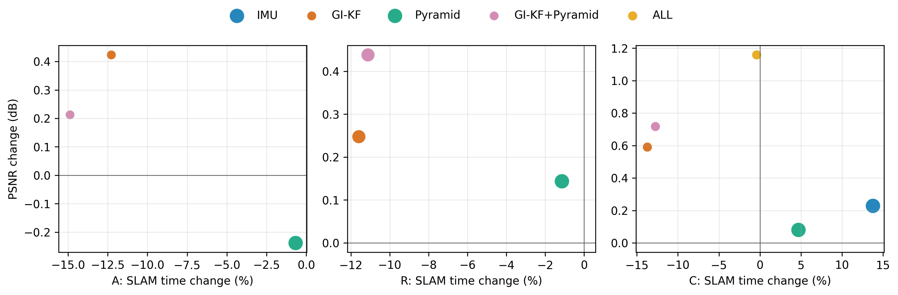

## 4.2. Tracking accuracy

**TUM RGB-D.** The non-A3 scenes show that the tracking response is scene dependent. GI-KF+Pyramid lowers ATE relative to Baseline on A2, while A1, A4, and A5 have higher ATE; Pyramid alone gives the lowest A1 ATE but does not carry that behavior across the group. On A2, GI-KF+Pyramid changes ATE from 3.795 to 3.322 cm, PSNR from 12.501 to 13.594 dB, and persistent keyframes from 635 to 286, a 54.96% reduction.

A3 is the required counterexample: aligned ATE is 7.005 cm for Baseline, 563.912 cm for GI-KF, and 18.782 cm for GI-KF+Pyramid; the combined value remains 168.13% above Baseline. This failure rules out a general TUM tracking-improvement or divergence-prevention claim. The available records establish the outcome but do not identify a physical cause.

**Replica.** Across the eight scenes, GI-KF+Pyramid changes macro ATE from 0.292 to 0.262 cm, a 10.30% reduction, and RPE-t from 0.000632 to 0.000594 m, a 6.10% reduction, while RPE-r rises from 0.02019 to 0.02092 degrees, a 3.61% increase. Pyramid alone has the lowest macro ATE, so the combined strategy is not the tracking optimum on every metric. The budget-matched Replica result instead shows that deferring some persistent observations can remain compatible with similar tracking behavior in this synthetic group.

## 4.3. Rendering and depth reconstruction

On TUM, GI-KF+Pyramid reduces persistent keyframes by 63.90% while changing fixed-observed-view macro PSNR by +0.213 dB, MS-SSIM by +2.83%, LPIPS by -3.07%, and Depth L1 by -3.33% relative to Baseline. These rendering changes coexist with the A3 tracking failure described immediately above; they cannot substitute for trajectory accuracy.

On Replica, GI-KF+Pyramid reduces persistent keyframes by 16.30%, raises macro PSNR by 0.438 dB, and reduces Depth L1 by 12.59% relative to Baseline. Its RPE-r is higher than Baseline, Pyramid has lower ATE, and GI-KF has lower LPIPS. The combined strategy therefore demonstrates a quality--budget trade-off rather than across-metric dominance.

FMDataset supports reconstruction and resource claims only. Relative to its Baseline macro, ALL raises fixed-observed-view PSNR by 1.159 dB and MS-SSIM by 3.47%, while reducing LPIPS by 8.97%, Depth L1 by 25.64%, and persistent keyframes by 58.33%. There is no trajectory reference in these records, so these differences do not demonstrate improved localization, drift, or visual-inertial odometry.

{#fig:metric-deltas}

## 4.4. Resource efficiency

The paired resource measurements isolate strategy changes from hardware differences. On Replica, GI-KF+Pyramid reduces macro elapsed time by 11.94%, with same-scene reductions ranging from 2.5% to 20.0%; macro peak PyTorch allocation changes from 6.947 to 6.875 GiB. The small allocation change indicates that persistent observation count is not the only contributor to the resident Replica workload.

On FMDataset, ALL reduces macro peak PyTorch allocation by 47.61% and macro elapsed time by 1.18%. Its scene-level elapsed-time changes are -7.5% on C1, -0.6% on C2, and +6.9% on C3, so the macro result is not a consistent per-scene speedup. All of these comparisons are within the shared RTX 2080 Ti environment; they do not define a cross-GPU benchmark.

Persistent storage and update accounting must also remain separate. The TUM combined macro contains 610.4 persistent keyframes and 1080.4 transient support updates, for 1690.8 processed frames. Thus the reported persistent-keyframe reduction does not imply an equal reduction in mapping or update events: support updates perform a shorter, non-persistent optimization on the live map and are timed separately.

{#fig:quality-efficiency}

## 4.5. Ablation study

**Inertial rotation.** On FMDataset, IMU-only changes macro PSNR by +0.230 dB, Depth L1 by -18.55%, and LPIPS by -2.56%, but changes MS-SSIM by -2.06%; its elapsed time and peak PyTorch allocation increase by 13.71% and 7.45%, respectively. It also worsens C1 LPIPS and C3 PSNR. The component therefore provides mixed reconstruction evidence and has measurable cost. Because FMDataset lacks trajectory ground truth, this ablation cannot establish a localization or drift benefit.

**Observation-adaptive keyframes.** FMDataset GI-KF reduces persistent keyframes by 58.50% and raises PSNR by 0.591 dB, while Depth L1 falls by only 1.27% relative to Baseline. This isolates GI-KF's principal evidence as persistent-observation and resource control; it does not justify a no-cost reconstruction claim. The Replica rows, where support is disabled and cadence is budget matched, further show that the admission rule can reduce the persistent set without relying on transient updates.

**Usage-guided coarse-to-fine supervision.** FMDataset Pyramid leaves the macro persistent-keyframe count unchanged, raises PSNR by 0.081 dB, and reduces Depth L1 by 19.12% relative to Baseline. This separates the supervision schedule from admission: its clearest single-component signal is depth reconstruction, not storage reduction. The scene rows remain mixed, so the result does not imply that the pyramid improves every sequence or metric.

**Compatibility.** FMDataset GI-KF+Pyramid raises macro PSNR by 0.718 dB and MS-SSIM by 4.67%, reduces LPIPS by 5.28% and Depth L1 by 22.56%, and reduces persistent keyframes by 58.50% relative to Baseline. ALL changes the balance again after inertial rotation is enabled, improving some macro measures while giving lower MS-SSIM than GI-KF+Pyramid. These combinations demonstrate that the decisions can operate together; they do not show that every component improves every metric.

## 4.6. Qualitative and failure analysis

The Replica R5 mapper panels show the sampled input, rendered RGB-D output, depth residual, and densification mask for the same observed frame under Baseline and GI-KF+Pyramid. They are optimization diagnostics, not held-out renderings or complete global-map evaluations.

{#fig:r5-baseline}

{#fig:r5-combined}

The A3 trajectories visualize the failure already quantified in Section 4.2. Baseline remains near the aligned reference, whereas GI-KF departs substantially. This contrast shows why fixed-observed-view rendering agreement cannot stand in for global trajectory accuracy, and why a safer fallback for observation admission remains necessary in trajectory-sensitive settings.

{#fig:a3-baseline}

{#fig:a3-gikf}

The failure boundary is empirical. The records do not isolate whether motion, overlap estimation, map state, or another factor causes A3, so assigning a physical mechanism would exceed the evidence. Likewise, Azure Kinect material without a controlled reference remains an engineering illustration rather than an ablation or accuracy result.
